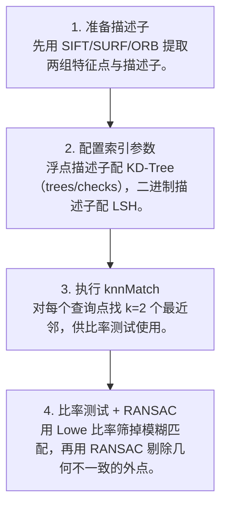

# 第 4 页 · 算法架构

## 完整流程图

## 每一步在做什么

### 步骤 1：准备描述子

先用 SIFT/SURF/ORB 提取两组特征点与描述子。

### 步骤 2：配置索引参数

浮点描述子配 KD-Tree（trees/checks），二进制描述子配 LSH。

### 步骤 3：执行 knnMatch

对每个查询点找 k=2 个最近邻，供比率测试使用。

### 步骤 4：比率测试 + RANSAC

用 Lowe 比率筛掉模糊匹配，再用 RANSAC 剔除几何不一致的外点。

## 在整体视觉管线中的位置

## 复杂度分析

时间复杂度约 O(N·log N)（建索引 + 查询），低于暴力匹配的 O(N²)；空间复杂度即索引大小 O(N)。

## 参数总览（论文建议 vs OpenCV 默认 vs 实战推荐）

| 参数 | 含义 | 论文建议 | OpenCV 默认 | 实战推荐 |
|------|------|----------|-------------|----------|
| algorithm | 索引算法 | KD-Tree | FLANN_DIST_L2 | **SIFT→KDTree；ORB→LSH** |
| trees | KD-Tree 数量 | 4 | 4 | ****4~8**** |
| checks | 搜索节点上限 | 32 | 32 | ****50~100**** |
| table_number | LSH 哈希表数 | — | 12 | **12** |

## 边界情况与失败模式

- **用 FLANN 匹配 ORB 却没建 LSH**：对二进制描述子用 KD-Tree，结果一团糟。
- **checks 太小**：近似太激进，匹配数骤减。
- **特征点很少时用它**：几百个点以下，暴力匹配更快且更准。
- **不做比率测试**：Lowe 比率测试缺失，误匹配大量涌入。
