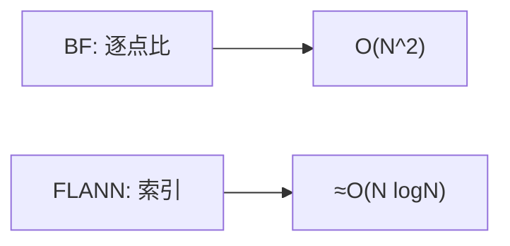

## 🧪 原理互动演示

<AlgoVisualizer type="flann" />

# 第 3 页 · 核心概念

🧪 公式看不懂？去 <a href="/math-lab/">原理实验室</a> 拖动滑块直观体验卷积/梯度/高斯/霍夫/角点/RANSAC/光流等核心概念；看完原理再去本页底部 <a href="./source">源码/真机实验室</a> 亲手调参数。

## 先用生活直觉理解

你在图书馆找一本最接近某主题的书。暴力法是走遍每一排书架；FLANN 是先用「分区索引」直接跳到可能的那几排，找到「差不多最好」的就走。偶尔不是最优，但快得多——匹配几千个特征点的时候，这点误差根本不重要。

**典型应用**：大规模特征匹配（SLAM、全景拼接、图像检索）、SIFT/SURF 描述子匹配、点云配准

## 概念逐个拆解

### 概念 1：什么是最近邻搜索

给定一个查询特征，在库里找与它最相似的那个。匹配两张图就是让彼此的特征互为最近邻。

### 概念 2：暴力匹配 vs 索引

暴力匹配逐个算距离 O(N²)；索引法只查最可能的分支，把 N² 降到接近 N·log N。

### 概念 3：KD-Tree 与 LSH

浮点描述子（SIFT/SURF）用 KD-Tree 按维度切分空间；二进制描述子（ORB/BRIEF）用 LSH 做哈希分桶。

### 概念 4：近似换速度

checks 参数控制搜索多少个节点。设小则快但漏，设大则准但慢——典型的时间换精度旋钮。

## 和其他算法的关系

| 关系 | 算法 | 说明 |
|------|------|------|
| 前置依赖 | 特征检测 + 描述子（SIFT/SURF/ORB） | 通常先做这些再做本算法 |
| 同类对比 | BFMatcher 暴力匹配 | 解决同类问题，各有取舍 |
| 下游常用 | 比率测试、RANSAC 几何验证、单应估计 | 本算法结果常交给它们处理 |

::: tip 记忆锚点
记住「浮点描述子用 KD-Tree（trees/checks），二进制描述子用 LSH」。
:::
