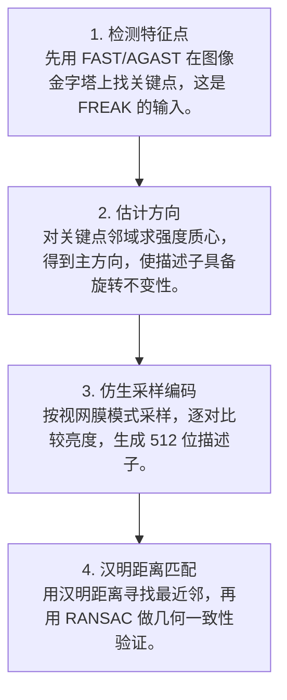
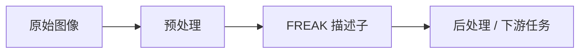

# 第 4 页 · 算法架构

## 完整流程图

## 每一步在做什么

### 步骤 1：检测特征点

先用 FAST/AGAST 在图像金字塔上找关键点，这是 FREAK 的输入。

### 步骤 2：估计方向

对关键点邻域求强度质心，得到主方向，使描述子具备旋转不变性。

### 步骤 3：仿生采样编码

按视网膜模式采样，逐对比较亮度，生成 512 位描述子。

### 步骤 4：汉明距离匹配

用汉明距离寻找最近邻，再用 RANSAC 做几何一致性验证。

## 在整体视觉管线中的位置

## 复杂度分析

时间复杂度 O(N·P)，N 为特征点数、P 为采样对数（512）；匹配为 O(N²·512/64) 位运算。空间复杂度 O(N×64) 字节。

## 参数总览（论文建议 vs OpenCV 默认 vs 实战推荐）

| 参数 | 含义 | 论文建议 | OpenCV 默认 | 实战推荐 |
|------|------|----------|-------------|----------|
| patternScale | 采样模式缩放 | 1.0 | 22.0 | ****按图像尺度调**** |
| orientationNormalized | 是否估计方向 | True | True | **True** |
| scaleNormalized | 是否尺度归一 | True | True | **True** |
| nOctaves | 尺度金字塔层数 | 4 | 4 | **4** |

## 边界情况与失败模式

- **把 FREAK 当检测器用**：FREAK 只是描述子，必须先有特征点位置。
- **patternScale 不匹配**：采样模式半径与图像尺度不适配，匹配率骤降。
- **跨尺度匹配直接失败**：不配金字塔时，不同尺度的同一目标匹配不上。
- **用浮点距离匹配**：二进制描述子必须用汉明距离，用欧氏距离毫无意义。
