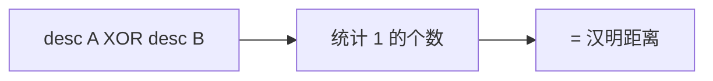

## 🧪 原理互动演示

<AlgoVisualizer type="freak" />

# 第 3 页 · 核心概念

🧪 公式看不懂？去 <a href="/math-lab/">原理实验室</a> 拖动滑块直观体验卷积/梯度/高斯/霍夫/角点/RANSAC/光流等核心概念；看完原理再去本页底部 <a href="./source">源码/真机实验室</a> 亲手调参数。

## 先用生活直觉理解

人眼看东西不是均匀扫描，而是中间清楚、周围模糊——视网膜的感光细胞分布就是「中心密、外围疏」。FREAK 照着这个规律摆了 43 个采样点，越靠中心越密，然后比较一堆像「眼睛」一样的感受野亮度差，拼成一串 0/1。

**典型应用**：移动端/嵌入式实时匹配、AR、物体识别，在算力受限设备上替代 SIFT/SURF

## 概念逐个拆解

### 概念 1：仿生采样模式

43 个采样点按中心密、外围疏排列，模拟人眼视网膜。中心采样密保证精度，外围采样疏保证对形变宽容。

### 概念 2：感受野与二进制码

每对比两个采样区域的平滑亮度，前者亮记 1、后者亮记 0，512 对就是 512 位。

### 概念 3：汉明距离匹配

两个二进制描述子的差异用「不同的位数」衡量，一次异或加计数即可，极快。

### 概念 4：粗到细级联匹配

描述子前几位代表最强特征（像眼睛、嘴这样的大结构）。先比这些位，不匹配的候选立刻淘汰，省下大量计算。

## 和其他算法的关系

| 关系 | 算法 | 说明 |
|------|------|------|
| 前置依赖 | 特征点检测（FAST/AGAST）+ 金字塔 | 通常先做这些再做本算法 |
| 同类对比 | BRIEF、ORB、BRISK | 解决同类问题，各有取舍 |
| 下游常用 | 汉明距离匹配、RANSAC 几何验证 | 本算法结果常交给它们处理 |

::: tip 记忆锚点
记住「FREAK = 仿生采样模式 + 512 位二进制 + 粗到细级联匹配」。
:::

<!-- AUTO-EXTENSION-2 -->

## 🧓 大白话：FREAK = "人眼视网膜采样模式的二值描述子"

BRIEF/ORB/BRISK 的采样点都是人为设计的（随机 / 同心圆环）。FREAK（Fast Retina Keypoint）的灵感来自**人眼视网膜**：
- 视网膜中央凹（fovea）感光细胞密集，周边稀疏；
- 所以 FREAK 的采样模式是**中心密、外圈疏的指数分布圆环**，越靠关键点中心采样点越密。

另一个创新是**按描述子 bit 的"强度"从粗到细级联匹配**：前 128 bit 是粗略信息（大尺度差异），用它先筛掉 90% 不匹配候选，再用后续 bit 精细确认——比 BRISK/ORB 匹配快约 1 个数量级。

## 选型对比

| 特征 | 采样设计 | 描述子长度 | 专利 |
| --- | --- | --- | --- |
| BRIEF | 随机点对 | 256 bit | 免费 |
| ORB | rBRIEF（学习过的点对）| 256 bit | 免费 |
| BRISK | 均匀同心圆环 | 512 bit | 免费 |
| **FREAK** | **视网膜式中心密外围疏** | **512 bit** | 免费 |

FREAK 在 OpenCV 里有实现，但 OpenCV.js 的 WASM 构建没带。
