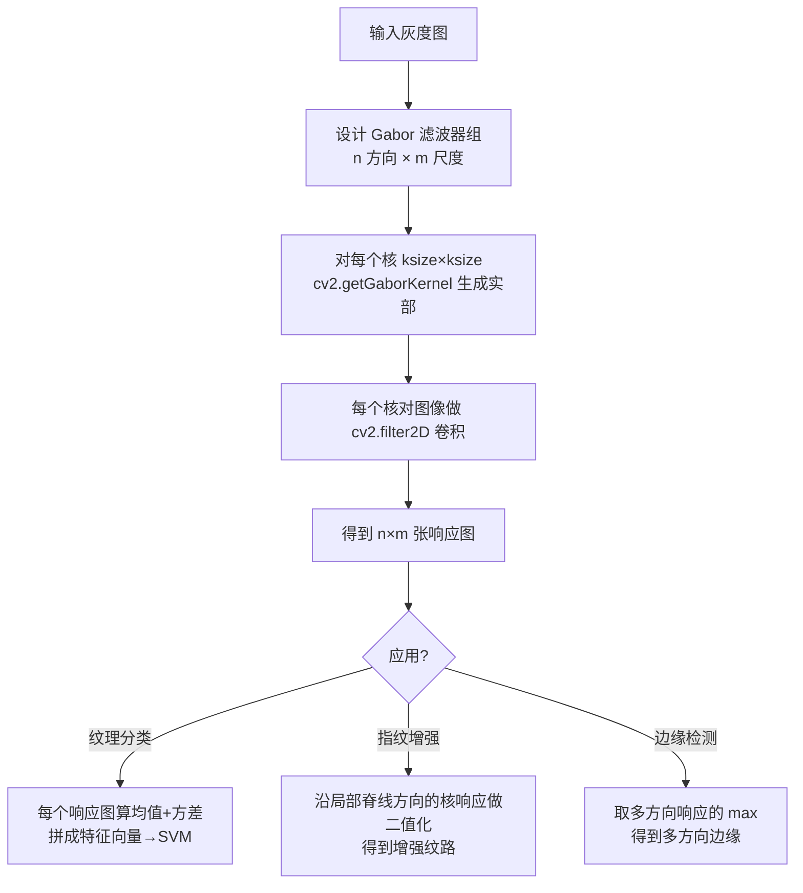

# 算法流程：Gabor 滤波器

## 整体流程图



## 步骤详解

### Step 1：设计滤波器组参数
- 方向：θ = k·π/8（k=0..7，共 8 方向）
- 波长：λ = [3, 5, 9, 15, 25]（共 5 尺度）
- 其他：ψ=0（实部余弦），γ=0.5，σ=0.56·λ（带宽约 1 倍频）
- ksize：通常设为奇数，约 6σ 大小（例如 31×31）

### Step 2：生成每个核
```python
cv2.getGaborKernel((ksize, ksize), sigma, theta, lambd, gamma, psi, ktype=cv2.CV_32F)
```
返回一个 (ksize,ksize) float32 核，已经过零均值归一化（可直接 filter2D）。

### Step 3：卷积
对每个核 `g`：`resp = cv2.filter2D(img, cv2.CV_32F, g)`
- 输出 CV_32F 响应图，正值代表「同相位匹配」，负值代表反相位匹配
- 若只关心能量，取 np.abs(resp)

### Step 4：特征提取
- **纹理分类**：每个响应图分块（如 16×16 block）算 mean 和 std，拼成向量送分类器
- **指纹增强**：根据局部脊线方向选择对应 θ 的核做增强
- **边缘检测**：对每个像素取多方向响应的 max，即「最佳朝向的边缘」

### Step 5：归一化
由于不同尺度的核响应幅度不同，通常对每个响应图做 L2 归一化或 z-score 归一化，再拼接。

## 参数对照（论文 vs OpenCV 默认 vs 工程建议）

| 参数 | 论文建议 | OpenCV 默认 | 工程建议 | 调参影响 |
|---|---|---|---|---|
| ksize | 31×31 | — | 6σ+1（奇数） | 核大小，过小截断高斯 |
| sigma | 0.56λ | 自动 | 0.56λ（1 octave） | 高斯包络，大→感受野大 |
| theta | 8 方向均分 | 0 | 0~π 取 8 或 6 个 | 方向采样 |
| lambd | 3,5,9,15,25 | 11 | 按倍频程 | 波长（纹路粗细）|
| gamma | 0.5 | 1.0 | 0.5 | 椭圆纵横比，越扁越方向敏感 |
| psi | 0 或 π/2 | 0 | 0（实部，blob）/π/2（虚部，边缘）| 相位 |

## 复杂度分析

- 单个核卷积：O(ksize² · W · H)，但 filter2D 内部用 separable / FFT 优化
- 40 个核的 Gabor 组：640×480 图在 OpenCV 上约 50–100ms
- FFT 卷积可降到 O(n_m_log_n · W · H)
