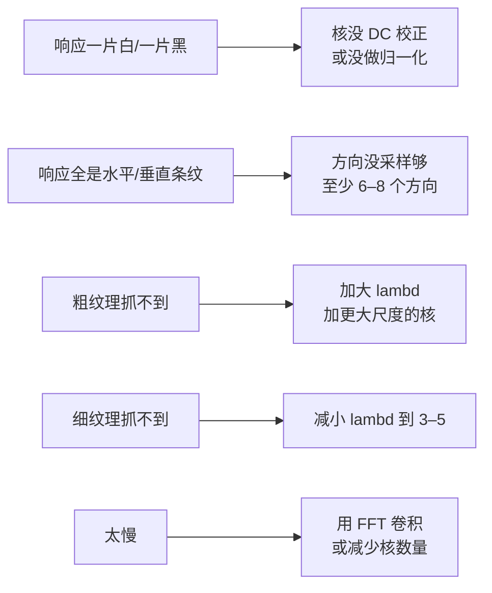

# 实战踩坑：Gabor 滤波器

## 最常见的 8 个坑

### 1. ksize 太小导致核被截断
高斯尾部被截断会产生频谱旁瓣、响应畸变。**修法**：ksize ≈ 6σ+1（奇数）。

### 2. 没做 DC 校正导致对灰度整体偏移敏感
OpenCV 的 getGaborKernel 已经做了 DC 校正（核均值为 0），自己写核时容易忘——结果整体亮度高的地方响应都大，不像纹理响应。

### 3. 用浮点响应直接阈值化
Gabor 响应有正有负，阈值前必须取 np.abs() 或平方。**修法**：对实部/虚部分别取模。

### 4. 只用一个方向/一个尺度，结果没意义
单 Gabor 核只对特定方向/粗细的纹理响应；你必须用**滤波器组**。

### 5. 把 Gabor 当万能特征
Gabor 在规则纹理（指纹/虹膜/织物）上效果极好，但对**物体识别**、**自然场景**这种纹理不统一的任务，不如 SIFT/CNN。

### 6. 没归一化就拼特征向量
大尺度 λ 的核响应幅度天然大于小尺度，不做归一化分类器会偏向大尺度。**修法**：每个响应图做 z-score 或归一化到 [0,1]。

### 7. 直接用彩色图
Gabor 是单通道算子。彩色图通常转灰度再做；或对 L 通道做。

### 8. 太慢没做 FFT 加速
40 核 + 大 ksize 在大图上会慢。**修法**：用 cv2.createGaussianKernel 那种 separable 不行（Gabor 不可分）；可以用 `cv2.filter2D` 内部做 DFT（大核时 OpenCV 会自动用 DFT），或自己用 np.fft.fft2 乘频域核。

## 失败案例诊断流程

