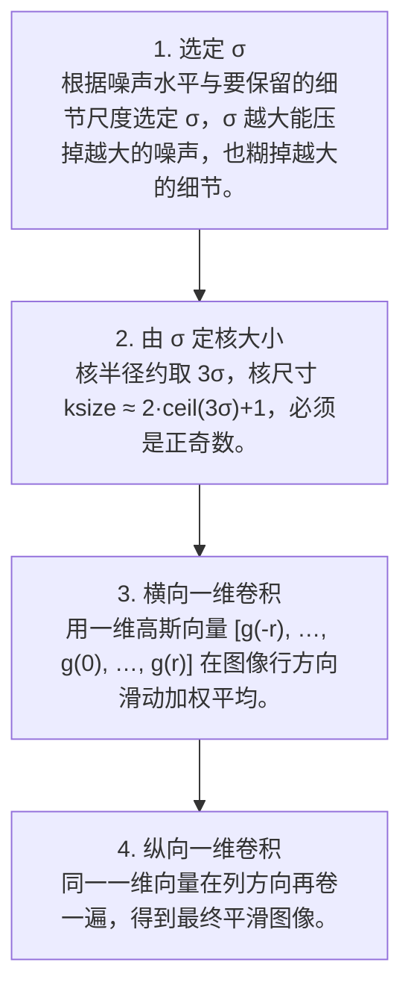

# 第 4 页 · 算法架构

## 完整流程图

## 每一步在做什么

### 步骤 1：选定 σ

根据噪声水平与要保留的细节尺度选定 σ，σ 越大能压掉越大的噪声，也糊掉越大的细节。

### 步骤 2：由 σ 定核大小

核半径约取 3σ，核尺寸 ksize ≈ 2·ceil(3σ)+1，必须是正奇数。

### 步骤 3：横向一维卷积

用一维高斯向量 [g(-r), …, g(0), …, g(r)] 在图像行方向滑动加权平均。

### 步骤 4：纵向一维卷积

同一一维向量在列方向再卷一遍，得到最终平滑图像。

## 在整体视觉管线中的位置

## 复杂度分析

时间复杂度：朴素二维卷积 O(W·H·k²)；可分离后 O(W·H·k)，k 为核边长。空间复杂度 O(W·H)。

## 参数总览（论文建议 vs OpenCV 默认 vs 实战推荐）

| 参数 | 含义 | 论文建议 | OpenCV 默认 | 实战推荐 |
|------|------|----------|-------------|----------|
| ksize | 高斯核尺寸 | 6σ+1（奇数） | (5,5) | **(5,5) 或 (7,7)** |
| sigmaX | X 方向标准差 σ | 由 ksize 反推 | 0（自动推导） | **按场景 1.0~3.0** |
| sigmaY | Y 方向标准差 | = sigmaX | 0（等于 sigmaX） | **0** |
| borderType | 边界处理 | — | BORDER_DEFAULT（反射） | **BORDER_REPLICATE（消暗边）** |

## 边界情况与失败模式

- **边缘被糊掉**：σ 越大边缘越模糊，若目标是保边去噪，必须换成双边滤波。
- **ksize 取偶数**：OpenCV 直接报错，核尺寸必须是正奇数。
- **图像边界变暗**：默认反射边界的卷积会使边缘略变暗，可改用 BORDER_REPLICATE。
- **σ=0 的误用**：sigmaX=0 时按 ksize 自动推导 σ，但二者不对应会让模糊程度失控。
