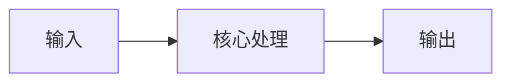
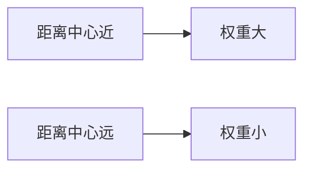
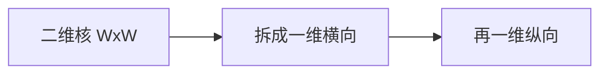

# 第 3 页 · 核心概念

🧪 公式看不懂？去 <a href="/math-lab/">原理实验室</a> 拖动滑块直观体验卷积/梯度/高斯/霍夫/角点/RANSAC/光流等核心概念；看完原理再去本页底部 <a href="./source">源码/真机实验室</a> 亲手调参数。

## 先用生活直觉理解

想象你隔着一层磨砂玻璃看照片：近处的细纹看不清了，大轮廓还在。离你越近的像素权重越大，越远的权重越小，像一个钟形的钟罩把附近的颜色加权平均掉——这就是高斯模糊。

**典型应用**：拍照手抖模糊、人脸磨皮、Canny 去噪预处理、SIFT/SURF 尺度空间构建

## 概念逐个拆解

### 概念 1：权重从小到大的钟形核

高斯核是一个「中间高、四周低」的小矩阵，中心权重最大，越往外越小。OpenCV 会自动把核归一化，保证总权重为 1，这样滤波后亮度不变。

### 概念 2：σ 决定模糊程度

σ（标准差）越大，钟形越扁平，远处邻居也参与平均，图像越糊；σ 越小则越接近原图，去噪能力越弱。

### 概念 3：可分离卷积

二维高斯核可以拆成「横着一条 + 竖着一条」，先横向卷一遍再纵向卷一遍，结果和直接二维卷积一样，但速度快得多。

### 概念 4：尺度空间的意义

不同 σ 的高斯模糊结果堆叠起来，构成「尺度金字塔」。SIFT 正是靠它来检测不同大小的特征点。

## 和其他算法的关系

| 关系 | 算法 | 说明 |
|------|------|------|
| 前置依赖 | 灰度化、通道拆分 | 通常先做这些再做本算法 |
| 同类对比 | 中值滤波、双边滤波 | 解决同类问题，各有取舍 |
| 下游常用 | Canny 边缘检测、SIFT 尺度空间、梯度计算 | 本算法结果常交给它们处理 |

::: tip 记忆锚点
记住「σ 是管模糊半径、ksize 是管范围」——ksize 一般取 6σ 左右的奇数。
:::

---

## 🧪 原理可视化

看不懂上面的公式？下面这个互动组件把「高斯分布」画出来了——拖动滑块，看每一步怎么算。

<ClientOnly>
  <MathVisualizer initial-tab="gauss" compact />
</ClientOnly>

> 想看它在真实照片上的实际效果？回到 [本算法首页](./index) 或去 [🎮 真机实验室](/playgrounds/)。
