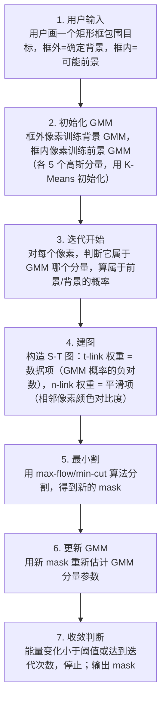
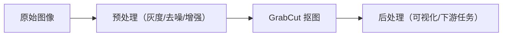

# GrabCut 抠图 · 算法流程

<AlgorithmCard
  name="GrabCut 抠图"
  enName="GrabCut Interactive Foreground Extraction"
  chapter="ch-10-image-segmentation"
  branch="segmentation"
  year="2004"
  author="C. Rother / V. Kolmogorov / A. Blake"
  paper="—"
  level="mid"
  tagline="画一个框就能把目标抠出来，GMM+GraphCut 迭代优化，Photoshop 快速选择的灵魂"
  analogy="你用笔在目标周围画个圈，对算法说「圈外肯定是背景，圈内有前景也有背景」。GrabCut 就像一个聪明的学徒，先猜哪些颜色像前景，再用 GraphCut 切一刀，反复 5 次抠得干干净净"
  scene="照片抠图换背景、数据集快速标注、医学影像交互式分割、人像美颜前景提取"
  :pros='["用户只需画一个框", "边缘细节比 GraphCut 好", "支持笔刷精修", "GMM 建模多峰颜色分布"]'
  :cons='["高分辨率慢", "前景背景颜色接近时效果差", "矩形外永远是背景", "边缘毛发需 matting"]'
/>

## 完整算法流程

GrabCut 抠图算法可以分解为以下关键步骤：

## 步骤详解

### 步骤 1：用户输入

用户画一个矩形框包围目标，框外=确定背景，框内=可能前景

### 步骤 2：初始化 GMM

框外像素训练背景 GMM，框内像素训练前景 GMM（各 5 个高斯分量，用 K-Means 初始化）

### 步骤 3：迭代开始

对每个像素，判断它属于 GMM 哪个分量，算属于前景/背景的概率

### 步骤 4：建图

构造 S-T 图：t-link 权重 = 数据项（GMM 概率的负对数），n-link 权重 = 平滑项（相邻像素颜色对比度）

### 步骤 5：最小割

用 max-flow/min-cut 算法分割，得到新的 mask

### 步骤 6：更新 GMM

用新 mask 重新估计 GMM 分量参数

### 步骤 7：收敛判断

能量变化小于阈值或达到迭代次数，停止；输出 mask

## 在整体视觉 pipeline 中的位置

### 关键复杂度

| 维度 | 复杂度 |
|---|---|
| 时间 | 详见各实现 |
| 内存 | 与图像尺寸线性相关 |

