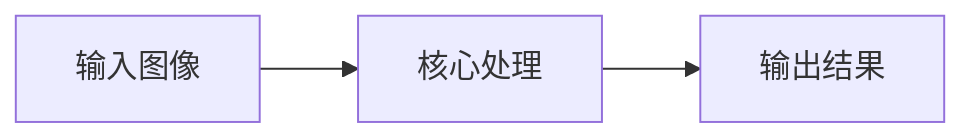
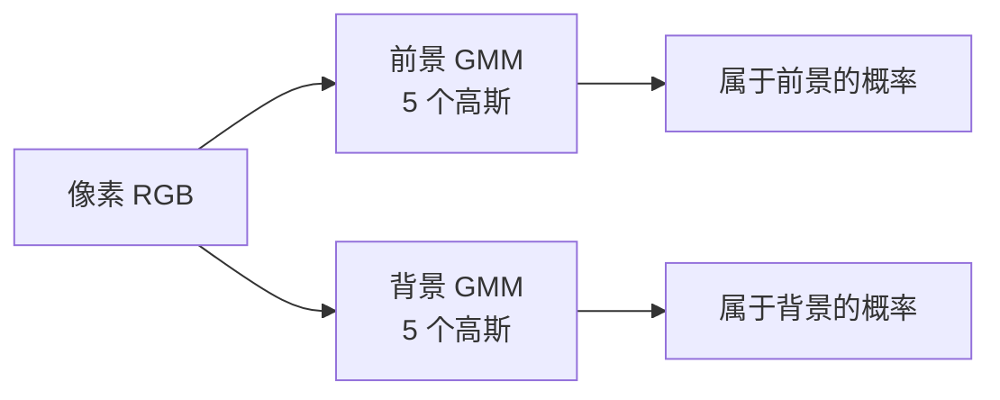
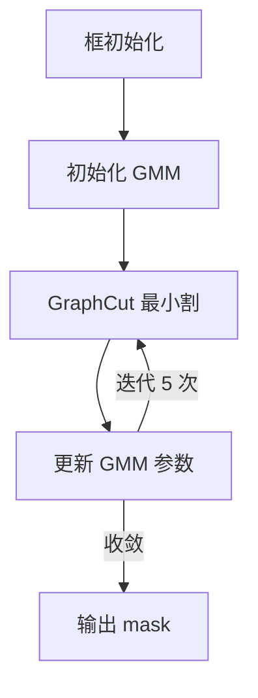

# GrabCut 抠图 · 核心概念

<AlgorithmCard
  name="GrabCut 抠图"
  enName="GrabCut Interactive Foreground Extraction"
  chapter="ch-10-image-segmentation"
  branch="segmentation"
  year="2004"
  author="C. Rother / V. Kolmogorov / A. Blake"
  paper="—"
  level="mid"
  tagline="画一个框就能把目标抠出来，GMM+GraphCut 迭代优化，Photoshop 快速选择的灵魂"
  analogy="你用笔在目标周围画个圈，对算法说「圈外肯定是背景，圈内有前景也有背景」。GrabCut 就像一个聪明的学徒，先猜哪些颜色像前景，再用 GraphCut 切一刀，反复 5 次抠得干干净净"
  scene="照片抠图换背景、数据集快速标注、医学影像交互式分割、人像美颜前景提取"
  :pros='["用户只需画一个框", "边缘细节比 GraphCut 好", "支持笔刷精修", "GMM 建模多峰颜色分布"]'
  :cons='["高分辨率慢", "前景背景颜色接近时效果差", "矩形外永远是背景", "边缘毛发需 matting"]'
/>

## GrabCut 抠图的核心思想

画一个框就能把目标抠出来，GMM+GraphCut 迭代优化，Photoshop 快速选择的灵魂。你用笔在目标周围画个圈，对算法说「圈外肯定是背景，圈内有前景也有背景」。GrabCut 就像一个聪明的学徒，先猜哪些颜色像前景，再用 GraphCut 切一刀，反复 5 次抠得干干净净

**生活类比**：你用笔在目标周围画个圈，对算法说「圈外肯定是背景，圈内有前景也有背景」。GrabCut 就像一个聪明的学徒，先猜哪些颜色像前景，再用 GraphCut 切一刀，反复 5 次抠得干干净净

**典型应用**：照片抠图换背景、数据集快速标注、医学影像交互式分割、人像美颜前景提取

## 核心概念详解

### 概念1：GMM 高斯混合模型

前景/背景各用 5 个高斯分量建模颜色分布（RGB 三维）。每个高斯是一个椭球云团，描述「这一类颜色」。每个像素属于哪个高斯，由当前分割结果动态决定。

### 概念2：GraphCut 最小割

把每个像素看作图的节点，加两个虚拟节点 S（前景源）和 T（背景汇）。S 到像素连边权重 = 该像素属于前景的概率；T 到像素连边权重 = 属于背景的概率；相邻像素之间连边权重 = 颜色相似度。求最小割——割断的边总权重最小，即得到最优分割。

### 概念3：迭代优化

GMM 和分割互相改进：初始 GMM（基于框内外）→ GraphCut 得到初始分割 → 用分割结果重新训练 GMM → 再 GraphCut……迭代 5 次左右收敛。

### 概念4：mask 四值

OpenCV 的 mask 用 4 个值：0=确定背景（GC_BGD）、1=确定前景（GC_FGD）、2=可能背景（GC_PR_BGD）、3=可能前景（GC_PR_FGD）。**用户画框时框内=3，框外=0**。

