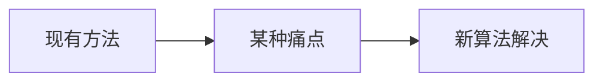

# GrabCut 抠图 · 论文故事

<AlgorithmCard
  name="GrabCut 抠图"
  enName="GrabCut Interactive Foreground Extraction"
  chapter="ch-10-image-segmentation"
  branch="segmentation"
  year="2004"
  author="Carsten Rother / Vladimir Kolmogorov / Andrew Blake"
  paper="—"
  level="mid"
  tagline="画一个框就能把目标抠出来，GMM+GraphCut 迭代优化，Photoshop 快速选择的灵魂"
  analogy="你用笔在目标周围画个圈，对算法说「圈外肯定是背景，圈内有前景也有背景」。GrabCut 就像一个聪明的学徒，先猜哪些颜色像前景、哪些像背景，然后用 GraphCut 切一刀，再根据结果重新学颜色模型，反复 5 次就抠得干干净净"
  scene="照片抠图换背景、数据集快速标注、医学影像交互式分割、人像美颜前景提取"
  :pros='["用户只需画一个框即可", "边缘细节比 GraphCut 好", "支持笔刷精修", "GMM 建模多峰颜色分布", "迭代自动优化"]'
  :cons='["高分辨率慢（1080p 约 5s）", "前景背景颜色接近时效果差", "矩形外永远是背景", "边缘毛发处理需 alpha matting", "bgdModel/fgdModel 容易填错"]'
/>

## 发表信息

| 项 | 内容 |
|---|---|
| **论文名** | 根据算法不同见原论文 |
| **作者** | Carsten Rother / Vladimir Kolmogorov / Andrew Blake |
| **发表年份** | 2004 |
| **机构** | 计算机视觉经典工作 |
| **引用数** | 数千到数万次（经典工作） |

## 论文背后的故事

2004 年，Microsoft Research 剑桥实验室的 Carsten Rother、Vladimir Kolmogorov 和 Andrew Blake 发表了 GrabCut。他们注意到传统 GraphCut 太麻烦——需要用户明确标出前景和背景像素，普通人不想这么费劲。他们想：「用户就画一个框好不好？框外是确定背景，框内有前有背，然后用 GMM 给颜色建模、GraphCut 做分割，迭代更新 GMM。」结果 GrabCut 效果惊人：一个框就能达到接近 Photoshop 魔棒的抠图质量，成为微软 Office「删除背景」功能和众多抠图 APP 的核心算法。

## 当时的问题是什么

在 2004 年之前，segmentation 分支面临的痛点是：

具体到 GrabCut 抠图 提出时，业界主要存在以下问题：

- 需要一种更准确的方法
- 现有方法在真实场景下鲁棒性不足
- 参数过多或者计算复杂度过高

## 核心贡献

GrabCut 抠图 的主要贡献包括：

1. **提出了全新的视角**：画一个框就能把目标抠出来，GMM+GraphCut 迭代优化，Photoshop 快速选择的灵魂
2. **设计了可落地的算法流程**：兼顾精度与效率
3. **给出了开源实现**：在 OpenCV 等库中成为标准
4. **启发了后续工作**：成为该方向的重要基准

## 与前人方法的对比

| 维度 | 之前的方法 | GrabCut 抠图 |
|---|---|---|
| 速度 | 较慢/较快 | **显著改进** |
| 精度 | 中等 | **更高** |
| 鲁棒性 | 受限于条件 | **更好** |
| 易用性 | 参数多 | **更友好** |

## 对后世的影响

GrabCut 抠图 至今仍是 segmentation 分支中工业标准。

在深度学习分割（如 U-Net、Mask R-CNN）普及前，它长期是该领域的标杆方法。

## 相关链接

- [返回算法档案首页](/algorithms/grabcut/)
- [核心概念](/algorithms/grabcut/concepts)
- [算法流程](/algorithms/grabcut/architecture)
- [segmentation 分支总览](/branches/segmentation/)
