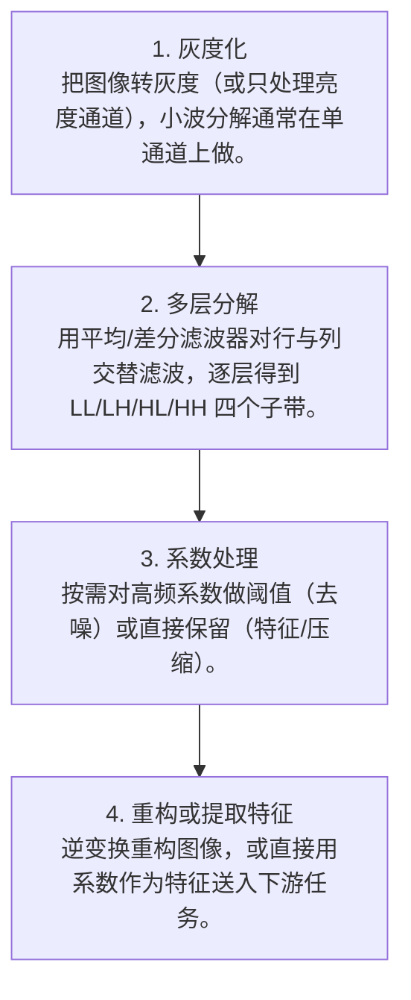

# 第 4 页 · 算法架构

## 完整流程图

## 每一步在做什么

### 步骤 1：灰度化

把图像转灰度（或只处理亮度通道），小波分解通常在单通道上做。

### 步骤 2：多层分解

用平均/差分滤波器对行与列交替滤波，逐层得到 LL/LH/HL/HH 四个子带。

### 步骤 3：系数处理

按需对高频系数做阈值（去噪）或直接保留（特征/压缩）。

### 步骤 4：重构或提取特征

逆变换重构图像，或直接用系数作为特征送入下游任务。

## 在整体视觉管线中的位置

## 复杂度分析

时间复杂度 O(W·H) 每层（只有加减）；多层 O(W·H·(1+1/4+…))≈O(W·H)。空间复杂度 O(W·H)。

## 参数总览（论文建议 vs OpenCV 默认 vs 实战推荐）

| 参数 | 含义 | 论文建议 | OpenCV 默认 | 实战推荐 |
|------|------|----------|-------------|----------|
| level | 分解层数 | — | — | ****2~5 层**** |
| mode | 边界延拓方式 | — | symmetric | **symmetric / periodization** |
| threshold | 去噪阈值 | — | — | **软阈值 3σ** |
| wavelet | 小波基 | haar | haar | **haar（或 db2 更平滑）** |

## 边界情况与失败模式

- **层数过多丢信息**：分解太深，最粗尺度只剩几个像素，失去意义。
- **未做边界延拓**：卷积在边界处出错，产生边缘伪影。
- **直接对彩色三通道分解**：应在 YCbCr 的亮度通道或 Lab 分解更合理。
- **把细节系数当噪声一刀切**：阈值过大把所有边缘也删了。
