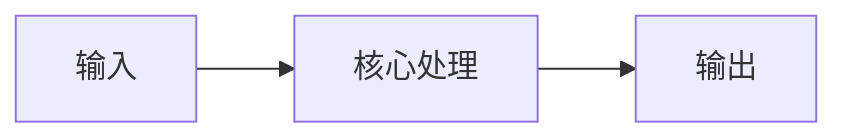
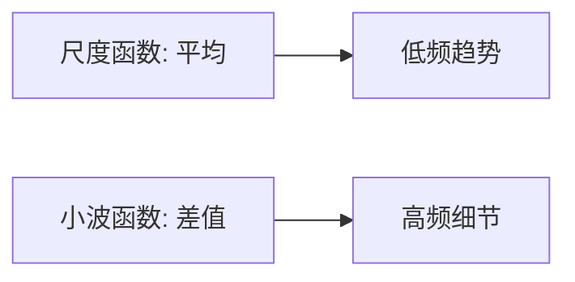
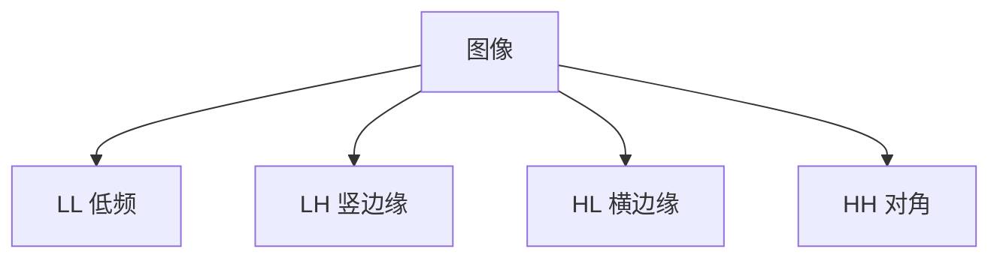

# 第 3 页 · 核心概念

🧪 公式看不懂？去 <a href="/math-lab/">原理实验室</a> 拖动滑块直观体验卷积/梯度/高斯/霍夫/角点/RANSAC/光流等核心概念；看完原理再去本页底部 <a href="./source">源码/真机实验室</a> 亲手调参数。

## 先用生活直觉理解

Haar 小波像把照片反复「对折比较」：先左右相邻两两求和（看到整体趋势）与求差（看到这里有没有突变），再对求和的低分辨率图重复一次。最后你会得到一堆「差值图」——它们精准标出了边缘在哪里。

**典型应用**：图像压缩（JPEG2000 概念前身）、多分辨率分析、快速 Haar 特征（Viola-Jones 人脸的基石）、边缘/纹理分析

## 概念逐个拆解

### 概念 1：尺度与小波函数

尺度函数做「平均」抓趋势，小波函数做「差」抓突变。两者配合，既保留整体又定位细节。

### 概念 2：一层分解的四宫格

对图像行、列各做一次低通/高通，得到 LL（低频）、LH、HL、HH（三个方向的细节）。

### 概念 3：多分辨率金字塔

对 LL 再分解一层，层层递进，得到不同尺度的表示——和图像金字塔异曲同工。

### 概念 4：与 Haar 特征的联系

Viola-Jones 的 Haar 特征就是「白矩形区灰度均值 − 黑矩形区灰度均值」，正是 Haar 小波「平均值与差值」思想在检测任务中的应用。

## 和其他算法的关系

| 关系 | 算法 | 说明 |
|------|------|------|
| 前置依赖 | 灰度化 | 通常先做这些再做本算法 |
| 同类对比 | Gabor 滤波、傅里叶变换、DoG | 解决同类问题，各有取舍 |
| 下游常用 | 系数阈值去噪、特征提取、边缘检测 | 本算法结果常交给它们处理 |

::: tip 记忆锚点
记住「Haar 只有平均与差——低通看趋势，高通看边缘」。
:::

---

## 🧪 原理可视化

看不懂上面的公式？下面这个互动组件把「傅里叶频域」画出来了——拖动滑块，看每一步怎么算。

<ClientOnly>
  <MathVisualizer initial-tab="fourier" compact />
</ClientOnly>

> 想看它在真实照片上的实际效果？回到 [本算法首页](./index) 或去 [🎮 真机实验室](/playgrounds/)。

<!-- AUTO-EXTENSION-2 -->

## 🧓 大白话：Haar 小波 = "用平均和差值分解图像"

Haar 小波是最简单的小波变换。每次做 2×2 块的分解：
- **LL**（低-低）= 4 个像素的平均 → 相当于 2×均值下采样；
- **LH**（低-高）= 横向平均、纵向差 → 水平边缘；
- **HL**（高-低）= 横向差、纵向平均 → 垂直边缘；
- **HH**（高-高）= 对角差 → 对角纹理/噪声。

然后对 LL 再递归分解，得到多级"金字塔"。

## 为什么 SURF 用 Haar 而不是 SIFT 的 DoG？

SIFT 用高斯差分（DoG）近似 LoG，需要构造多层高斯金字塔再逐像素减；SURF 用**方框滤波近似 Haar 小波**，配合积分图，**任意大小滤波核都是常数时间**，速度比 SIFT 快 3 倍。

Haar 小波本身在图像压缩（JPEG2000 用的是更复杂的 CDF 9/7，但 Haar 是教学版）、纹理检索、SURF 特征点方向估计（在圆形邻域内统计 Haar 响应）中都有应用。
