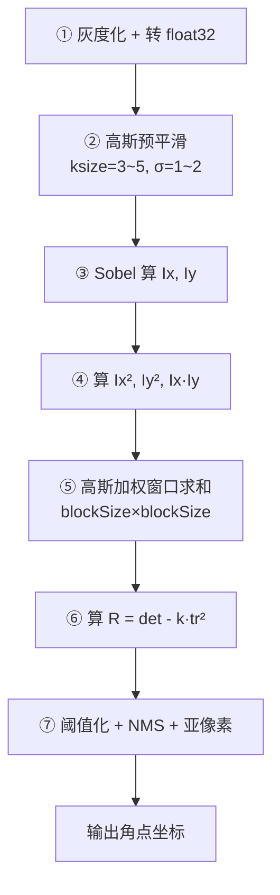

# 算法架构与实现流程

## 完整 7 步管线



### 每一步做什么、为什么

| 步 | 操作 | OpenCV 对应 | 作用 |
|---|---|---|---|
| ① | `cvtColor(BGR2GRAY)`, `np.float32` | `cv2.cvtColor` | 梯度只能在单通道算；float32 避免溢出 |
| ② | `GaussianBlur(gray, (5,5), 1.4)` | `cv2.GaussianBlur` | 压噪声，否则 Sobel 会把噪点当边缘 |
| ③ | `Sobel(gray, CV_32F, 1,0,ksize=3)` | `cv2.Sobel` | 算 x/y 方向梯度 |
| ④ | `Ix2 = Ix*Ix` | numpy 逐元素 | 三个二次项 |
| ⑤ | `GaussianBlur(Ix2, (blockSize,blockSize), σ)` | `cv2.GaussianBlur` | 窗口加权求和（盒滤波也行，高斯更好）|
| ⑥ | `R = (A*B - C*C) - k*(A+B)**2` | numpy 逐元素 | 响应函数 |
| ⑦ | `R > thresh*R.max()` + NMS + `cornerSubPix` | `cv2.dilate` + `cv2.cornerSubPix` | 阈值、去重、亚像素精化 |

## 60 行 Numpy 手写实现

```python
import numpy as np
import cv2

def harris_corner(img, blockSize=3, ksize=3, k=0.04, thresh_ratio=0.01):
    """
    手写 Harris 角点检测
    blockSize: 窗口大小（奇数）
    ksize:     Sobel kernel
    k:         响应函数参数，0.04~0.06
    thresh_ratio: 阈值 = thresh_ratio * R.max()
    """
    gray = cv2.cvtColor(img, cv2.COLOR_BGR2GRAY)
    gray = np.float32(gray)

    # ② 预平滑（抑制梯度噪声）
    gray = cv2.GaussianBlur(gray, (5,5), 1.4)

    # ③ 梯度
    Ix = cv2.Sobel(gray, cv2.CV_32F, 1, 0, ksize=ksize)
    Iy = cv2.Sobel(gray, cv2.CV_32F, 0, 1, ksize=ksize)

    # ④ 二次项
    Ix2 = Ix * Ix
    Iy2 = Iy * Iy
    Ixy = Ix * Iy

    # ⑤ 窗口加权（高斯加权求和）
    sigma = 0.3 * (blockSize/2 - 1) + 0.8  # OpenCV 经验公式
    A = cv2.GaussianBlur(Ix2, (blockSize,blockSize), sigma)
    B = cv2.GaussianBlur(Iy2, (blockSize,blockSize), sigma)
    C = cv2.GaussianBlur(Ixy, (blockSize,blockSize), sigma)

    # ⑥ 响应函数
    R = (A*B - C*C) - k * (A+B)**2

    # ⑦ 阈值 + 非极大抑制
    R_dilated = cv2.dilate(R, None)  # 3x3 max filter 实现 NMS
    corners = np.where((R > thresh_ratio * R.max()) & (R == R_dilated))

    return list(zip(corners[1], corners[0]))  # (x, y)

# 测试
img = cv2.imread("chessboard.png")
corners = harris_corner(img, blockSize=3, ksize=3, k=0.04, thresh_ratio=0.01)
for (x, y) in corners:
    cv2.circle(img, (x, y), 3, (0, 0, 255), -1)
cv2.imwrite("harris_out.png", img)
print(f"检测到 {len(corners)} 个角点")
```

## OpenCV 标准 API 参数表

`cv2.cornerHarris(src, blockSize, ksize, k[, dst[, borderType]])`

| 参数 | 类型 | 范围 | 默认 | 调参指南 |
|---|---|---|---|---|
| `src` | 单通道 float32 | — | — | 必须 `np.float32`，否则返回值是错的 |
| `blockSize` | int | 2–15 奇数 | 2 | 窗口大小（M 矩阵求和区域）；小=细角点，大=粗团块 |
| `ksize` | int | 1, 3, 5, 7 | 3 | Sobel 核；3 常用，1 是 Scharr（更锐）|
| `k` | float | 0.02–0.06 | 0.04 | R 函数系数；大=点少而精，小=点多 |
| `borderType` | int | — | BORDER_REFLECT | 几乎不用改 |

**返回值**：和 src 同大小的 float32 响应图 R（不做阈值、不做 NMS）。

### 标准调用模板

```python
gray = cv2.cvtColor(img, cv2.COLOR_BGR2GRAY)
gray = np.float32(gray)  # ← 易错点：必须转 float32
R = cv2.cornerHarris(gray, blockSize=2, ksize=3, k=0.04)
R = cv2.dilate(R, None)  # 标记更明显
img[R > 0.01 * R.max()] = [0, 0, 255]  # 标红
```

## Shi-Tomasi API（更适合跟踪）

`cv2.goodFeaturesToTrack(image, maxCorners, qualityLevel, minDistance[, ...])`

| 参数 | 含义 | 常用值 |
|---|---|---|
| `maxCorners` | 返回的最大角点数 | 100–500（多了 KLT 跟踪会慢）|
| `qualityLevel` | 质量阈值 × R.max() | 0.01（严格）~0.001（宽松）|
| `minDistance` | 角点之间的最小欧氏距离（像素）| 7–15（避免聚类）|
| `blockSize` | 窗口大小 | 3 |
| `useHarrisDetector` | 是否用 Harris 代替 Shi-Tomasi | False（默认 Shi-Tomasi 更稳）|

**它内部自动做了：float32 转换、梯度、窗口加权、NMS、按质量排序、minDistance 过滤**——所以实战基本都用它。

```python
corners = cv2.goodFeaturesToTrack(gray, maxCorners=200, qualityLevel=0.01,
                                  minDistance=10, blockSize=3)
corners = np.int0(corners)
for c in corners:
    x, y = c.ravel()
    cv2.circle(img, (x,y), 3, (0,255,0), -1)
```

## 亚像素定位：cornerSubPix

Harris 返回的是整数像素坐标，精度只有 1 像素。**相机标定、三维重建**这些场景需要 0.01 像素精度——用 `cv2.cornerSubPix` 做二次精化：

```python
criteria = (cv2.TERM_CRITERIA_EPS + cv2.TERM_CRITERIA_MAX_ITER, 100, 0.001)
corners = cv2.goodFeaturesToTrack(gray, 200, 0.01, 10)
corners_sub = cv2.cornerSubPix(gray, corners, (5,5), (-1,-1), criteria)
# corners_sub 是 float32，精度 ~0.01 像素
```

原理：在角点附近，灰度梯度与"从角点指向邻域点"的向量**正交**——通过最小二乘找一个最满足这个正交条件的点。

## 三代角点检测器对比

| 特性 | Moravec (1977) | **Harris (1988)** | Shi-Tomasi (1994) | FAST (2006) |
|---|---|---|---|---|
| 方向 | 8 个离散 | 连续 | 连续 | 16 像素圆 |
| 响应函数 | min SSD | det-k·tr² | min(λ₁,λ₂) | 圆周段连续亮 |
| 需要解特征值 | 否 | 否 | **是** | 否 |
| 尺度不变 | ✗ | ✗ | ✗ | ✗ |
| 旋转不变 | ✗ | 部分 | 部分 | 部分（ORB 补方向）|
| 速度 | 快 | **快** | 中 | **极快** |
| 适合做描述子 | 否 | 否（无方向）| 否 | ORB 用它 |

## 复杂度分析

假设图像 N 像素、blockSize=B、ksize=K：

| 步骤 | 复杂度 |
|---|---|
| 高斯预平滑 | O(N·B²) |
| Sobel | O(N·K²) |
| 高斯窗口 | O(N·B²) |
| R 逐元素 | O(N) |
| NMS（3×3 dilate）| O(N·9) |
| **总计** | **O(N)**，线性 |

典型速度：1080p 图在现代 CPU 上 **<5ms**，嵌入式 ARM 上 <20ms——这是它能做实时跟踪的根本原因。

---

**下一篇**：[源码走读与调参 →](./source)
