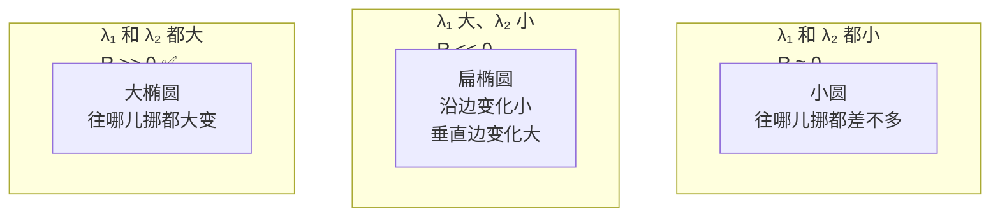

# 核心概念：Harris 角点检测

> 如果 Canny 是"找边"，Harris 就是"找角"。它是一个只有 6 步、参数极少、数学非常干净的检测器——也是理解所有后续特征点（SIFT/SURF/ORB/FAST）的必修课。

## 1. 自相关函数 E(u,v)

在图像上一个位置 $(x,y)$ 放一个小窗口，往 $(u,v)$ 方向挪一点点，窗口内像素亮度变化的平方和（SSD）：

$$ E(u, v) = \sum_{(x,y) \in W} w(x,y) \cdot [I(x+u, y+v) - I(x,y)]^2 $$

| 符号 | 含义 |
|---|---|
| $W$ | 窗口，通常 3×3 / 5×5 / 7×7 |
| $w(x,y)$ | 窗口权重，通常是高斯核（中心权重大，边缘小）|
| $I$ | 灰度图 |

**生活比方**：把窗口想象成一个放大镜在桌面上滑动——挪到桌角时，镜里的画面变化最大。

## 2. 一阶泰勒展开 → 二次型

把 $I(x+u, y+v)$ 做一阶泰勒展开（见[泰勒展开算子](../../operators/taylor-expansion)）：

$$ I(x+u, y+v) \approx I(x,y) + u I_x + v I_y $$

代入得：

$$ E(u, v) \approx \sum w \cdot (u I_x + v I_y)^2 = A u^2 + 2C uv + B v^2 = \begin{bmatrix} u & v \end{bmatrix} \begin{bmatrix} A & C \\ C & B \end{bmatrix} \begin{bmatrix} u \\ v \end{bmatrix} $$

其中：

$$ A = \sum w I_x^2, \quad B = \sum w I_y^2, \quad C = \sum w I_x I_y $$

这个 $\begin{bmatrix} A & C \\ C & B \end{bmatrix}$ 就是 **M 矩阵（二阶矩矩阵 / 结构张量）**。

## 3. M 的特征值 = 两个正交方向的"变化强度"

M 是一个对称半正定矩阵，所以它一定有两个非负实特征值 λ₁ ≥ λ₂ ≥ 0，和两个正交特征向量。

$$ \lambda_1, \lambda_2 \geq 0 $$

**这两个 λ 就是理解 Harris 最重要的东西**——它们代表"在这两个正交方向上，挪一像素亮度变化有多大"。

### 三种情况一张图记一辈子



| 位置 | λ₁ | λ₂ | 生活比方 |
|---|---|---|---|
| 平坦区 | 小 | 小 | 桌面中央，四面都滑 |
| 边缘 | 大 | 小 | 桌边，只能沿边滑 |
| **角点** | **大** | **大** | **桌角，四面都卡住** |

## 4. 响应函数 R：不用解特征值的巧妙公式

解特征值在 1988 年很贵。Harris 发现可以用行列式和迹来代替：

$$ \det(M) = \lambda_1 \lambda_2 = AB - C^2 $$
$$ \text{tr}(M) = \lambda_1 + \lambda_2 = A + B $$

构造：

$$ \boxed{R = \det(M) - k \cdot (\text{tr}(M))^2 = \lambda_1 \lambda_2 - k (\lambda_1 + \lambda_2)^2} $$

| 判据 | 数学条件 | 直觉 |
|---|---|---|
| 角点 | $R > 0$ 且大于阈值 | 两个 λ 都大且接近，乘积大胜过和的平方 |
| 边缘 | $R < 0$ 且绝对值大 | 一个 λ 远大于另一个，乘积小 |
| 平坦 | $\|R\| \approx 0$ | 两个 λ 都小 |

**k 的取值**：经验常数，常用 **0.04**，范围 0.02–0.06。
- k 越大 → R 越难是正 → 只留最强的角点（召回率↓，精度↑）
- k 越小 → 越容易是正 → 点变多（召回率↑，精度↓）

## 5. 为什么用高斯窗口？

矩形窗口（Moravec 原方法）每个像素权重一样，有两个问题：

1. 窗边缘的像素对响应贡献和中心一样——边缘一旦有噪声就被放大
2. 响应在窗边界处不连续（图像不是 C¹ 的）

换成高斯窗口 $w(x,y) = \exp(-(x^2+y^2)/2\sigma^2)$：

- **中心权重大，边缘小**：符合"我关心的是当前像素附近发生了什么"
- **天然抗噪**：离中心远的噪声点被压制
- **卷积核平滑可分离**：高斯可以分两次 1D 卷积，算得快

所以 Harris 的标准管线是**梯度前先做高斯平滑**，**得到 A/B/C 后再做一次高斯窗口加权**——两次高斯各有各的目的（一次消梯度噪声，一次做窗口）。

## 6. 非极大抑制（NMS）

即使 R 很大，也可能是"角点附近的像素 R 都大"——一个真正的角点会在周围 3×3 / 5×5 邻域里产生一簇大 R。

必须做非极大抑制：只保留邻域内的**局部最大值**。

```python
# 3×3 非极大抑制
for y in range(1, h-1):
    for x in range(1, w-1):
        if R[y,x] > max(R[y-1,x], R[y+1,x], R[y,x-1], R[y,x+1],
                        R[y-1,x-1], R[y-1,x+1], R[y+1,x-1], R[y+1,x+1]):
            corners.append((x, y))
```

OpenCV 的 `cornerHarris` **不做 NMS**，返回的是 R 图；阈值化后要自己做。而 `goodFeaturesToTrack`（Shi-Tomasi）**内部做了 NMS**，直接返回角点坐标。

## 7. 与 Shi-Tomasi（1994）的关系

Shi-Tomasi 把 R 函数改了：不再用 det - k·tr²，而是**直接取较小的那个特征值**：

$$ R_{ST} = \min(\lambda_1, \lambda_2) $$

理由：角点要求两个 λ 都大，所以只要较小的那个大于阈值就行。

| 特性 | Harris R = det - k·tr² | Shi-Tomasi R = min(λ₁,λ₂) |
|---|---|---|
| 需要特征值分解吗 | 不需要 | 需要 |
| k 参数 | 需要调 | 不需要 |
| 稳定性 | 略差 | **更好**（跟踪场景常用）|
| OpenCV 函数 | `cv2.cornerHarris` | `cv2.goodFeaturesToTrack` |

**结论**：做角点跟踪（KLT 光流）默认用 Shi-Tomasi；做快速检测/理解原理用 Harris。

## 8. 五个必须记住的直觉

1. **角点 = 多方向亮度变化都大**——这是所有角点检测器的共同定义
2. **M 矩阵的两个 λ 是两个方向的变化强度**——一个大=边，两个都大=角
3. **R = det - k·tr² 是免特征值分解的工程技巧**——不是数学必然
4. **高斯窗口是抗噪关键**——两次高斯各有作用
5. **必须做 NMS**——否则一个角点会变成一团点

---

**下一篇**：[完整架构与代码逻辑 →](./architecture)

> 🧪 **看不懂公式？去[数学实验室](/math-lab/)拖动滑块直观体验**——卷积、梯度、高斯、霍夫、角点、RANSAC、光流都有实时互动demo，看完再回来。
