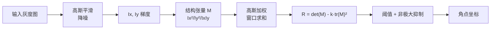

# Harris 角点检测 (1988)

<AlgorithmCard
  name="Harris 角点"
  enName="Harris Corner Detector"
  :year="1988"
  chapter="第4章 · 基元检测"  chapterLink="/chapters/ch04-primitives"
  branch="特征检测"
  level="低层"
  analogy="在桌面上放一块小玻璃窗，往四周挪动——往任何方向推，窗里画面都大变化的位置，就是桌角"
  scene="相机标定板找角点、跟踪初始特征、图像配准、视频稳像"
  paper="https://www.robots.ox.ac.uk/~vgg/research/affine/det_eval_files/harris_1988.pdf"
/>

> **TL;DR**：在图像上取一个小窗口往任意方向挪一点，如果窗内亮度变化在所有方向都大，就是角点。数学上用结构张量 M 的两个特征值判断——两个都大=角，一个大一个小=边，都小=平坦。速度比 SIFT 快两个数量级，但不具备尺度/旋转不变性。

## 3 分钟电梯演讲

**它解决什么**：Moravec 算子（1977）只在 8 个离散方向移动，对斜方向边缘不鲁棒、对噪声敏感——经常把斜边缘当角点。

**核心发明**：用**自相关矩阵（结构张量）M 在连续方向上看"亮度变化椭圆"**，而不是只在 8 个方向测试；并给出一个不需要解特征值就能判定角点的**响应函数 R = det(M) - k·tr(M)²**，计算成本极低。

**代价**：没有尺度不变性（同一个角点在不同尺度下 R 值差异巨大）、没有主方向（旋转会影响响应）、对光照敏感——这些问题后来由 SIFT 解决。

## 四层闭环视图

| 层 | 文件 | 这页讲什么 |
|---|---|---|
| L1 论文 | [paper](./paper) | Harris & Stephens 1988 原文精读：为什么 Moravec 不够，M 矩阵和 R 函数如何被发明 |
| L2 方法 | [concepts](./concepts) | 自相关矩阵、特征值判据、R 响应函数、结构张量的几何意义 |
| L3 实现 | [architecture](./architecture) | 7 步管线 + 60 行 Numpy 手写 + OpenCV API 参数表 + Harris vs Shi-Tomasi vs FAST 对比 |
| L3 代码 | [source](./source) | OpenCV 调用 / Numpy 手写 / Shi-Tomasi / sub-pixel 亚像素定位 / 视频跟踪完整 demo |
| L4 实战 | [painpoints](./painpoints) | 8 个典型坑：阈值、blockSize、ksize、k 值、邻接簇、坐标漂移、尺度问题 |
| L4 实战 | [tricks](./tricks) | 参数配方、与 SIFT/ORB 选型判据、亚像素技巧、去伪角点的 5 种办法 |

## 核心贡献

| 贡献点 | 解决的问题 | 代码落点 |
|---|---|---|
| 自相关矩阵 M 连续方向分析 | Moravec 只能看 8 个方向 | `M = [[Ix², IxIy], [IxIy, Iy²]]` 卷积 |
| 响应函数 R = det-k·tr² | 不需要解特征值 | `cv2.cornerHarris` |
| 高斯加权窗口 | 离中心近的像素贡献更大 | `cv2.GaussianBlur` 预平滑 |
| 非极大抑制 NMS | 每个角点只留一个点 | 3×3 局部最大值筛选 |

**前置阅读**：[灰度图与梯度](/glossary#梯度-gradient) · [Sobel 算子](../../operators/sobel) · [非极大抑制](../../operators/non-max-suppression)

---

**下一篇**：[原论文精读 →](./paper)

---

## 🚀 动手体验（浏览器里直接玩，不用装环境）

> 下面这些组件都在**你的浏览器本地运行**，不上传任何图片、也不用安装 OpenCV 或写代码。

### 🧪 先懂原理：Harris 角点到底在算什么

拖动滑块，看数学是怎么一步步变成图像的——纯 Canvas 绘制，秒开。

<ClientOnly>
  <MathVisualizer initial-tab="harris" compact />
</ClientOnly>

### 🎮 再跑真机：在浏览器里真跑 Harris 角点

换成你自己的照片也行；下面还会**实时生成**对应的 Python / C++ / JavaScript 代码，拖参数时代码同步更新。

<ClientOnly>
  <OpencvPlayground initial-algo="harris" compact />
</ClientOnly>

> 想换示例图、上传自己的照片、或切换别的算法？去 [🎮 真机实验室](/playgrounds/)；想看完整的 14 个数学原理互动？去 [🧪 原理实验室](/math-lab/)。
