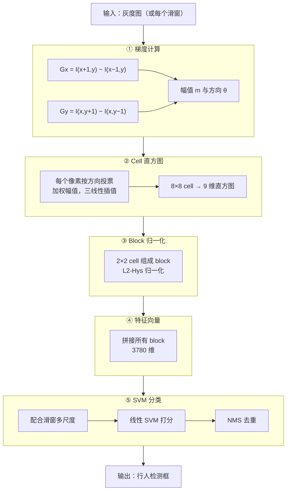
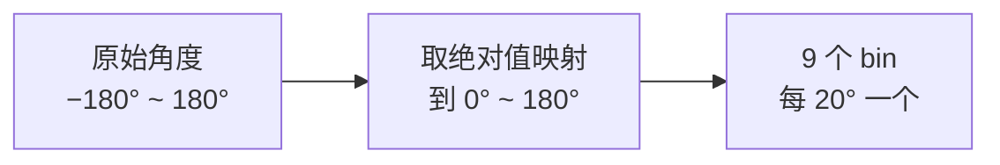
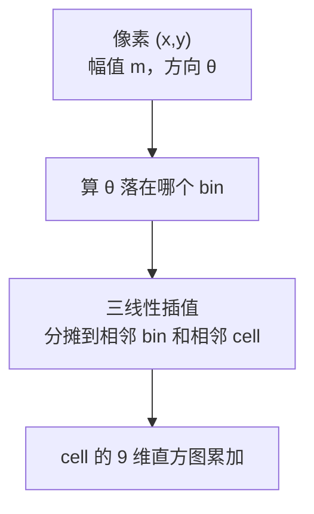
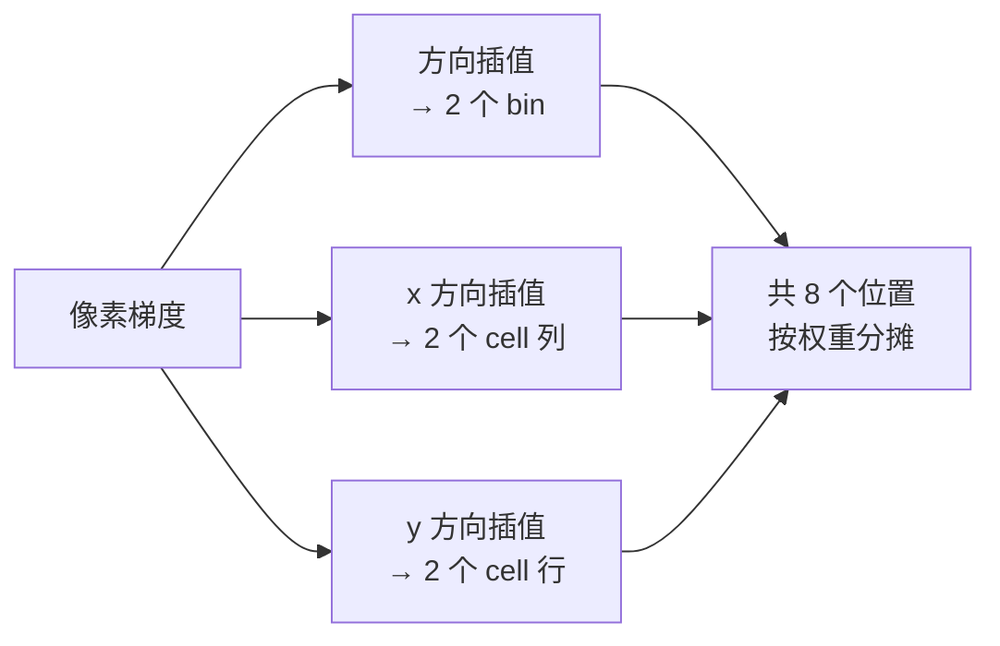
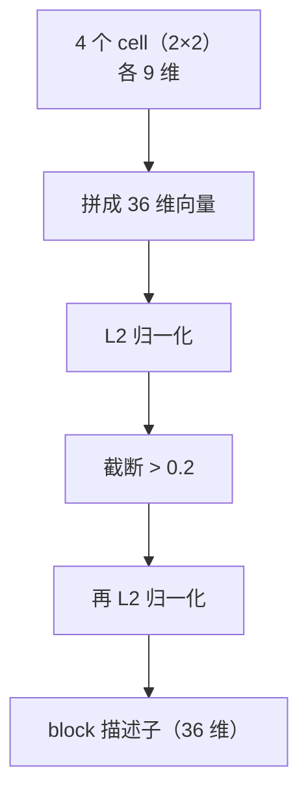
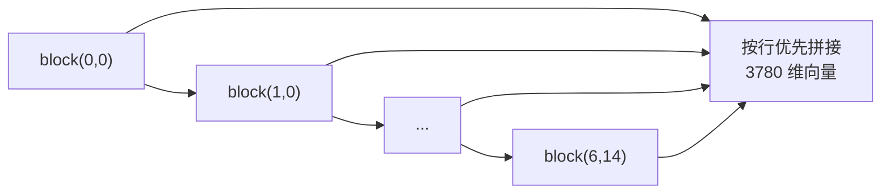
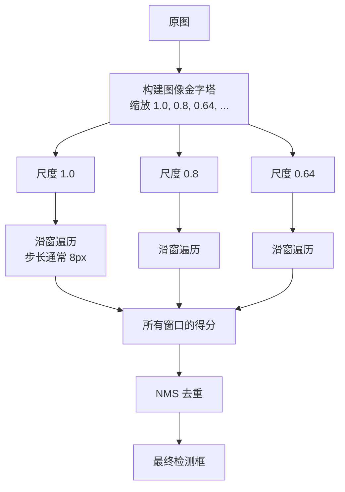
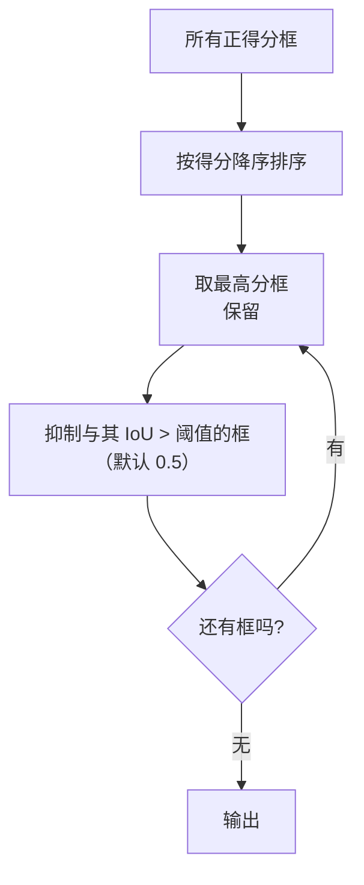

# HOG+SVM 算法流程

> 把 HOG+SVM 拆成五个阶段，每一步的输入输出都讲清楚。

## 总流程图



## 阶段 ①：梯度计算

### 梯度核

这是 HOG 和 SIFT 差异最大的地方——**用最简单的无平滑核**：

$$
G_x = I(x+1, y) - I(x-1, y), \qquad G_y = I(x, y+1) - I(x, y-1)
$$

**等价于卷积核**：

$$
K_x = [-1, 0, 1], \qquad K_y = [-1, 0, 1]^T
$$

### 幅值与方向

$$
m(x,y) = \sqrt{G_x^2 + G_y^2}, \qquad \theta(x,y) = \arctan\left(\frac{G_y}{G_x}\right)
$$

**方向处理的关键**：HOG 用**无符号方向**（0–180°）



**为什么用无符号**：

| 有符号（0–360°，18 bin） | 无符号（0–180°，9 bin） |
|---|---|
| 区分「亮→暗」和「暗→亮」 | 不区分 |
| 维度高 | 维度低 |
| 论文测试效果更差 | **论文测试效果最好** |

**原因**：行人的轮廓方向是对称的——「左边亮右边暗」和「左边暗右边亮」对描述轮廓是等价的。

## 阶段 ②：Cell 直方图

### 投票机制



### 9 个 bin 的角度范围

| bin | 角度范围 | 中心角度 |
|---|---|---|
| 0 | 0°–20° | 10° |
| 1 | 20°–40° | 30° |
| 2 | 40°–60° | 50° |
| 3 | 60°–80° | 70° |
| 4 | 80°–100° | 90° |
| 5 | 100°–120° | 110° |
| 6 | 120°–140° | 130° |
| 7 | 140°–160° | 150° |
| 8 | 160°–180° | 170° |

### 三线性插值

一个像素的投票会按距离权重分配到 **8 个位置**：

- **2 个方向 bin**（方向维度插值）
- **2 个 cell 列**（x 方向插值）
- **2 个 cell 行**（y 方向插值）



::: tip 为什么要空间插值
如果一个像素刚好在 cell 边界上，只把它归给一个 cell 会导致**边界敏感**——稍微移动图像，特征就大变。

通过插值分摊到相邻 cell，特征对微小位移就变得平滑鲁棒。
:::

## 阶段 ③：Block 归一化

### 结构



### L2-Hys 完整公式

**步骤 1**：L2 归一化

$$
v \leftarrow \frac{v}{\sqrt{\|v\|_2^2 + \epsilon^2}}
$$

**步骤 2**：截断

$$
v_i \leftarrow \min(v_i, 0.2)
$$

**步骤 3**：再归一化

$$
v \leftarrow \frac{v}{\sqrt{\|v\|_2^2 + \epsilon^2}}
$$

其中 $\epsilon$ 通常取 $10^{-5}$（防止除零）。

### 为什么截断 0.2

::: tip 直观理解
一个 block 里如果有一个**极强的边缘**（比如高对比度物体边界），它的梯度值会远超其他分量。

如果不截断，归一化后这个分量会独占整个向量，其他有用的弱边缘信息全被压没了。

**截断 0.2 的含义**：任何单个分量最多占「总能量的 20%」，保证其他信息不被淹没。
:::

## 阶段 ④：特征向量拼接

### 维度计算（窗口 64×128）

| 项目 | 数量 |
|---|---|
| cell 大小 | 8 × 8 |
| block 大小 | 16 × 16（2×2 cell） |
| block 步长 | 8 px（重叠一个 cell） |
| 窗口内 cell 数 | 8 列 × 16 行 = 128 |
| 窗口内 block 数 | 7 列 × 15 行 = **105** |
| 每 block 维度 | 2×2×9 = 36 |
| **总维度** | 105 × 36 = **3780** |

### 拼接顺序



标准实现里，向量按「block 行优先（先从左到右，再从上到下）」的顺序拼接。

## 阶段 ⑤：SVM 分类与检测

### 单窗口打分

$$
f(\mathbf{x}) = \mathbf{w}^T \mathbf{x} + b
$$

- $f > $ 阈值 → 是行人
- $f \leq $ 阈值 → 非行人

### 多尺度滑动窗口



### NMS 去重



::: tip NMS 的来源
NMS 最早用在 Canny 边缘检测里（沿梯度方向去重），后来移植到目标检测（沿空间位置去重）。

**同一个思想，两个应用**——这正是传统 CV 知识传承的魅力。详见 [NMS 到 YOLO](/legacy/nms-to-yolo)。
:::

## 数据流转示例

假设输入一张 **640×480** 灰度图：

| 阶段 | 数据 | 规模 |
|---|---|---|
| 输入 | 灰度图 | 640 × 480 |
| ① 梯度 | Gx, Gy | 各 640 × 480 |
| ② cell 直方图 | 每 cell 9 维 | 80 × 60 个 cell |
| ③ block 归一化 | 每 block 36 维 | 79 × 59 个 block |
| ④ 窗口特征 | 3780 维 | 每个候选窗口 |
| ⑤ 滑动 + 多尺度 | 数万个窗口 | 视步长和尺度数 |
| NMS 后 | 检测框 | 通常几个到几十个 |

## 复杂度分析

| 阶段 | 时间复杂度 | 说明 |
|---|---|---|
| ① 梯度 | $O(N)$ | N 为像素数 |
| ② cell 直方图 | $O(N)$ | 每像素常数次投票 |
| ③ block 归一化 | $O(N)$ | 每 cell 被 4 个 block 用到 |
| ⑤ 滑窗打分 | $O(W \cdot D)$ | W 为窗口数，D = 3780 |

**瓶颈在 ⑤**：窗口数随尺度和步长快速增长。这也是 HOG 慢的根本原因。

## 加速手段

| 手段 | 效果 |
|---|---|
| 增大滑窗步长 | 减少窗口数，但可能漏检 |
| 减少尺度数量 | 同上 |
| 特征复用 | 相邻窗口的 cell 直方图可复用 |
| 用 SIMD 加速 | 编译器自动向量化 |
| 用 GPU | 大幅提速 |
| **用 `cv2.HOGDescriptor`** | OpenCV 已做优化 |

## 与本体实例的对应

```yaml
- id: algo-hog-svm
  type: Algorithm
  stages:
    - order: 1
      name: "梯度计算"
      operators: ["op-gradient-simple"]
    - order: 2
      name: "Cell 直方图"
      operators: ["op-histogram-vote"]
    - order: 3
      name: "Block 归一化"
      operators: ["op-l2-hys-normalize"]
    - order: 4
      name: "特征拼接"
      operators: ["op-concat"]
    - order: 5
      name: "SVM 分类 + 滑窗"
      operators: ["op-linear-svm", "op-sliding-window", "op-nms"]
```
