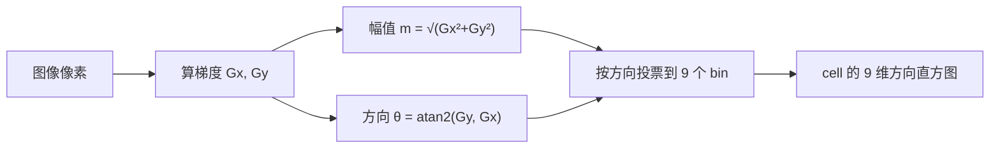
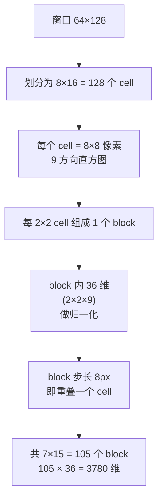
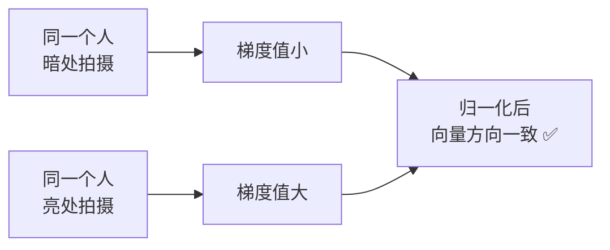
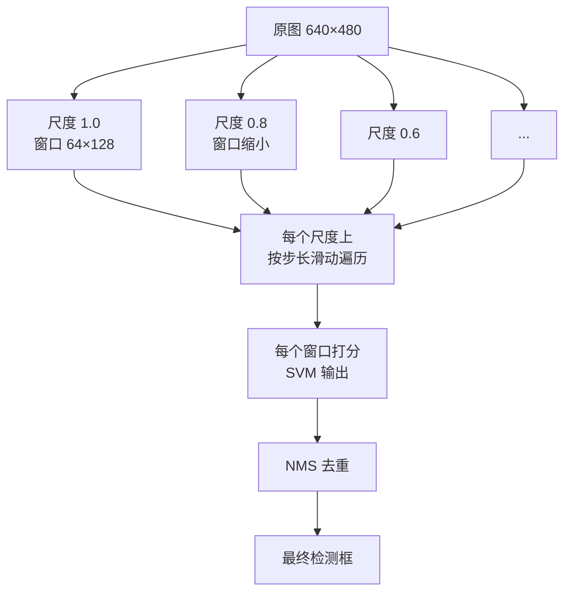
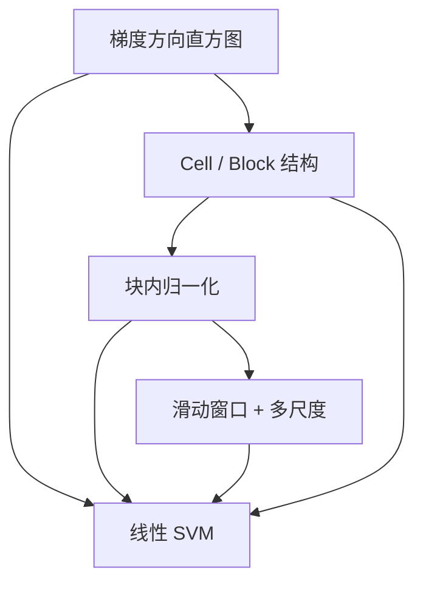

# HOG+SVM 核心概念

> HOG+SVM 里 5 个关键概念，逐个讲清楚「为什么需要它」。

<div class="tip custom-block"><p>🧪 公式看不懂？去 <a href="/math-lab/">原理实验室</a> 拖动滑块直观体验卷积/梯度/高斯/霍夫/角点/RANSAC/光流等核心概念；看完原理再去本页底部 <a href="./source">源码/真机实验室</a> 亲手调参数。</p></div>


## Concept 1：梯度方向直方图（HOG）

**一句话**：把图像分小块，每块统计「梯度朝各方向的强度分布」，形成描述轮廓的特征。

**通俗版**：把图像切成小格子，每个格子里记录「这里的线条主要朝哪些方向、各有多明显」。头肩有很多水平线，腿有很多垂直线，这些方向信息就是「人形指纹」。

**计算流程**：



**为什么好**：

| 特性 | 说明 |
|---|---|
| 对光照不敏感 | 描述的是方向分布，不是绝对亮度 |
| 对着装不敏感 | 不关心颜色，只关心形状轮廓 |
| 对局部形变有一定容忍 | 小形变不会大幅改变方向分布 |

## Concept 2：Cell / Block 两级结构

**一句话**：cell 是统计单元（8×8），block 是归一化单元（2×2 cell）。



**尺寸计算（窗口 64×128）**：

| 层级 | 尺寸 | 数量 |
|---|---|---|
| 窗口 | 64×128 | 1 |
| cell | 8×8 | 8 列 × 16 行 = 128 个 |
| block | 16×16（2×2 cell） | 7 列 × 15 行 = 105 个 |
| 特征维度 | — | 105 × 2×2 × 9 = **3780** |

**为什么 block 要重叠**：

- block 步长 = 8 px（一个 cell 宽），而 block 本身 16 px
- 所以每个 cell 会被 **4 个 block 覆盖**
- 产生 4 次不同的归一化响应 → 增强鲁棒性

## Concept 3：块内归一化

**一句话**：把 block 内的梯度向量除以它的能量，消除光照影响。

**通俗版**：同一首曲子，音量调大调小，但**旋律（各音符的相对强弱）不变**。归一化就是找这个「相对强弱」。

**公式（L2-Hys）**：

步骤 1：L2 归一化

$$
v' = \frac{v}{\sqrt{\|v\|_2^2 + \epsilon^2}}
$$

步骤 2：截断

$$
v''_i = \min(v'_i, 0.2)
$$

步骤 3：再次 L2 归一化

$$
v''' = \frac{v''}{\sqrt{\|v''\|_2^2 + \epsilon^2}}
$$

**为什么必须归一化**：



**不同归一化方案对比**：

| 方案 | 效果 | 论文结论 |
|---|---|---|
| L1 | 一般 | — |
| L2 | 好 | — |
| **L2-Hys** | **最好** | **论文推荐** |
| L1-sqrt | 接近 L2-Hys | — |

## Concept 4：滑动窗口 + 多尺度

**一句话**：用一个固定大小的窗口，在图上各个位置、各种尺度上滑动检测。



**问题**：这是 HOG+SVM **最慢的环节**。640×480 图上，多尺度 + 密集滑动会产生**数万个窗口**，每个都要算 3780 维特征 + SVM 打分。

**为什么需要**：

- HOG 特征**不具备尺度不变性**（不像 SIFT 有尺度空间）
- 所以只能靠「图像缩放 + 固定窗口」来覆盖不同大小的目标

::: tip 通俗理解
这就像拿一个固定大小的「人物取景框」，在照片上到处移动、还要在照片的不同缩放版本上移动——总有一个位置和大小正好框住行人。
:::

## Concept 5：线性 SVM

**一句话**：在 3780 维 HOG 特征空间里，找一个超平面把「行人」和「非行人」分开。

**通俗版**：把每个窗口的特征看成 3780 维空间里的一个点。行人样本聚成一堆，非行人聚成另一堆，SVM 就是找一条「最宽的分界线」。

**公式**：

决策函数：

$$
f(x) = \mathbf{w}^T \mathbf{x} + b
$$

分类：

$$
\text{label} = \text{sign}(f(x)) = \text{sign}(\mathbf{w}^T\mathbf{x} + b)
$$

**为什么线性就够了**：


**HOG 的判别函数可视化**：

把学到的权重 $\mathbf{w}$ 反向渲染成图像（叫 **HOG weight visualization**），会发现它长得**像一个行人的轮廓模板**——这正是 HOG 特征设计成功的证据。


## 概念之间的关系



**逻辑链**：

1. 梯度方向直方图 → 提供基础特征表达
2. Cell/Block 结构 → 把特征组织成有层次的网格
3. 块内归一化 → 消除光照影响，增强鲁棒性
4. 滑动窗口 + 多尺度 → 解决「目标可能在任意位置和大小」的问题
5. 线性 SVM → 在特征空间里做最终判别

## 与 SIFT 的概念对照

| 概念 | SIFT | HOG |
|---|---|---|
| 特征单元 | 关键点邻域 | 规则 cell / block |
| 方向 bin | 36（每 10°） | 9（无符号，每 20°） |
| 归一化 | 描述子整体归一化 | **块内归一化（更局部）** |
| 梯度算子 | 有平滑（DoG） | **无平滑 `[-1,0,1]`** |
| 不变性目标 | 尺度 + 旋转不变 | 光照不变（不需尺度旋转不变） |
| 任务 | 特征匹配 | 目标判别 |

## 本体实例

```yaml
- id: algo-hog-svm
  type: Algorithm
  concepts:
    - "concept-hog-descriptor"
    - "concept-cell-block"
    - "concept-block-normalization"
    - "concept-sliding-window"
    - "concept-linear-svm"
  dependsOn:
    - "op-gradient-simple"
    - "op-histogram-vote"
    - "op-l2-hys-normalize"
  papers: ["paper-hog-svm-2005"]
  appliedIn:
    - "app-pedestrian-detection"
    - "app-video-surveillance"
```
