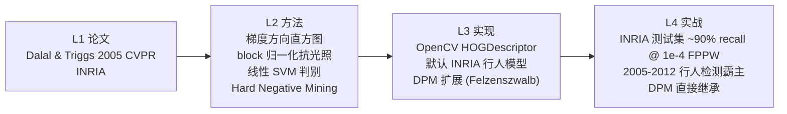

# HOG+SVM 行人检测

<ClientOnly>
  <AlgoVisualizer type="dpm" />
</ClientOnly>


<AlgorithmCard
  name="HOG + SVM 行人检测"
  en-name="Histogram of Oriented Gradients + SVM Detector"
  chapter="第6章 · 目标表达和描述 / 第12章 · 景物识别"  chapterLink="/chapters/ch06-representation"
  branch="目标检测 · 经典检测器族"
  year="2005"
  author="Navneet Dalal, Bill Triggs"
  paper="https://hal.inria.fr/inria-00548512/document"
  level="高层"
  tagline="传统目标检测的巅峰之作——深度学习爆发前最能打的行人检测器"
  analogy="把人看成一个「由边组成的形状」：头是圆的轮廓、肩膀是横着的两条线、腿是两条竖线。HOG 就像统计每个小格子里这些「边朝向」的投票，凑起来像不像一个站着的人；SVM 则是个老法官，拿着训练好的标准告诉你：「这个轮廓组合是人的概率 99%，下一个。」"
  scene="行人检测（摄像头/监控/ADAS）、车辆检测、HOG+DPM 多类别检测、人头计数、安防入侵检测、倒车雷达的行人预警（早期特斯拉/Mobileye EyeQ2 用的就是它）。"
  :pros="[
    '在行人这类「轮廓清晰」的目标上表现极佳',
    '物理意义强：每个梯度方向都对应人/车的轮廓结构',
    'CPU 上可跑（128×64 滑窗 + 金字塔约 100ms/帧）',
    '2005 年起统治行人检测近 10 年，直至深度学习',
    '为 DPM、可变形部件模型、端到端检测奠定了思路'
  ]"
  :cons="[
    '只擅长「固定姿势/刚性/半刚性」目标，对弯腰、坐下行人掉点',
    '滑动窗口+金字塔是暴力搜索，计算量与窗口数成正比',
    '需要非极大值抑制（NMS）去重，多尺度金字塔参数敏感',
    '遮挡严重时表现跳水',
    '2013 年起被 DPM 拉开距离，2015 年起被 CNN 全面碾压'
  ]"
/>

## TL;DR

**一句话**：把检测窗口切成 8×8 的 cell 统计**梯度方向直方图**，2×2 cell 合成 block 归一化，整窗拼成 3780 维向量送进**线性 SVM** 判"是不是行人"；多尺度滑窗扫描整张图，最后 NMS 去重。
**解决**：Haar 特征太简单、对行人这种"形状复杂"的目标表达力不足的问题。
**代价**：多尺度滑窗暴力搜索，CPU 上速度中等（1–5 FPS @ VGA）；固定 64×128 窗口对大形变（弯腰、坐姿）不友好。
**前置阅读**：[🐣 入门第 4 页 HOG+SVM 一句话](/for-beginners/p4-other-classics#hog-svm-形状统计--分类器) → [💡 核心概念](./concepts)

## 3 分钟电梯演讲


## 四层闭环视图



## 核心贡献一览

| 贡献 | 一句话 | 代码落点 |
|---|---|---|
| 梯度方向直方图 cell | 8×8 cell 统计 9 bin 无符号方向 (0–180°) | `HOGDescriptor::computeGradient` |
| block 重叠归一化 | 2×2 cell 滑动 block，L2-Hys 归一化抗光照 | `HOGDescriptor::compute` |
| 3780 维窗口特征 | 7×15 blocks × 36 维 = 3780 维 | `win_size=(64,128), block=(16,16), block_stride=(8,8), cell=(8,8), nbins=9` |
| 线性 SVM + HNM | 线性 SVM 分类；难例挖掘反复训降误报 | `cv2.HOGDescriptor_getDefaultPeopleDetector` |
| 多尺度滑窗 + NMS | 图像金字塔 + 滑窗 + NMS 去重 | `detectMultiScale(..., scale=1.05, hitThreshold=0)` |

## 📖 档案目录

| 页面 | 内容 |
|---|---|
| [📄 论文精读](/algorithms/hog-svm/paper) | Dalal & Triggs 2005 CVPR，行人检测的里程碑 |
| [💡 核心概念](/algorithms/hog-svm/concepts) | 梯度方向直方图、cell/block、滑窗、硬负样本挖掘 |
| [🏗 算法流程](/algorithms/hog-svm/architecture) | HOG 特征提取 → SVM 分类 → 滑窗扫描 → NMS |
| [🔍 源码走读](/algorithms/hog-svm/source) | OpenCV `cv2.HOGDescriptor_getDefaultPeopleDetector` |
| [💣 实战踩坑](/algorithms/hog-svm/painpoints) | 误检、漏检、多尺度、小目标等常见问题 |
| [🎛 调参技巧](/algorithms/hog-svm/tricks) | winStride、padding、scale、hitThreshold 怎么调 |

## 🔗 所属网络

- **学习路径**：🟥 [第6章 表达与描述 + 第12章 景物识别](/learning-path)
- **技术分支**：🌿 [目标检测 → 经典检测器](/branches/detection/classic-detectors)
- **上游依赖**：Sobel 梯度（第3章）、SVM 分类器、积分图（加速）、图像金字塔
- **下游输出**：滑窗+特征+分类器范式 → 直接演化到 DPM → NMS 和 Anchor 思路被 YOLO/R-CNN 继承
- **演化关系**：← Haarr+AdaBoost（Viola-Jones 2001）→ DPM（2008/2010）→ R-CNN（2014，深度学习接手）→ 传承到 [YOLO 一脉](/legacy/nms-to-yolo)

## 🚀 一行代码

```python
import cv2
hog = cv2.HOGDescriptor()
hog.setSVMDetector(cv2.HOGDescriptor_getDefaultPeopleDetector())
rects, weights = hog.detectMultiScale(img, winStride=(8,8), padding=(8,8), scale=1.05)
```


---

## 🚀 动手体验（浏览器里直接玩，不用装环境）

> 下面这些组件都在**你的浏览器本地运行**，不上传任何图片、也不用安装 OpenCV 或写代码。

### 🎮 再跑真机：在浏览器里真跑 HOG + SVM 行人检测

换成你自己的照片也行；下面还会**实时生成**对应的 Python / C++ / JavaScript 代码，拖参数时代码同步更新。


> 想换示例图、上传自己的照片、或切换别的算法？去 [🎮 真机实验室](/playgrounds/)；想看完整的 14 个数学原理互动？去 [🧪 原理实验室](/math-lab/)。

> ⚠️ **本算法在当前 OpenCV.js 浏览器构建中暂未提供**，真机实验室无法直接跑。请查看上方 🧪 原理互动演示理解算法行为，或参考「源码/真机实验室」章节的 Python / C++ 代码在本地运行。
