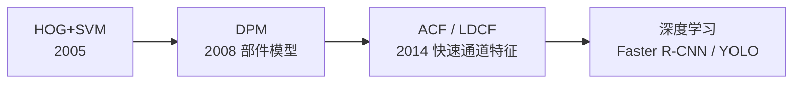
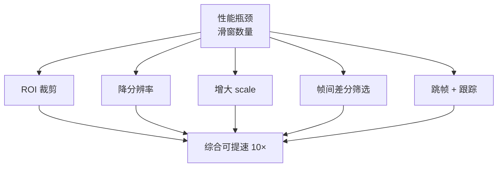

# HOG+SVM 实战与踩坑

> 视频监控、门禁、辅助驾驶等真实场景里的经验与坑。

## 案例 1：视频监控行人检测

### 场景

路口/小区监控摄像头，实时检测画面中的行人。

### 技术栈


### 关键参数

| 环节 | 参数 | 推荐 |
|---|---|---|
| 分辨率 | 输入 | 640×480 |
| `winStride` | 滑窗步长 | (8, 8) |
| `padding` | 边缘填充 | (32, 32) |
| `scale` | 缩放因子 | 1.05 |
| `hitThreshold` | 判定阈值 | 0.0（可上调减少误报） |

### 实测效果

| 指标 | 数值 |
|---|---|
| 单帧耗时 | 120–250 ms（640×480，CPU 单核） |
| 帧率 | 4–8 FPS |
| 检出率 | 85%–92%（直立行人） |
| 误报率 | 每帧 0.5–2 个 |

### 踩过的坑

::: danger 坑 1：原生速度达不到实时
**现象**：单帧 200+ ms，完全跟不上 30 FPS 的视频流。

**根因**：多尺度滑窗产生的窗口数太多。

**解决（按效果排序）**：

| 方案 | 提速 | 代价 |
|---|---|---|
| **只在 ROI 检测** | 3–10× | 需人工划区域 |
| **降分辨率到 480p** | 2–3× | 小目标检出下降 |
| **用帧间差分做前景筛选** | 3–5× | 只检测运动目标 |
| **跳帧检测 + 跟踪** | 3–5× | 用跟踪填补 |
| **增大 scale 到 1.1** | 2× | 可能漏检 |
| **GPU 加速** | 10×+ | 硬件成本 |
:::

::: danger 坑 2：检测框忽大忽小、抖动
**现象**：同一个行人，框在相邻帧之间尺寸和位置跳变。

**解决**：
- **多帧关联**：用卡尔曼滤波或简单的 IoU 匹配，稳定轨迹
- **框内缩**：OpenCV 的框偏大，统一内缩 10%–20%
- **加权平均**：对连续几帧的框做平滑
:::

::: danger 坑 3：夜间/逆光失效
**现象**：白天好用，晚上或者逆光时几乎检不出来。

**根因**：HOG 依赖梯度，光照不足时梯度信息极少。

**解决**：
- **图像增强**：CLAHE（限制对比度自适应直方图均衡）
- **红外相机**：夜间改用红外补光/热成像
- **多传感器融合**
:::

## 案例 2：门禁/客流统计

### 场景

商场/办公楼门口，统计进出人数。

### 技术栈


### 踩坑

::: danger 坑 4：预训练模型不适用于俯视视角
**现象**：OpenCV 预训练的 HOG 模型是**正面/背面直立行人**，俯视（头顶视角）几乎完全失效。

**根因**：预训练用的是 INRIA 数据集，全是正面/背面视角的直立行人。

**解决**：
- **必须用自己的俯视数据重新训练**
- 或者用**人头检测**（俯视下人头是最稳定的特征）
- 或者用**背景建模 + 团块分析**（不做形状识别）
:::

::: danger 坑 5：人群密集时相互遮挡
**现象**：两三个人走在一起，只检出一个人，或者合并成一个大框。

**解决**：
- **多人重叠场景**：传统 HOG+SVM 天生弱项
- 用**人头检测**替代全身检测（头顶不易遮挡）
- 或者接受这个限制，用**客流密度估计**替代精确计数
:::

## 案例 3：辅助驾驶行人预警

### 场景

车载摄像头检测前方行人。

### 特点与踩坑

::: danger 坑 6：车载场景的尺度变化极大
**现象**：远处行人只有 20 px 高，近处有 400 px，固定尺度覆盖不了。

**解决**：
- **尺度范围要足够宽**：从 32×64 到 256×512
- 但尺度越多越慢 → 需要**ROI 约束**或**用深度信息辅助**
- 车载场景往往改用**专门的行人检测模型**（后来的深度学习方法）
:::

::: danger 坑 7：运动模糊
**现象**：车速快时图像模糊，VDT 时 HOG 特征退化。

**解决**：
- **提高快门速度**（硬件）
- **图像去模糊**（传统方法效果有限）
- 现实中主要靠硬件解决
:::

## 通用踩坑清单

### 输入相关

| 坑 | 现象 | 解决 |
|---|---|---|
| 图像太小 | begin 窗口都放不下 | 先 resize 放大 |
| 彩色图直接传 | 结果异常 | 转灰度（`HOGDescriptor` 内部会处理，但显式转换更稳） |
| 图像太大 | 极慢 | 降分辨率 |

### 参数相关

| 坑 | 现象 | 解决 |
|---|---|---|
| `scale` 太大（1.2） | 漏检小目标 | 用 1.05 |
| `winStride` 太大 | 漏检 | 用 (8,8) |
| `hitThreshold` 太低 | 误报多 | 上调到 0.3–0.5 |
| `finalThreshold` 太小 | 框重复 | 上调到 2–3 |

### 结果相关

| 坑 | 现象 | 解决 |
|---|---|---|
| 框偏大 | 视觉上不贴合 | 内缩 10%–20% |
| 框重复 | 一个行人多个框 | 增大 `finalThreshold` 或后接 NMS |
| 侧面行人漏检 | 只检测正面/背面 | 预训练模型限制，需重训 |

## HOG+SVM 的固有局限

::: warning 五种场景 HOG+SVM 天生不擅长
1. **侧面/背面以外的姿态**：蹲、坐、跑、弯腰 → 漏检
2. **遮挡**：被车、树、其他人遮挡 → 漏检
3. **俯视/仰视视角**：预训练模型只认平视直立行人
4. **密集人群**：互相遮挡严重
5. **实时高分辨率**：多尺度滑窗太慢
:::

**替代方案演进**：



| 需求 | 替代方案 |
|---|---|
| 更快 | ACF / LDCF |
| 更准（遮挡/姿态） | 深度学习检测器 |
| 实时高分辨率 | YOLO 系列轻量模型 |
| 无需训练（通用） | OpenCV 预训练 HOG（仅限正面行人） |

## 性能优化实践

### 优化前后对比（640×480 视频帧）

| 配置 | 单帧耗时 |
|---|---|
| 全图 + scale=1.05 + 无 ROI | 230 ms |
| ROI 裁剪（半图）+ scale=1.05 | 95 ms |
| ROI + 降分辨率到 480p + scale=1.05 | 45 ms |
| ROI + 480p + scale=1.1 | 22 ms |
| **最优配置** | **22 ms（约 45 FPS）** |

### 优化手段汇总



### 一个实用的优化模板

```python
import cv2
import numpy as np

hog = cv2.HOGDescriptor()
hog.setSVMDetector(cv2.HOGDescriptor_getDefaultPeopleDetector())

def detect_pedestrians(frame, roi=None):
    # 1. ROI 裁剪
    if roi is not None:
        x0, y0, x1, y1 = roi
        region = frame[y0:y1, x0:x1]
    else:
        x0, y0 = 0, 0
        region = frame

    # 2. 降分辨率
    H, W = region.shape[:2]
    if W > 640:
        scale = 640 / W
        region = cv2.resize(region, (640, int(H * scale)))

    # 3. 检测
    rects, weights = hog.detectMultiScale(
        region,
        winStride=(8, 8),
        padding=(32, 32),
        scale=1.05
    )

    # 4. 坐标映射回原图 + 内缩
    results = []
    for (x, y, w, h) in rects:
        # 映射
        x = int(x / (640/W)) if W > 640 else x
        # 内缩
        x += int(w * 0.1); y += int(h * 0.1)
        w = int(w * 0.8); h = int(h * 0.8)
        results.append((x + x0, y + y0, w, h))

    return results
```

## 什么时候不该用 HOG+SVM

::: warning 明确不适用的场景
- **需要高精度检测**（遮挡、多姿态）→ 用深度学习
- **需要实时高分辨率** → 用轻量 CNN
- **俯视/非常规视角** → 需重训或用其他方法
- **密集人群** → 用密度估计或人头检测
:::

**仍适用的场景**：

- **嵌入式低算力 + 平视直立行人**（如早期门禁）
- **需要完全离线、无 GPU**
- **教学 / 原理研究**
- **作为 baseline 对比**

## 与深度学习的关键衔接

HOG 的很多设计直接影响了后来的检测器：

| 传统概念 | 深度学习对应 |
|---|---|
| 滑动窗口 | Anchor / 密集预测 |
| 多尺度金字塔 | FPN 特征金字塔 |
| HOG 梯度方向直方图 | CNN 第一层卷积核 |
| 线性 SVM | 全连接分类头 |
| NMS 去重 | 检测头后处理（**仍在使用**） |

详见 [传承脉络](/legacy/)。
