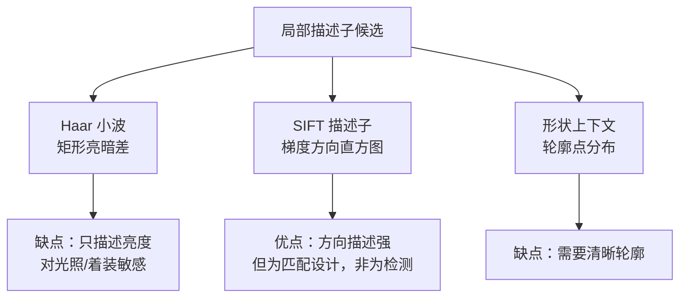
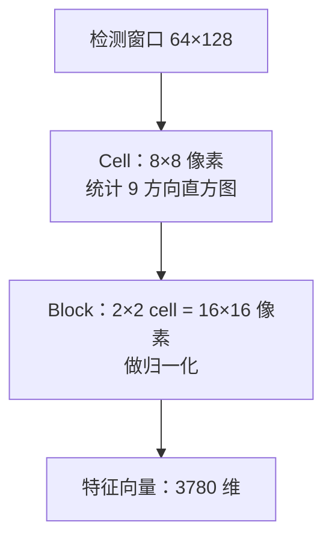
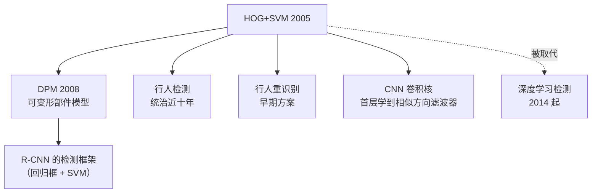

# HOG+SVM 论文精读

> **Histograms of Oriented Gradients for Human Detection**
> Navneet Dalal, Bill Triggs, IEEE CVPR 2005

## 论文要解决什么问题

2005 年，行人检测的主流是 **Haar 小波 + AdaBoost**（Viola-Jones 的路线）。但论文作者发现，这套方法在**行人检测**上效果不理想：

| 问题 | 说明 |
|---|---|
| Haar 描述的是亮度模式 | 人换衣服、光照变化，亮度模式全变 |
| 缺少轮廓描述能力 | 行人是「以轮廓为主」的目标 |
| 需要大量特征 | Haar 靠 AdaBoost 从海量特征里选，训练慢 |

论文的出发点是一句非常朴素的观察：

> **人的外形轮廓是由边缘和梯度方向勾勒出来的**——那为什么不直接描述梯度方向？

## Motivation：为什么要用「梯度方向直方图」

论文对比了几种局部描述子的思路：

**关键洞察**：

> SIFT 的梯度方向直方图**方向是对的**，但它是为「特征匹配」设计的——需要精确定位、需要尺度不变。
> **而检测任务需要的是「可判别性」而不是「可匹配性」**——于是论文把梯度方向直方图**简化 + 网格化**，做成了 HOG。

**简化方式**：

- 不找关键点，直接在**规则网格**上统计
- 不做尺度空间，用**多尺度滑窗**代替
- 不做方向对齐（不需要旋转不变，行人一般是直立的）
- 加上**块内归一化**（这是 SIFT 没有强调的）

## Innovation 1：Cell 与 Block 的两级结构

这是 HOG 最核心的设计。

**为什么是两级结构**：

| 层级 | 作用 |
|---|---|
| **Cell（8×8）** | 提供**局部**方向统计，分辨率细 |
| **Block（2×2 cell）** | 提供**归一化单元**，消除光照影响 |

::: tip 为什么 block 要重叠
Block 之间**互相重叠一个 cell 宽度**（步长 8 px，但 block 宽 16 px）。

这样每个 cell 会被**4 个不同的 block 归一化**，产生 4 次不同的响应——这看起来冗余，但实验证明**重叠能显著提升精度**。

原因：单个 block 归一化在光照突变的边界处会失效；多个归一化版本让分类器有「多个视角」可参考。
:::

## Innovation 2：梯度计算（最简单的核反而最好）

论文做了一个反直觉的发现：**最简单的梯度算子效果最好**。

论文测试了多种梯度算子：

| 算子 | 效果 |
|---|---|
| 3×3 Sobel | 一般 |
| 2×2 对角 | 一般 |
| **1D 无平滑核 `[-1, 0, 1]`** | **最好** |
| 3×3 高斯平滑后求导 | 反而更差 |

**结论**：

$$
G_x = I(x+1, y) - I(x-1, y), \qquad G_y = I(x, y+1) - I(x, y-1)
$$

**为什么平滑反而更差**：

- 行人检测的判别信息在**细节的边缘方向**上
- 平滑会抹掉细节，降低判别力
- 噪声的影响**已经被 block 归一化部分抑制了**

::: warning 这是一个重要教训
在特征匹配任务里，平滑去噪是必要的（SIFT 用 DoG）。
但在**判别**任务里，**过度的平滑会削弱判别信息**。任务不同，策略相反。
:::

## Innovation 3：方向 bin 与投票

**方向 bin 设置**：

| 设置 | 论文测试 | 结论 |
|---|---|---|
| bin 数量 | 6 / 9 / 12 | **9 个最好** |
| 方向范围 | 0–180°（无符号）/ 0–360°（有符号） | **无符号（0–180°）更好** |
| 投票权重 | 幅值 / 幅值²/ 幅值³ | **幅值最好** |

**为什么用「无符号」方向（0–180°）**：

- 有符号（0–360°）区分「亮度上升」和「亮度下降」
- 但行人的轮廓方向，**上升和下降是对称的**
- 无符号可以**减少特征维度**（9 个 bin 而非 18 个），同时**增强鲁棒性**（正负边缘被合并）

**投票方式**：

**三线性插值**：像素的投票会按距离权重分配到相邻的方向 bin（以及相邻 cell，如果有空间插值）。

## Innovation 4：块内归一化（最关键的鲁棒性来源）

论文测试了 4 种归一化方案：

| 方案 | 公式 | 效果 |
|---|---|---|
| L2-norm | $v / \sqrt{\|v\|_2^2 + \epsilon^2}$ | 好 |
| L1-norm | $v / (\|v\|_1 + \epsilon)$ | 一般 |
| L1-sqrt | $\sqrt{v / (\|v\|_1 + \epsilon)}$ | 好 |
| **L2-Hys** | L2-norm 后截断 0.2 再归一化 | **最好** |

**L2-Hys 的完整流程**：

::: tip 通俗理解归一化
同一个行人，在暗处拍梯度值小，在亮处拍梯度值大——**绝对值完全不同**。

但只要**除以块内的总梯度能量**，这个比值就稳定了。这就像「同一首曲子，音量调大调小，但旋律（各音符的相对强弱）不变」。
:::

## Innovation 5：线性 SVM 的胜利

论文最重要的实证结论之一：

> **在 HOG 特征上，线性 SVM 的效果几乎等同于非线性核 SVM（RBF）。**

| 分类器 | 效果 | 速度 |
|---|---|---|
| 线性 SVM | 优秀 | **极快** |
| RBF SVM | 略好 | 慢太多 |

**结论**：HOG 特征已经把问题「线性化」了——在 3780 维空间里，行人和非行人**已经是线性可分的**。

::: tip 这说明了什么
**好的特征工程 > 复杂的分类器**。

HOG 把「人的轮廓方向分布」显式编码成了特征，剩下的分类问题变得非常简单。这也是后来深度学习「端到端学特征」要挑战的核心——深度学习要证明「学出来的特征比手工特征更好」。
:::

### `-γ-ν` 参数化技巧

论文还提出一个实用技巧：用**修改的 SVM 参数化**，在**单次训练**中同时搜索 $\gamma$（特征缩放）和 $\nu$（误差上界），避免笛卡尔积式的网格搜索。

效果：**训练时间从数天降到几小时**。

## Tradeoff：代价与妥协

| 维度 | HOG+SVM 的取舍 |
|---|---|
| **判别力 vs 不变性** | 为判别力放弃旋转不变性（行人一般直立，可接受） |
| **精度 vs 速度** | 3780 维特征 + 滑窗多尺度 → 精度好但很慢 |
| **光照鲁棒 vs 遮挡** | 对光照很鲁棒，但**遮挡**处理差 |
| **直立行人 vs 姿态** | 默认行人直立、正面/背面，**侧面、蹲坐、奔跑**都会漏 |
| **手工特征的天花板** | 论文自身也承认——继续调参数收益越来越小 |

## 论文的长期影响

**HOG 的历史地位**：

- 它是「手工特征时代」**最后一个统治级的方法**
- 它让整个领域意识到：**轮廓方向信息 > 亮度模式信息**
- 2014 年 R-CNN 出现后，HOG 逐步被 CNN 特征取代——但**CNN 第一层卷积核学到的，恰好就是类似 HOG 的方向滤波器**

## 一句话总结

> HOG+SVM 证明了**「用正确的特征描述正确的信息，简单分类器就够了」**——它既是手工特征的巅峰，也预示了深度学习将如何超越它。

## 延伸阅读

- 原文：Dalal, N., & Triggs, B. (2005). *Histograms of Oriented Gradients for Human Detection.* CVPR.
- 后续：Felzenszwalb et al. (2008). *A Discriminatively Trained, Multiscale, Deformable Part Model.* (DPM)
- 数据：INRIA Person Dataset
- 工程实现：[源码走读](/algorithms/hog-svm/source)
