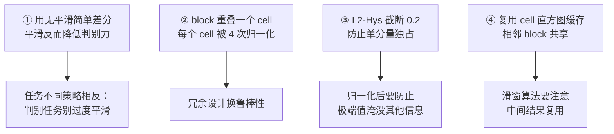

# HOG+SVM 源码走读

> 基于 **OpenCV 4.x** 的 `HOGDescriptor` 实现。
> 相关文件：`modules/objdetect/src/hog.cpp`

::: warning 说明
以下为**结构与逻辑示意**的伪代码注解。实际代码请以本地 OpenCV 版本为准。
:::

## 1. HOGDescriptor 的默认参数

```cpp
// HOGDescriptor 默认构造（简化示意）
HOGDescriptor::HOGDescriptor()
{
    winSize = Size(64, 128);        // ① 检测窗口 64×128
    blockSize = Size(16, 16);       // ② block 16×16（2×2 cell）
    blockStride = Size(8, 8);       // ③ block 步长 8×8（重叠一个 cell）
    cellSize = Size(8, 8);          // ④ cell 8×8
    nbins = 9;                      // ⑤ 9 个方向 bin
    derivAperture = 1;              // ⑥ 梯度核孔径
    winSigma = -1.0;                // ⑦ 高斯平滑 sigma（-1 = 不用）
    histogramNormType = HOGDescriptor::L2Hys;  // ⑧ L2-Hys 归一化
    L2HysThreshold = 0.2;           // ⑨ 截断阈值
    gammaCorrection = true;         // ⑩ gamma 校正
    nlevels = HOGDescriptor::DEFAULT_NLEVELS;  // ⑪ 默认 64 层
    signedGradient = false;         // ⑫ 无符号梯度（0-180°）
}
```

**默认参数对照论文**：

| 参数 | OpenCV 默认 | 论文值 | 说明 |
|---|---|---|---|
| `winSize` | 64×128 | 64×128 | 行人比例约 1:2 |
| `cellSize` | 8×8 | 8×8 | — |
| `blockSize` | 16×16 | 16×16 | 2×2 cell |
| `blockStride` | 8×8 | 8×8 | 重叠一个 cell |
| `nbins` | 9 | 9 | 无符号方向 |
| `histogramNormType` | L2Hys | L2-Hys | — |
| `L2HysThreshold` | 0.2 | 0.2 | — |

## 2. 单窗口特征计算

```cpp
// 计算一个窗口的 HOG 特征
void HOGDescriptor::compute(InputArray _img, std::vector<float>& descriptors,
                            Size winStride, Size padding,
                            const std::vector<Point>& locations) const
{
    // 1. gamma 校正（可选）
    Mat img;
    if (gammaCorrection)
        pow(_img.getMat(), gammaCorrection, img, 1.0 / 2);   // ⑬ 开平方
    else
        img = _img.getMat();

    // 2. 验证图像尺寸够不够
    CV_Assert(img.size().width >= winSize.width &&
              img.size().height >= winSize.height);

    // 3. 计算滑动位置
    if (locations.empty()) {
        // 自动生成所有滑窗位置
        // stepSize = winStride
    }

    // 4. 逐窗口计算特征
    for (each location) {
        // 4.1 计算该窗口的梯度图
        computeGradient(img, grad, qangle, paddingTL, paddingBR, padding);

        // 4.2 统计 cell 直方图
        // 4.3 block 归一化
        // 4.4 写入 descriptors
        int nblocks = (winSize.width  - blockSize.width) / blockStride.width + 1;
        int nblocks_y = (winSize.height - blockSize.height)/ blockStride.height + 1;
        // 对默认参数：nblocks = (64-16)/8+1 = 7, nblocks_y = (128-16)/8+1 = 15
        // 所以 7 × 15 = 105 个 block
        for (int by = 0; by < nblocks_y; by++) {
            for (int bx = 0; bx < nblocks; bx++) {
                // ⑭ 从 cell 直方图缓存里取 2×2 个 cell
                float* blockHist = ...;
                // ⑮ L2-Hys 归一化
                normalizeBlockHistogram(blockHist, blockSize, cellSize, nbins,
                                        histogramNormType, L2HysThreshold);
                // ⑯ 写入输出向量
                for (int i = 0; i < blockSize.width/cellSize.width *
                                    blockSize.height/cellSize.height * nbins; i++)
                    descriptors.push_back(blockHist[i]);
            }
        }
    }
}
```

**逐点理解**：

| 行 | 关键点 |
|---|---|
| ⑬ | gamma 校正：`pow(img, 0.5)` 开平方，压缩动态范围 |
| ⑭ | 复用 cell 直方图缓存——**相邻 block 共享 cell**，避免重复计算 |
| ⑮ | 每个 block 独立归一化 |
| ⑯ | 按 block 顺序写入 |

::: tip 关于 gamma 校正
OpenCV 默认 `gammaCorrection = true`，即对图像做 $\sqrt{I}$ 变换。

**目的**：压缩亮度动态范围，让暗部细节的梯度更明显，提升对光照的鲁棒性。

注意：**论文的原始实现里没有这一步**，OpenCV 加上它是工程上的改进。
:::

## 3. 梯度与 cell 直方图

```cpp
// 计算梯度并统计 cell 直方图（简化示意）
void HOGDescriptor::computeGradient(const Mat& img, Mat& grad, Mat& qangle,
                                    ...) const
{
    // 1. 算 Gx, Gy（用简单的 [-1,0,1] 核）
    //    实际实现里用 SIMD 加速版
    for (int y = ...; y < ...; y++) {
        for (int x = ...; x < ...; x++) {
            // ⑰ 简单差分，无平滑
            float dx = (float)(img.at<uchar>(y, x+1) - img.at<uchar>(y, x-1));
            float dy = (float)(img.at<uchar>(y+1, x) - img.at<uchar>(y-1, x));

            // ⑱ 幅值
            float mag = std::sqrt(dx*dx + dy*dy);
            grad.at<float>(y, x) = mag;

            // ⑲ 量化方向到 bin（含小数部分，供插值）
            float angle = std::atan2(dy, dx) * 180.f / CV_PI;
            if (angle < 0) angle += 180.f;         // 无符号化
            // 记录「落在哪个 bin + 插值权重」
            qangle.at<uchar>(y, x) = quantize(angle, nbins);
        }
    }
}
```

**关键点**：

| 行 | 说明 |
|---|---|
| ⑰ | **无平滑简单差分**——这是 HOG 论文的核心发现，平滑反而更差 |
| ⑱ | 幅值用精确的 `sqrt`（不用 L1 近似） |
| ⑲ | 方向无符号化后量化，同时保留小数部分用于插值 |

### 三线性插值的实现

```cpp
// 把像素的梯度投票到 cell 直方图（含空间和方向插值）
inline void voteHistogram(...)
{
    // ⑳ 方向插值：分摊到相邻两个 bin
    float w = angle_fraction;      // 0~1
    hist[bin]     += mag * (1 - w);
    hist[bin + 1] += mag * w;

    // ㉑ 空间插值：分摊到相邻 cell
    // cell 边界的距离权重
    hist_cell1 += ...;
    hist_cell2 += ...;
}
```

## 4. Block 归一化

```cpp
// L2-Hys 归一化（简化示意）
void HOGDescriptor::normalizeBlockHistogram(float* hist, ...) const
{
    if (histogramNormType == L2Hys) {
        // ㉒ 第一次 L2 归一化
        float s = 0.f;
        for (int i = 0; i < len; i++)
            s += hist[i] * hist[i];           // 平方和
        s = 1.f / (std::sqrt(s) + 1e-5f);     // 1/√(s + ε)

        for (int i = 0; i < len; i++)
            hist[i] = std::min(hist[i] * s, (float)L2HysThreshold);   // ㉓ 截断

        // ㉔ 第二次 L2 归一化
        s = 0.f;
        for (int i = 0; i < len; i++)
            s += hist[i] * hist[i];
        s = 1.f / (std::sqrt(s) + 1e-5f);

        for (int i = 0; i < len; i++)
            hist[i] *= s;
    }
    // 还有 L1、L1-sqrt 等其他方案...
}
```

**三行核心**：

| 行 | 说明 |
|---|---|
| ㉒ | 第一次 L2 归一化 |
| ㉓ | **截断到 0.2**（关键） |
| ㉔ | 第二次 L2 归一化 |

## 5. 多尺度检测

```cpp
// 多尺度检测
void HOGDescriptor::detectMultiScale(
    InputArray _img, std::vector<Rect>& foundLocations,
    std::vector<double>& foundWeights,
    double hitThreshold, Size winStride, Size padding,
    double scale, double finalThreshold, bool useMeanshiftGrouping) const
{
    // 1. 构建图像金字塔
    std::vector<double> levelScale;
    for (int i = 0; i < nlevels; i++)
        levelScale.push_back(scale * ...);    // ㉕ 每层缩放因子

    // 2. 逐层检测
    for (size_t i = 0; i < levelScale.size(); i++) {
        double scale = levelScale[i];
        Size sz(cvRound(_img.cols() / scale), cvRound(_img.rows() / scale));

        if (sz.width < winSize.width || sz.height < winSize.height)
            break;      // ㉖ 太小了，停止

        Mat imgScaled;
        resize(_img, imgScaled, sz);     // ㉗ 缩放
        // 在缩放后的图上做检测
        detect(imgScaled, hits, hitThreshold, winStride, padding);
        // 把坐标映射回原图尺度
        // ...
    }

    // 3. 合并重复检测（NMS 或 Meanshift）
    if (useMeanshiftGrouping) {
        // Meanshift 聚合
    } else {
        // ㉘ NMS 去重
        groupRectangles(foundLocations, groupThreshold, 0.2);
    }
}
```

**关键点**：

| 行 | 说明 |
|---|---|
| ㉕ | 每层按 `scale`（默认 1.05）缩放 |
| ㉖ | 缩放到小于检测窗口就停止 |
| ㉗ | 缩放后做检测，**坐标要映射回原图** |
| ㉘ | `groupRectangles` 做框去重 |

::: tip `scale = 1.05` 的含义
每层图像比上一层缩小 5%。**层级越密，越不容易漏检，但越慢**。

- `scale = 1.05`：慢但准（推荐）
- `scale = 1.1`：快但可能漏小目标
- `scale = 1.2`：很快，精度下降明显
:::

## 6. 使用预训练行人检测器

OpenCV 内置了**用 INRIA 数据集训练好的**行人检测器：

```cpp
// ① 创建默认 HOG 描述子（含预训练 SVM 权重）
HOGDescriptor hog;
hog.setSVMDetector(HOGDescriptor::getDefaultPeopleDetector());

// ② 多尺度检测
std::vector<Rect> found;
std::vector<double> weights;
hog.detectMultiScale(
    img, found, weights,
    0.0,                  // hitThreshold
    Size(8, 8),           // winStride（滑窗步长）
    Size(32, 32),         // padding
    1.05,                 // scale
    2.0,                  // finalThreshold
    false                 // useMeanshiftGrouping
);
```

## 7. Python 调用示例

```python
import cv2
import numpy as np

# ① 读图
img = cv2.imread('street.jpg')
if img is None:
    raise FileNotFoundError('读图失败')

# ② 创建 HOG 描述子 + 载入预训练行人检测器
hog = cv2.HOGDescriptor()
hog.setSVMDetector(cv2.HOGDescriptor_getDefaultPeopleDetector())

# ③ 多尺度检测
#    参数：图片, hitThreshold, winStride, padding, scale
rects, weights = hog.detectMultiScale(
    img,
    winStride=(8, 8),
    padding=(32, 32),
    scale=1.05
)

# ④ 画框
for i, (x, y, w, h) in enumerate(rects):
    # ④.1 框稍微内缩一点（HOG 的框通常偏大）
    x += int(w * 0.1)
    y += int(h * 0.1)
    w = int(w * 0.8)
    h = int(h * 0.8)
    cv2.rectangle(img, (x, y), (x + w, y + h), (0, 255, 0), 2)

cv2.imwrite('result.jpg', img)
print(f'检测到 {len(rects)} 个行人')
```

::: warning 为什么要把框内缩
OpenCV 的 HOG 检测框通常比实际人体**偏大一圈**（因为检测窗口 64×128 包含了较多背景）。

**实践做法**：把框内缩 10%–20%，视觉上更贴合。
:::

## 8. 手动计算 HOG 特征（理解用）

如果你想看清特征长什么样：

```python
import cv2
import numpy as np

img = cv2.imread('person.jpg', cv2.IMREAD_GRAYSCALE)
img = cv2.resize(img, (64, 128))   # 统一到检测窗口大小

hog = cv2.HOGDescriptor()
features = hog.compute(img)

print(f'特征维度: {features.shape}')   # 应该是 (3780, 1)

# 验证维度
# cell: 8×8 → 64×128 窗口里有 8×16 = 128 个 cell
# block: 2×2 cell，步长 1 cell → 7×15 = 105 个 block
# 每 block: 2×2×9 = 36 维
print(3780 == 105 * 36)   # True
```

**验证维度公式**：

$$
\text{block 数} = \left(\frac{64-16}{8}+1\right) \times \left(\frac{128-16}{8}+1\right) = 7 \times 15 = 105
$$

$$
\text{总维度} = 105 \times 2 \times 2 \times 9 = 3780
$$

## 9. 可视化 HOG 特征

HOG 的特征可以画出来看，非常直观：

```python
import cv2
import numpy as np
from skimage.feature import hog
from skimage import exposure

img = cv2.imread('person.jpg', cv2.IMREAD_GRAYSCALE)

# 计算 HOG 并可视化
fd, hog_image = hog(
    img,
    orientations=9,           # 9 个方向 bin
    pixels_per_cell=(8, 8),
    cells_per_block=(2, 2),
    visualize=True,           # 返回可视化图
    block_norm='L2-Hys'
)

# 增强对比度便于观察
hog_image_rescaled = exposure.rescale_intensity(hog_image, in_range=(0, 10))
cv2.imwrite('hog_vis.png', (hog_image_rescaled * 255).astype(np.uint8))
print(f'特征维度: {fd.shape}')   # (3780,)
```

::: tip 可视化能看出什么
HOG 可视化图里，每个 cell 会用若干条短线段表示该区域的主导梯度方向。

**看行人**：头部区域的线段杂乱（纹理多），肩部/腿部有明显的主导方向，整体轮廓能辨认出人形。
:::

## 10. 源码学习的四个关键收获



## 参考

- OpenCV 源码：`opencv/modules/objdetect/src/hog.cpp`
- 官方文档：[OpenCV HOGDescriptor](https://docs.opencv.org/4.x/d5/d33/structcv_1_1HOGDescriptor.html)
- scikit-image：[hog](https://scikit-image.org/docs/stable/api/skimage.feature.html#skimage.feature.hog)
