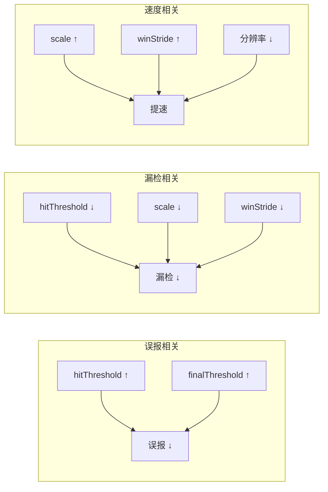
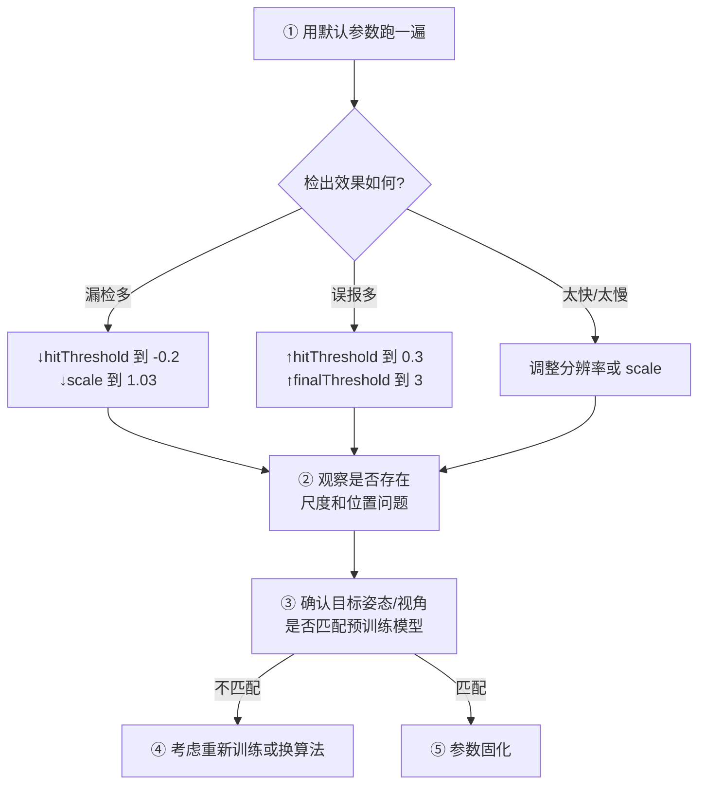
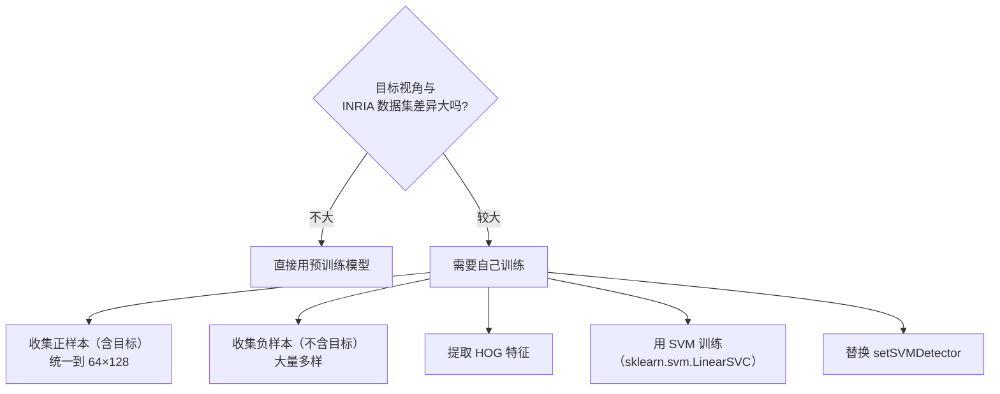
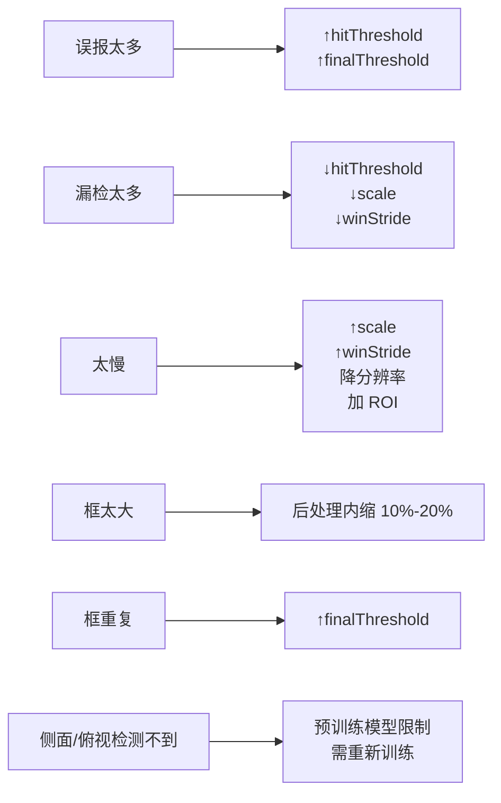

# HOG+SVM 调参技巧

> HOG+SVM 的参数分两类：**特征参数**（怎么描述）和**检测参数**（怎么搜索）。这一页讲清楚怎么定。

## 参数总览

### 特征参数（HOGDescriptor 构造时）

```python
hog = cv2.HOGDescriptor(
    _winSize=(64, 128),        # 检测窗口大小
    _blockSize=(16, 16),       # block 大小
    _blockStride=(8, 8),       # block 步长
    _cellSize=(8, 8),          # cell 大小
    _nbins=9,                  # 方向 bin 数
    _derivAperture=1,
    _winSigma=-1,
    _histogramNormType=0,      # L2-Hys
    _L2HysThreshold=0.2,
    _gammaCorrection=True,
    _nlevels=64,
    _signedGradient=False
)
```

### 检测参数（detectMultiScale 时）

```python
rects, weights = hog.detectMultiScale(
    img,
    hitThreshold=0,            # 判定阈值
    winStride=(8, 8),          # 滑窗步长
    padding=(32, 32),          # 边缘填充
    scale=1.05                 # 尺度缩放因子
)
```

## 特征参数详解

### winSize（检测窗口）

**方向**：必须**匹配目标的宽高比**。

| 目标 | 建议窗口 |
|---|---|
| 直立行人 | **64×128**（论文标准，比例 1:2） |
| 上半身 | 64×64 |
| 车辆（正面） | 96×48 或 128×64 |
| 人头 | 32×32 或 48×48 |

::: warning 不要随便改
改 `winSize` 就**必须重新训练 SVM**（因为特征维度变了）。

OpenCV 的预训练模型只对应 **64×128**。
:::

### cellSize（cell 大小）

**方向**：**值越小 → 空间分辨率越高 → 特征维度越大 → 越慢但越精细**。

| cellSize | 效果 |
|---|---|
| 4×4 | 精细，但维度爆炸、容易过拟合 |
| **8×8** | **论文/OpenCV 默认，推荐** |
| 16×16 | 粗糙，快，细节少 |

### blockSize 与 blockStride

**方向**：**block 越大 → 归一化范围越大、越鲁棒；步长越小 → 重叠越多、维度越高**。

| 配置 | 维度（64×128 窗口） | 效果 |
|---|---|---|
| block 16×16，stride 8×8 | 3780 | **默认，推荐** |
| block 16×16，stride 16×16 | 2016 | 不重叠，快但精度略降 |
| block 32×32，stride 8×8 | 更大 | 更鲁棒但很慢 |

### nbins（方向 bin 数）

| nbins | 效果 |
|---|---|
| 6 | 粗糙，快 |
| **9** | **论文最优，推荐** |
| 12 | 更精细，略慢，收益不明显 |

### L2HysThreshold（截断阈值）

| 取值 | 效果 |
|---|---|
| 0.1 | 更严格截断，抑制强边缘更强 |
| **0.2** | **论文/OpenCV 默认** |
| 0.5 | 宽松，接近不做截断 |

::: tip 一般不用改
**保持 0.2**。这个值在论文里做过实验对比。
:::

## 检测参数详解（更重要）

### hitThreshold（判定阈值）

**方向**：**值越大 → 判定越严 → 误报少但漏检多**。

| 取值 | 效果 | 适用 |
|---|---|---|
| -0.5 | 很宽松 | 高召回（会误报） |
| **0.0** | **默认** | 平衡 |
| 0.3–0.5 | 严格 | 低误报（精度优先） |
| 1.0+ | 很严格 | 只检最确信的 |

::: tip 实践建议
- **先试默认 0.0**，看误报情况
- 误报太多 → 上调到 0.3 或 0.5
- 漏检太多 → 下调到 -0.2
:::

### winStride（滑窗步长）

**方向**：**值越小 → 滑窗越密 → 覆盖越全 → 越慢**。

| 取值 | 效果 | 速度 |
|---|---|---|
| (4, 4) | 极密，几乎不漏 | 很慢（4×） |
| **(8, 8)** | **推荐** | 正常 |
| (16, 16) | 稀疏，可能漏检 | 快（4×） |

::: tip 默认用 (8, 8)
这是 HOG 论文和 OpenCV 的默认值，对应「block 步长」，让滑窗正好移动一个 cell。
:::

### padding（边缘填充）

**作用**：给图像边缘补像素，让检测窗口能覆盖到图像边界附近的目标。

| 取值 | 效果 |
|---|---|
| (0, 0) | 边缘附近的目标可能漏检 |
| **(32, 32)** | **推荐**（等于半个窗口大小） |
| (64, 64) | 更宽松，略慢 |

### scale（尺度缩放因子）

**方向**：**值越小 → 尺度越多 → 越不容易漏 → 越慢**。

| 取值 | 速度 | 效果 |
|---|---|---|
| 1.02 | 很慢 | 几乎不漏 |
| **1.05** | **推荐** | 平衡 |
| 1.1 | 快 | 可能漏小目标 |
| 1.2 | 很快 | 明显漏检 |

::: tip 为什么 1.05 是黄金值
每层缩放 5%，意味着一个 64 px 高的目标，从「正好匹配窗口」到「缩小到下一个尺度」大约需要 14 层。

这个密度足够覆盖所有尺寸，同时层级数不会过多。**这是 OpenCV 默认值和社区共识**。
:::

### finalThreshold（框合并阈值）

**作用**：控制 NMS 合并后，一个位置至少要有多少个重叠框才保留。

| 取值 | 效果 |
|---|---|
| 0 | 不合并（框很多很乱） |
| **2.0** | **推荐**（至少 2 个重叠框才保留） |
| 3.0 | 更严格，框更少 |

## 参数与效果关系图



## 一个完整的调参流程



## 不同场景参数起点

| 场景 | hitThreshold | winStride | scale | 分辨率 | 说明 |
|---|---|---|---|---|---|
| 监控（高召回） | -0.2 | (8,8) | 1.03 | 640×480 | 宁可误报不能漏 |
| 门禁（高精度） | 0.5 | (8,8) | 1.05 | 480×360 | 宁可漏报不能误报 |
| 辅助驾驶 | 0.0 | (8,8) | 1.05 | 720p | 需平衡 |
| 离线分析 | -0.5 | (4,4) | 1.02 | 原始 | 精度优先，慢无所谓 |
| 嵌入式 | 0.3 | (16,16) | 1.1 | 320×240 | 算力有限 |

## 预训练模型的使用边界

::: warning OpenCV 预训练行人检测器的局限性
`HOGDescriptor_getDefaultPeopleDetector()` 是**用 INRIA 数据集训练的**：

- 训练样本：**正面/背面视角的直立行人**
- 图像尺寸：**64×128**
- 场景：**户外、白天**

**所以它只适合**：
- 平视（相机水平或略俯）
- 直立行走的行人
- 白天户外

**不适合**：
- 俯视（如商场天花板摄像头）
- 侧面快速移动
- 蹲坐、弯腰、奔跑
- 夜间
:::

### 什么时候需要重新训练



### 重新训练的最小示例

```python
import cv2
import numpy as np
from sklearn.svm import LinearSVC

# ① 准备数据
#    positives: 目标样本（已 resize 到 64×128 的灰度图）
#    negatives: 背景样本（尺寸随便，随机裁剪出 64×128 窗口）
hog = cv2.HOGDescriptor()

def extract_features(images):
    feats = []
    for img in images:
        img = cv2.resize(img, (64, 128))
        f = hog.compute(img)
        feats.append(f.flatten())
    return np.array(feats)

X_pos = extract_features(positives)   # 正样本
X_neg = extract_features(negatives)   # 负样本

X = np.vstack([X_pos, X_neg])
y = np.hstack([np.ones(len(X_pos)), -np.ones(len(X_neg))])

# ② 训练
clf = LinearSVC(C=0.01, max_iter=10000)
clf.fit(X, y)

# ③ 取出权重，设置为检测器
#    注意：setSVMDetector 需要 [权重..., 偏置] 的形式
svm_vec = np.hstack([clf.coef_.ravel(), clf.intercept_]).astype(np.float32)
hog.setSVMDetector(svm_vec)
```

::: danger 训练注意事项
1. **正样本必须统一到 64×128**（或者你的 `winSize`）
2. **负样本要"困难负样本"**——从容易误检的区域里挖出来的才有用
3. **C 参数要小**（0.01 左右）——HOG 维度高，容易过拟合
4. **硬负样本挖掘（hard negative mining）**：用初版模型到处检测，把误检的框加入负样本重训，反复几轮
:::

## 调参速查表



## 参数调整的影响矩阵

| 参数 | ↑ 增大 | 影响 |
|---|---|---|
| `hitThreshold` | | 误报↓ 漏检↑ |
| `winStride` | | 速度↑ 漏检↑ |
| `scale` | | 速度↑ 漏检↑ |
| `finalThreshold` | | 框数↓ 可能漏 |
| `cellSize` | | 维度↓ 细节↓ |
| `nbins` | | 维度↑ 精度略↑ |
| `padding` | | 边界覆盖↑ 速度↓ |

## 最后一句建议

::: tip 调参优先级
1. **先确认目标是否匹配预训练模型**（视角、姿态、比例）——不匹配就该重训，别死调参数
2. **再定分辨率**（直接影响速度）
3. **然后调 scale 和 winStride**（速度与召回平衡）
4. **最后调 hitThreshold 和 finalThreshold**（精度与误报平衡）
5. **特征参数（cellSize、nbins、blockSize）默认就好**
:::
