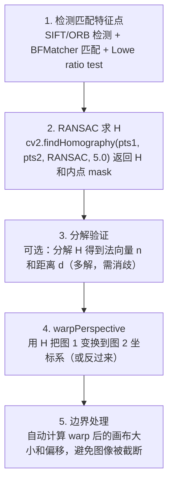

# 单应矩阵 · 算法流程

<AlgorithmCard
  name="单应矩阵"
  enName="Homography Matrix H"
  chapter="ch-14-3d-vision"
  branch="geometry"
  year="传统几何"
  author="射影几何经典"
  paper="—"
  level="mid"
  tagline="一个 3×3 矩阵搞定「一个平面」在两张图之间的映射，4 对点就能求，文档扫描和全景拼接的灵魂"
  analogy="你把手机对着一张纸拍斜了，单应矩阵就像一个拉正的魔法：告诉它纸的四个角应该在什么位置，它就能把整张纸拉正成矩形——就像你从正上方拍的一样"
  scene="文档扫描/矫正、逆透视变换 IPM（车道鸟瞰）、AR 平面跟踪、全景拼接（纯旋转）、张正友标定、图像配准"
  :pros='["数学简洁(8自由度)", "4对点可求", "OpenCV一行findHomography", "应用极广", "RANSAC鲁棒"]'
  :cons='["仅平面/纯旋转成立", "有深度差时错位", "点共线退化", "warpPerspective易出画布", "DLT需归一化"]'
/>

## 完整算法流程

单应矩阵算法可以分解为以下关键步骤：

## 步骤详解

### 步骤 1：检测匹配特征点

SIFT/ORB 检测 + BFMatcher 匹配 + Lowe ratio test

### 步骤 2：RANSAC 求 H

cv2.findHomography(pts1, pts2, RANSAC, 5.0) 返回 H 和内点 mask

### 步骤 3：分解验证

可选：分解 H 得到法向量 n 和距离 d（多解，需消歧）

### 步骤 4：warpPerspective

用 H 把图 1 变换到图 2 坐标系（或反过来）

### 步骤 5：边界处理

自动计算 warp 后的画布大小和偏移，避免图像被截断

## 在整体视觉 pipeline 中的位置

### 关键复杂度

| 维度 | 复杂度 |
|---|---|
| 时间 | 详见各实现 |
| 内存 | 与图像尺寸线性相关 |

