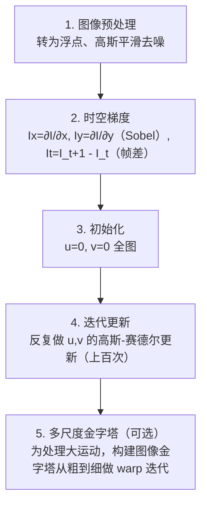

# Horn-Schunck 稠密光流 · 算法流程

<AlgorithmCard
  name="Horn-Schunck 稠密光流"
  enName="Horn-Schunck Optical Flow"
  chapter="ch-13-motion-analysis"
  branch="geometry"
  year="1981"
  author="Berthold Horn / Brian Schunck"
  paper="paper-horn-schunck-1981"
  level="advanced"
  tagline="给光流加全局平滑约束，用变分法求每个像素运动，开创稠密光流学派"
  analogy="LK 光流像独立办案的刑警，每个小窗口自己算自己的；Horn-Schunck 像一个总指挥，要求所有像素运动方向差不多，全局求解出密密麻麻的运动箭头图"
  scene="稠密运动场估计、流体运动分析、医学影像序列、变分光流研究基准、视频慢动作插帧（传统方法）"
  :pros='["稠密输出(每像素)", "全局一致平滑", "变分学派开创者", "理论优美", "基准方法"]'
  :cons='["迭代慢", "大运动不适用(需金字塔)", "运动边界过度平滑", "亮度恒定假设苛刻", "工程上Farneback/DIS更常用"]'
/>

## 完整算法流程

Horn-Schunck 稠密光流算法可以分解为以下关键步骤：

## 步骤详解

### 步骤 1：图像预处理

转为浮点、高斯平滑去噪

### 步骤 2：时空梯度

Ix=∂I/∂x, Iy=∂I/∂y（Sobel）, It=I_t+1 - I_t（帧差）

### 步骤 3：初始化

u=0, v=0 全图

### 步骤 4：迭代更新

反复做 u,v 的高斯-赛德尔更新（上百次）

### 步骤 5：多尺度金字塔（可选）

为处理大运动，构建图像金字塔从粗到细做 warp 迭代

## 在整体视觉 pipeline 中的位置

### 关键复杂度

| 维度 | 复杂度 |
|---|---|
| 时间 | 详见各实现 |
| 内存 | 与图像尺寸线性相关 |

