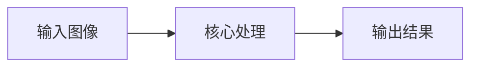
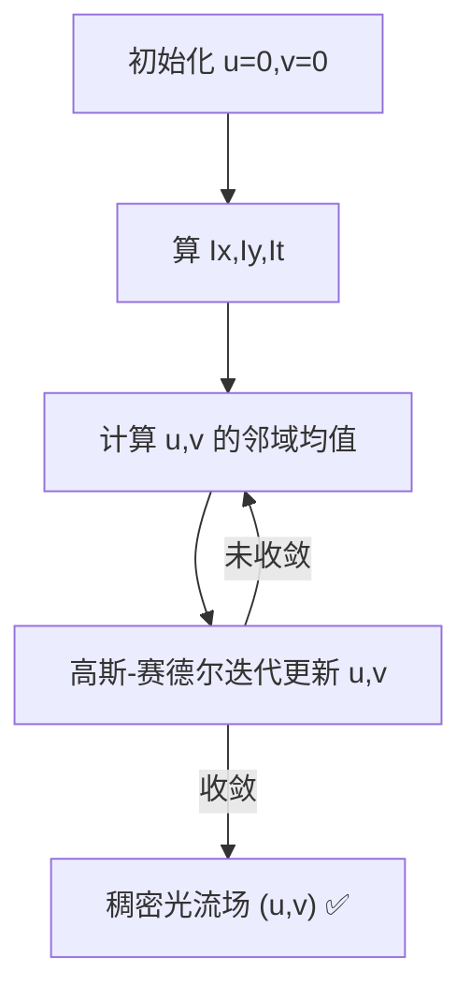

# Horn-Schunck 稠密光流 · 核心概念

<AlgorithmCard
  name="Horn-Schunck 稠密光流"
  enName="Horn-Schunck Optical Flow"
  chapter="ch-13-motion-analysis"
  branch="geometry"
  year="1981"
  author="Berthold Horn / Brian Schunck"
  paper="paper-horn-schunck-1981"
  level="advanced"
  tagline="给光流加全局平滑约束，用变分法求每个像素运动，开创稠密光流学派"
  analogy="LK 光流像独立办案的刑警，每个小窗口自己算自己的；Horn-Schunck 像一个总指挥，要求所有像素运动方向差不多，全局求解出密密麻麻的运动箭头图"
  scene="稠密运动场估计、流体运动分析、医学影像序列、变分光流研究基准、视频慢动作插帧（传统方法）"
  :pros='["稠密输出(每像素)", "全局一致平滑", "变分学派开创者", "理论优美", "基准方法"]'
  :cons='["迭代慢", "大运动不适用(需金字塔)", "运动边界过度平滑", "亮度恒定假设苛刻", "工程上Farneback/DIS更常用"]'
/>

🧪 公式看不懂？去 <a href="/math-lab/">原理实验室</a> 拖动滑块直观体验卷积/梯度/高斯/霍夫/角点/RANSAC/光流等核心概念；看完原理再去本页底部 <a href="./source">源码/真机实验室</a> 亲手调参数。

## Horn-Schunck 稠密光流的核心思想

给光流加全局平滑约束，用变分法求每个像素运动，开创稠密光流学派。LK 光流像独立办案的刑警，每个小窗口自己算自己的；Horn-Schunck 像一个总指挥，要求所有像素运动方向差不多，全局求解出密密麻麻的运动箭头图

**生活类比**：LK 光流像独立办案的刑警，每个小窗口自己算自己的；Horn-Schunck 像一个总指挥，要求所有像素运动方向差不多，全局求解出密密麻麻的运动箭头图

**典型应用**：稠密运动场估计、流体运动分析、医学影像序列、变分光流研究基准、视频慢动作插帧（传统方法）

## 核心概念详解

### 概念1：亮度恒定+小运动+空间平滑

同一点亮度不变 I(x,y,t)=I(x+u,y+v,t+1)，小运动允许泰勒展开 I_x·u+I_y·v+I_t=0，空间平滑要求相邻像素 (u,v) 差不多。

### 概念2：能量函数

HS 定义能量：$E = \int\int (I_x u+I_y v+I_t)^2 + \alpha^2(||\nabla u||^2 + ||\nabla v||^2) dxdy$。第一项是亮度恒定误差（数据项），第二项是平滑约束（正则项），α 控制平滑强度。

### 概念3：欧拉-拉格朗日方程

对能量函数求变分等于零，得到两个耦合的偏微分方程，用迭代方法（高斯-赛德尔迭代）求解：$u^{k+1}=\bar{u}^k - I_x(I_x\bar{u}^k+I_y\bar{v}^k+I_t)/(α²+I_x²+I_y²)$，v 类似。

### 概念4：α 参数

α 越大，平滑项权重越大，光流越平滑但边界越糊；α 越小，数据项主导，光流越锐利但越噪。α² 取 100（α=10）左右是常见选择。

### 概念5：与 LK 的区别

LK 是局部方法（窗口内常数流），HS 是全局方法（全图平滑）；LK 产稀疏流（只在角点），HS 产稠密流（每像素）；LK 线性方程直接解，HS 迭代求解。

---

## 🧪 原理可视化

看不懂上面的公式？下面这个互动组件把「Lucas-Kanade 光流」画出来了——拖动滑块，看每一步怎么算。

<ClientOnly>
  <MathVisualizer initial-tab="lk" compact />
</ClientOnly>

> 想看它在真实照片上的实际效果？回到 [本算法首页](./index) 或去 [🎮 真机实验室](/playgrounds/)。
