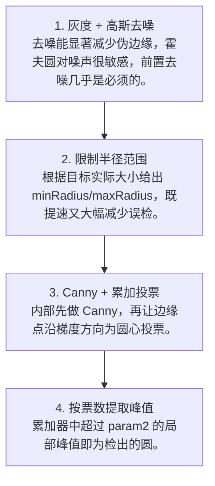

# 第 4 页 · 算法架构

## 完整流程图

## 每一步在做什么

### 步骤 1：灰度 + 高斯去噪

去噪能显著减少伪边缘，霍夫圆对噪声很敏感，前置去噪几乎是必须的。

### 步骤 2：限制半径范围

根据目标实际大小给出 minRadius/maxRadius，既提速又大幅减少误检。

### 步骤 3：Canny + 累加投票

内部先做 Canny，再让边缘点沿梯度方向为圆心投票。

### 步骤 4：按票数提取峰值

累加器中超过 param2 的局部峰值即为检出的圆。

## 在整体视觉管线中的位置

## 复杂度分析

时间复杂度与图像尺寸、半径搜索范围、dp 密切相关，通常 O(W·H·n_r)；空间复杂度即累加器大小 O(W/authH/r_range)。

## 参数总览（论文建议 vs OpenCV 默认 vs 实战推荐）

| 参数 | 含义 | 论文建议 | OpenCV 默认 | 实战推荐 |
|------|------|----------|-------------|----------|
| dp | 累加器分辨率倒数 | 1 | 1.0 | ****1.2~1.5**（提速）** |
| minDist | 圆心间最小距离 | — | 图像高度/8 | **按目标间距设** |
| param1 | Canny 高阈值 | — | 100 | **按边缘质量 50~200** |
| param2 | 圆心累加阈值 | — | 100 | ****越小越灵敏、易误检**** |
| minRadius | 最小半径 | — | 0 | **按目标约束收紧** |
| maxRadius | 最大半径 | — | 0 | ****一定要填，否则极慢**** |

## 边界情况与失败模式

- **不限制半径导致奇慢**：minRadius/maxRadius 留 0 会让搜索范围爆炸，1080p 图可能跑几秒。
- **param2 太小**：圆心阈值过低会把噪声聚成一堆假圆。
- **同心圆只检出一个**：多个圆共用圆心时，minDist 会把其余圆抑制掉。
- **边缘断裂检不出**：圆被遮挡超过一半时投票不足，检测失败。
