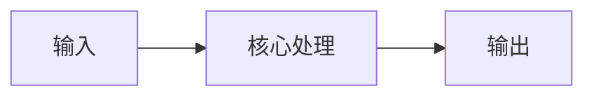
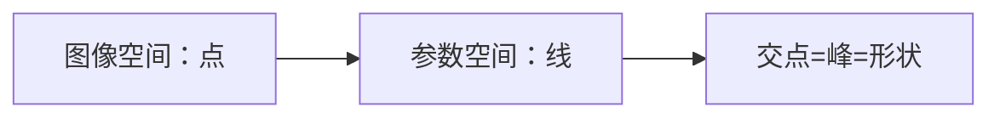
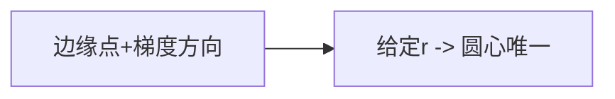

# 第 3 页 · 核心概念

🧪 公式看不懂？去 <a href="/math-lab/">原理实验室</a> 拖动滑块直观体验卷积/梯度/高斯/霍夫/角点/RANSAC/光流等核心概念；看完原理再去本页底部 <a href="./source">源码/真机实验室</a> 亲手调参数。

## 先用生活直觉理解

想象一群萤火虫在黑暗里飞成一个圆。每只萤火虫都说「我在圆上」，于是每只都在纸上以自己为圆心、按可能半径画一圈虚线。所有虚线交汇最多的那个点，就是真正的圆心——霍夫变换就是「集体投票定圆心」。

**典型应用**：硬币/零件计数、虹膜定位、仪表盘指针圆盘、交通标志检测、细胞计数

## 概念逐个拆解

### 概念 1：参数空间与投票

图像空间里一条直线上的无数点，在参数空间里对应同一个参数点。霍夫变换就是把「找形状」变成「找票数峰值」。

### 概念 2：圆的参数空间是三维的

圆心 (a, b) 加半径 r 共三个参数，理论上要建三维累加器，内存和耗时都大。

### 概念 3：梯度方向降维

圆的边缘梯度方向恰好指向圆心。知道方向和半径，圆心唯一确定——于是三维降到「只遍历半径」的二维。

### 概念 4：累加器阈值

param2 就是「多少票才算圆」。票多=真圆，票少=噪声。它是灵敏度和误检率的总开关。

## 和其他算法的关系

| 关系 | 算法 | 说明 |
|------|------|------|
| 前置依赖 | Canny 边缘检测、高斯去噪 | 通常先做这些再做本算法 |
| 同类对比 | 霍夫直线变换、轮廓拟合 | 解决同类问题，各有取舍 |
| 下游常用 | 圆心排序、计数统计、姿态估计 | 本算法结果常交给它们处理 |

::: tip 记忆锚点
记住「霍夫圆是三维投票（a, b, r），靠梯度信息把三维降到二维」。
:::
