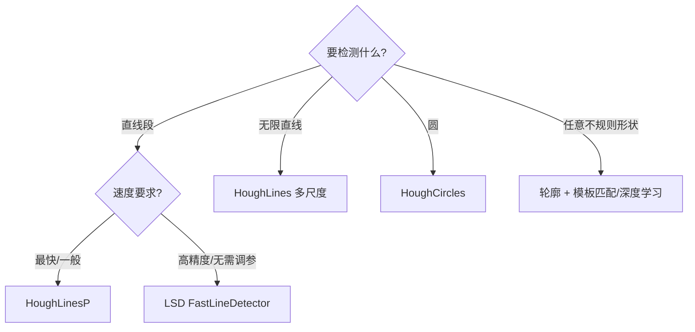
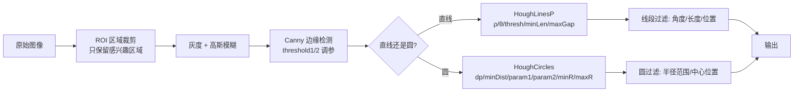

# 算法流程 · 霍夫变换

> 先把标准 HT / PPHT / 圆霍夫三种流程画清楚，再给可运行的最小实现。

## 一、标准霍夫线变换 SHT（Duda-Hart 1972）

### 流程图

```mermaid
flowchart TB
  S([输入图像]) --> G[转灰度]
  G --> C[Canny 边缘检测<br/>得到二值边缘图 E]
  C --> I[初始化累加器<br/>A[rho_bins, theta_bins] = 0]
  I --> L{遍历每个<br/>边缘点 (x,y)}
  L --> T{遍历每个<br/>θ_k}
  T --> R[计算 ρ_k = x cos θ_k + y sin θ_k]
  R --> V[A[rho_idx, k]++]
  V --> T
  T -->|θ 遍历完| L
  L -->|点遍历完| N[找 A 的局部极大值<br/>阈值 > T]
  N --> NM[NMS 邻域抑制]
  NM --> O([输出直线 (ρ, θ)])
```

### 步骤拆解

**Step 1：预处理**
- 转灰度
- 高斯模糊（可选，抗噪）
- Canny 得二值边缘图（这一步非常关键，见 [踩坑](/algorithms/hough/painpoints)）

**Step 2：初始化累加器**
```
ρ_max = √(W² + H²)          # 图像对角线长度
ρ_bins = ceil(2 * ρ_max / Δρ)  # Δρ=1 时就是 2*ρ_max
θ_bins = ceil(π / Δθ)       # Δθ=π/180 时就是 180
A = zeros(ρ_bins, θ_bins)
```

**Step 3：投票（核心）**
```python
for y, x in np.argwhere(edges > 0):      # 每个边缘点
    for k, theta in enumerate(thetas):
        rho = x * cos(theta) + y * sin(theta)
        rho_idx = int(round(rho + rho_max))
        if 0 <= rho_idx < rho_bins:
            A[rho_idx, k] += 1
```

**Step 4：找峰值**
- 遍历累加器，找超过阈值 T 的 cell
- NMS：每个峰值周围 (2k+1)×(2k+1) 邻域内只保留最大值
- 输出每个保留的峰值 $(\rho, \theta)$

### 复杂度

| 项 | 复杂度 | 备注 |
|---|---|---|
| 投票主循环 | $O(N_\text{edges} \cdot N_\theta)$ | $N_\theta$ 通常 180 |
| 峰值搜索 | $O(\rho_\text{bins} \cdot \theta_\text{bins})$ | 通常 $O(W \cdot H)$ |
| 典型 1080p 图像 | 边缘点 ~10 万，$N_\theta$=180 | 1800 万次累加 |

## 二、渐进概率霍夫 PPHT（OpenCV HoughLinesP）

### 流程图

```mermaid
flowchart TB
  S([边缘图]) --> P[建立边缘点池 List]
  P --> E{池空?}
  E -->|是| OUT([输出所有线段])
  E -->|否| R[随机抽一个点 p<br/>从池移除]
  R --> V[p 对累加器 A 投票]
  V --> T{存在 bin<br/>票数 >= 阈值?}
  T -->|否| E
  T -->|是| W[沿 (ρ,θ) 方向<br/>从 p 沿直线边缘行走]
  W --> EP[寻找最长线段段<br/>记录两端点 pt1, pt2]
  EP --> RM[把线段上所有边缘点<br/>从池和累加器移除]
  RM --> ADD[把线段 (pt1,pt2)<br/>加入输出列表]
  ADD --> E
```

### 关键差异

| 项 | SHT | PPHT |
|---|---|---|
| 是否遍历所有点 | 是 | **随机采样**，用完移除 |
| 何时输出 | 全部投票完才找峰值 | **边投票边输出** |
| 输出 | 无限长直线 (ρ,θ) | **直线段两端点** |
| 速度 | 慢 | **快 5–10 倍** |
| 假阳性 | 较少（统计充分）| 可能有假线段，需要后处理 |
| OpenCV 函数 | `HoughLines` | **`HoughLinesP`（首选）** |

### PPHT 额外参数（仅 HoughLinesP 有）
- `minLineLength`：线段最小长度（像素），短于这个的直接丢
- `maxLineGap`：线段上允许的最大间隙（像素），两点距离小于这个就视为同一条线段

👉 **这两个参数让 PPHT 输出的是"线段"而不是"无限直线"**，工业上几乎必用。

## 三、圆霍夫变换 21HT（OpenCV HoughCircles）

### 流程图

```mermaid
flowchart TB
  S([输入灰度图]) --> BL[高斯模糊<br/>HoughCircles 内置]
  BL --> CY[Sobel 算梯度<br/>dx, dy]
  CY --> CAN[内置 Canny<br/>找边缘点]
  CAN --> A2[初始化圆心累加器<br/>A[a, b] = 0]
  A2 --> L{遍历每个<br/>边缘点 p}
  L --> N[沿梯度方向 ± 半径范围<br/>投票圆心候选点]
  N --> C[A[a,b]++]
  C --> L
  L -->|遍历完| NP[NMS 找圆心峰值<br/>阈值 = param2]
  NP --> R{遍历每个<br/>候选圆心}
  R --> RV[对该圆心<br/>在半径维投 1D 票]
  RV --> RR[找半径峰值]
  RR -->|输出圆 (a,b,r)| R
  R -->|完| OUT
```

### 2-1 HT 的关键思想

**为什么是 2D+1D 而不是 3D**：
- 圆的边缘点梯度方向**指向或背离圆心**（法线方向过圆心）
- 每个边缘点只需沿梯度方向（正反 2 条线）投票圆心候选，而不是对所有 (a,b) 投票
- 圆心确定后，再对每个边缘点算距离 = 半径，做 1D 半径直方图
- 速度比 3D 累加器快 ~50 倍

## 四、最小可运行实现（Numpy 手写标准 HT）

```python
import numpy as np
import cv2

def hough_lines_manual(edges, rho_res=1, theta_res=np.pi/180, threshold=100):
    """手写标准霍夫线变换（教学版，直观但慢）"""
    H, W = edges.shape
    rho_max = int(np.ceil(np.sqrt(H*H + W*W)))
    rhos = np.arange(-rho_max, rho_max + rho_res, rho_res)
    thetas = np.arange(-np.pi/2, np.pi/2, theta_res)

    acc = np.zeros((len(rhos), len(thetas)), dtype=np.int32)

    ys, xs = np.where(edges > 0)
    cos_t = np.cos(thetas)
    sin_t = np.sin(thetas)

    # 投票
    for x, y in zip(xs, ys):
        rho_vals = x * cos_t + y * sin_t                 # (θ_bins,)
        rho_idx = np.round(rho_vals + rho_max).astype(int)
        for k, ri in enumerate(rho_idx):
            if 0 <= ri < len(rhos):
                acc[ri, k] += 1

    # 找峰值 + 简单 NMS
    lines = []
    for ri in range(1, acc.shape[0]-1):
        for ti in range(1, acc.shape[1]-1):
            v = acc[ri, ti]
            if v >= threshold and v == acc[ri-1:ri+2, ti-1:ti+2].max():
                lines.append((rhos[ri], thetas[ti]))
    return lines

# ---- 测试 ----
img = cv2.imread("road.jpg", 0)
edges = cv2.Canny(cv2.GaussianBlur(img, (5,5), 1.0), 50, 150)
lines = hough_lines_manual(edges, threshold=100)
print(f"检测到 {len(lines)} 条直线")
```

**教学版 vs OpenCV**：
- 教学版好懂但慢（双重 Python 循环），OpenCV 用 C++ + 优化（SIMD/多线程）速度快 100 倍以上
- OpenCV `HoughLinesP` 还做了 PPHT 边投边输出 + 线段生长
- **生产环境一律用 OpenCV**，手写仅用于理解算法

## 五、OpenCV API 速查

### 5.1 标准霍夫线（返回 (ρ,θ) 无限长直线）
```python
lines = cv2.HoughLines(image=edges, rho=1, theta=np.pi/180,
                       threshold=100, srn=0, stn=0, min_theta=0, max_theta=np.pi)
# lines.shape = (N, 1, 2)，每个是 [rho, theta]
```
- `srn, stn`：多尺度霍夫时 rho/theta 的除数；0 表示经典单尺度
- 多尺度 HT：rho 在粗分辨率投票定位，再在细分辨率精化，速度更快

### 5.2 概率霍夫线段（**工业首选**）
```python
lines = cv2.HoughLinesP(image=edges, rho=1, theta=np.pi/180,
                        threshold=100, minLineLength=100, maxLineGap=10)
# lines.shape = (N, 1, 4)，每个是 [x1,y1,x2,y2]
```

### 5.3 霍夫圆（直接传灰度图，内置 Canny）
```python
circles = cv2.HoughCircles(image=gray, method=cv2.HOUGH_GRADIENT,
                           dp=1.5, minDist=30,
                           param1=100, param2=30,
                           minRadius=10, maxRadius=100)
# circles.shape = (1, N, 3)，每个是 [x, y, r]（浮点数！）
if circles is not None:
    circles = np.round(circles[0]).astype(int)
```

### 5.4 广义霍夫（OpenCV 不内置，可用 scikit-image）
```python
from skimage.transform import hough_line, hough_line_peaks, hough_circle
# skimage 的 API 是研究友好的，返回 (accumulator, angles, dists)
```

## 六、Hough 变体家族对比

| 变体 | 形状 | 输出 | 速度 | 精度 | OpenCV |
|---|---|---|---|---|---|
| 标准 HT（SHT, Duda-Hart）| 直线 | (ρ,θ) | 慢 | 中 | `HoughLines` |
| 多尺度 HT（MSHT）| 直线 | (ρ,θ) | 中 | **高** | `HoughLines(srn,stn)` |
| 概率 HT（PHT）| 直线 | (ρ,θ) | 快 | 中 | 无（PPHT 已取代）|
| **渐进概率 PPHT** | 直线段 | **(x1,y1,x2,y2)** | **最快** | 中 | **`HoughLinesP`** |
| 圆 HT（CHT, 21HT）| 圆 | (x,y,r) | 中 | 中 | `HoughCircles` |
| 椭圆 HT | 椭圆 | (cx,cy,a,b,θ) | 慢 | 低 | 无（fitEllipse 替代）|
| 广义 HT（GHT）| 任意 | 位置+尺度+角度 | 很慢 | 低 | 无 |
| **LSD**（非 Hough 类）| 直线段 | (x1,y1,x2,y2) | 快 | **高** | `ximgproc.createFastLineDetector()` |

**选型决策树**：



## 七、常见预处理管线（工业标准）



**为什么要 ROI**：
- 霍夫变换会检测图像里所有符合形状的东西，包括你不想要的背景噪点
- 例如车道线只检测图像下半部分；瓶盖检测只检测瓶子上方区域
- ROI 裁剪能把速度提升好几倍，同时假阳性大幅降低

下一章：[💻 源码走读](/algorithms/hough/source)
