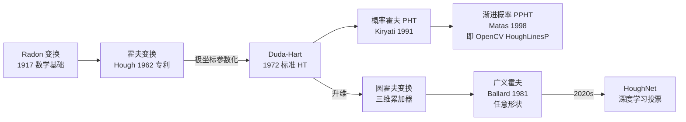

# 霍夫变换 Hough Transform (1962) · 总览

> **参数空间的「投票箱」**：图像里一条直线在原图上是斜的，但在（ρ, θ）参数空间就是一个点。让每个边缘像素给所有可能过它的直线投一票，得票最多的那几条就是真的直线。

<AlgorithmCard
  name="霍夫变换"
  enName="Hough Transform"
  year="1962"
  chapter="第4章 · 基元检测"  chapterLink="/chapters/ch04-primitives"
  branch="特征检测 / 几何基元提取"
  level="中层"
  analogy="让路口的人都给自己看到的直线投一票，最后票数最高的几条就是真的车道线"
  scene="车道线检测、圆检测、文档倾斜校正、PCB走线、瓶盖检测"
  paper="https://dl.acm.org/doi/10.1145/361237.361242"
/>

## TL;DR

| 项 | 内容 |
|---|---|
| **一句话** | 参数空间投票：每个边缘点给所有可能过它的形状投票，票多者真 |
| **解决什么** | 在有噪声、有断裂的边缘图里找出直线 / 圆 / 椭圆等几何基元 |
| **代价** | 标准霍夫线变换 $O(n_\text{edges} \cdot n_\theta)$，圆变换 $O(n_\text{edges} \cdot n_\theta \cdot n_r)$ |
| **前置阅读** | [Canny 边缘检测](/algorithms/canny/)（霍夫的输入通常是 Canny 边缘图）、[Sobel 算子](/operators/sobel/) |
| **最快上手** | `cv2.HoughLinesP(canny, 1, np.pi/180, 100, minLineLength=100, maxLineGap=10)` |

## 3 分钟电梯演讲


1. **先找边**：通常是 Canny 边缘图，不是原图。
2. **参数化**：直线用 $y = kx + b$ 参数化有斜率无穷大问题；Duda & Hart 1972 改用 **极坐标（ρ, θ）**：$x\cos\theta + y\sin\theta = \rho$，每个边缘点对应参数空间里一条正弦曲线。
3. **投票**：同一条直线上的所有边缘点会在参数空间**同一个点交汇**，累加器峰值即为直线。
4. **扩展到圆**：圆 $x^2+y^2=r^2$ 需要三维累加器 $(a,b,r)$；推广到任意形状就是**广义霍夫变换（GHT）**。

## 为什么它厉害

- **抗断裂、抗噪声**：边缘段不连续没关系，投票思想天然把"碎片"聚合成一条线。
- **不依赖连接**：Hough 不用做边缘跟踪/连通域，直接从二值边缘图出结果。
- **60 年未被淘汰**：车道线检测 ADAS 至今仍用它（HoughLinesP + 区域裁剪），它比深度学习快 100 倍、不需要训练数据。
- **几何基元通用范式**：直线→圆→椭圆→任意形状（GHT）→ 深度学习里的 Hough 投票（如 HoughNet）都沿用同一思想。

## 四层闭环视图

- **L1 论文层**：Hough 1962 专利「Method and Means for Recognizing Complex Patterns」→ [论文精读](/algorithms/hough/paper)
- **L2 理论层**：ρ-θ 参数化、累加器投票、Duda-Hart 极坐标改进、概率霍夫、广义霍夫 → [核心概念](/algorithms/hough/concepts)
- **L3 实现层**：标准 HT / SHT、多尺度 HT、概率 PHT、渐进概率 PPHT、圆 Hough、椭圆 Hough、广义 GHT → [算法流程](/algorithms/hough/architecture)
- **L4 实战层**：车道线、文档倾斜、PCB 直线、瓶盖检测、瞳孔定位 → [源码走读](/algorithms/hough/source) · [踩坑指南](/algorithms/hough/painpoints) · [调参技巧](/algorithms/hough/tricks)

## 核心贡献（含代码落点）

| 贡献 | 说明 | 代码中 |
|---|---|---|
| 参数空间投票 | 把图像空间的形状检测转成参数空间累加器峰值搜索 | `accumulator[rho_idx, theta_idx] += 1` |
| 极坐标参数化（Duda-Hart 1972） | 解决了 y=kx+b 的垂直直线问题 | `rho = x*cosθ + y*sinθ` |
| 累加器非极大抑制 | 同一条直线附近会有多个峰值，需要 NMS | `cv2.HoughLines` 内置 / 手写局部极大 |
| 概率霍夫 PHT（Kiryati 1991）/ PPHT（Matas 1998） | 不遍历所有边缘点，随机采样 + 直线生长，速度快一个数量级 | `cv2.HoughLinesP` |
| 圆霍夫变换 | 用三维累加器 (a,b,r) 检测圆；OpenCV HoughCircles 用梯度方向降维 | `cv2.HoughCircles` |
| 广义霍夫变换 GHT（Ballard 1981） | R-table 查表实现任意形状投票 | 需手写或用 scikit-image |

## 快速上手（5 行）

```python
import cv2, numpy as np
img = cv2.imread("road.jpg")
gray = cv2.cvtColor(img, cv2.COLOR_BGR2GRAY)
edges = cv2.Canny(gray, 50, 150, apertureSize=3)
lines = cv2.HoughLinesP(edges, 1, np.pi/180, threshold=100,
                        minLineLength=150, maxLineGap=10)
for (x1,y1,x2,y2), in lines:
    cv2.line(img, (x1,y1), (x2,y2), (0,255,0), 2)
cv2.imwrite("result.jpg", img)
```

## 它在家族里的位置



## 什么时候用 / 不该用

| ✅ 该用霍夫 | ❌ 别用霍夫 |
|---|---|
| 找直线、圆、椭圆等**已知形状** | 找任意不规则轮廓（用轮廓查找 + 模板匹配）|
| 边缘有断裂/噪声、不连续 | 直线已被形态学闭合、连通域就能直接拿 |
| 实时性要求极高（车道线、嵌入式）| 需要语义理解（哪条是车道线、哪条是电线杆影子）|
| 边缘密度适中 | 边缘图满屏噪点（先优化 Canny 参数）|
| 无训练数据可用 | 有大量标注数据、可用深度学习 |

## 跟其他直线/圆检测的选型

| 算法 | 形状 | 速度 | 抗噪 | 备注 |
|---|---|---|---|---|
| **HoughLines（SHT）** | 直线（无限长）| 慢 | 中 | 返回 (ρ,θ)，无端点 |
| **HoughLinesP（PPHT）** | 直线段 | **快** | 中 | **工业首选**，返回两端点 |
| **HoughCircles** | 圆 | 中 | 中 | 内置 Canny + 梯度投票 |
| **fitLine（最小二乘）** | 直线 | 极快 | 差 | 需先把点分组，外点敏感 |
| **LSD（Von Gioi 2010）** | 直线段 | 快 | **强** | 无需调参，OpenCV `cv2.ximgproc.createFastLineDetector` |
| **轮廓拟合** | 任意形状 | 快 | 弱 | 依赖边缘连通性 |

👉 工业默认：**Canny → HoughLinesP（直线）/ HoughCircles（圆）**；对精度/抗噪要求高时换 **LSD**。

## 下一步

- [📄 原始论文](/algorithms/hough/paper)：Hough 1962 专利 + Duda-Hart 1972 + Matas 1998 PPHT
- [💡 核心概念](/algorithms/hough/paper): [核心概念](/algorithms/hough/concepts)
- [🏗️ 算法流程](/algorithms/hough/architecture)
- [💻 源码走读](/algorithms/hough/source)
- [⚠️ 踩坑指南](/algorithms/hough/painpoints)
- [🎛️ 调参技巧](/algorithms/hough/tricks)
