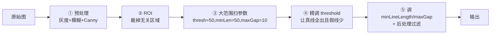
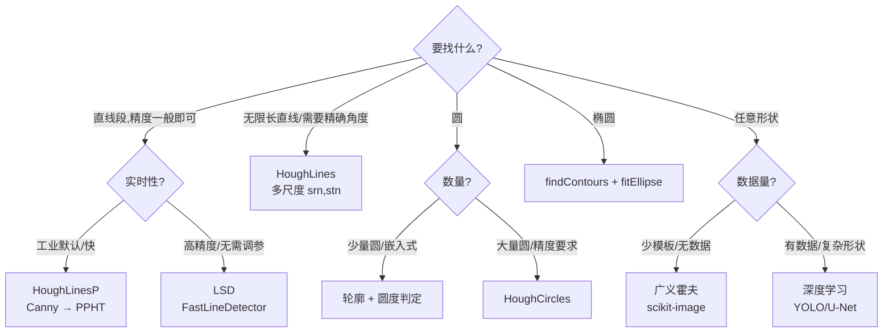

# 调参技巧 · 霍夫变换

> 5 步调参顺序 + 7 个工业场景抄作业参数 + 速度/精度优化 + 选型决策。

## 一、5 步调参顺序（直线 HoughLinesP）

永远按这个顺序调，乱调容易把问题搞复杂：



### Step 1：预处理（**这步最关键！**）
先把 Canny 调对，再谈 Hough：
```python
gray = cv2.cvtColor(img, cv2.COLOR_BGR2GRAY)
blur = cv2.GaussianBlur(gray, (5,5), sigmaX=1.0)
edges = cv2.Canny(blur, threshold1=50, threshold2=150, apertureSize=3)
# 单独看 edges，必须：真线连续、背景干净
cv2.imshow("edges", edges)
```
- Canny 阈值常见起点：低=50、高=150；对比度低的图降为 (30, 100)；对比度高升为 (80, 200)
- 模糊核 3×3 或 5×5；噪声多的视频用 5×5
- 光圈孔径 apertureSize=3 默认；想要更平滑的边缘用 5

### Step 2：ROI 裁剪
把感兴趣区域单独 mask 出来，速度和精度都大幅提升。

### Step 3：粗扫参数
先用默认值跑一次：
```python
lines = cv2.HoughLinesP(edges, rho=1, theta=np.pi/180,
                        threshold=50, minLineLength=50, maxLineGap=10)
```

### Step 4：精调 threshold
- **真线没出** → 调低 threshold（每次 -10）
- **假线太多** → 调高 threshold（每次 +10），同时看是否要提高 Canny 高阈值
- threshold 范围参考：30（宽松）/ 50（通用）/ 100（严格）/ 200（只保留很长很强的线）

### Step 5：调 minLineLength + maxLineGap
- **短噪声线段多** → minLineLength 调大（+20）
- **长直线被截成多段** → maxLineGap 调大（+5）
- **断裂处连错** → maxLineGap 调小（-5）

### 最后：后处理
角度/长度/位置过滤 + NMS 去重（详见 [踩坑](/algorithms/hough/painpoints)）。

## 二、圆检测 5 步调参（HoughCircles）


**起点参数**：
```python
circles = cv2.HoughCircles(gray, cv2.HOUGH_GRADIENT,
                           dp=1.2, minDist=50,
                           param1=100, param2=35,
                           minRadius=20, maxRadius=80)
```

调法：
1. **先把 minRadius/maxRadius 范围缩小**（这是提速和减少假圆最有效的方法）
2. **minDist = 典型直径**（避免同圆多次检出）
3. **param2 从 50 开始往下调**：50 没圆 → 40 → 30 → 20，直到真圆全出且假圆可接受
4. **param1 = Canny 高阈值**：边缘少/模糊 → 降到 70；边缘多/噪点多 → 升到 150
5. **dp=1** 精细、dp=2 快而粗，实时场景用 1.5

## 三、7 个场景参数抄作业表

### ① 车道线检测（1080p 前视摄像头，白天）
```python
# HoughLinesP
rho=1, theta=π/180,
threshold=50, minLineLength=80, maxLineGap=30
# 配合：
#   ROI 只保留下半部分梯形
#   Canny(50, 150)
#   后处理：按斜率分左右车道，角度 20°–70°
#   RANSAC/均值拟合左右车道线
```

### ② 文档倾斜校正（扫描 A4）
```python
# HoughLinesP
rho=1, theta=π/180,
threshold=200, minLineLength=300, maxLineGap=5
# 配合：
#   大阈值 + 长线段 → 只保留文档长边界
#   角度在 [-30°, 30°] 之间（因为倾斜不会太大）
#   用中位数角度旋转（避免异常值影响）
```

### ③ PCB 走线检测（高对比度二值图）
```python
# HoughLinesP
rho=1, theta=π/180,
threshold=30, minLineLength=20, maxLineGap=3
# 配合：
#   先二值化 + 细化（thinning）
#   量化到 0°/45°/90°/135° 四方向
#   maxLineGap 要小（走线不会断）
```

### ④ 瓶盖/圆零件计数（传送带，工业相机）
```python
# HoughCircles
method=HOUGH_GRADIENT, dp=1.0, minDist=60,
param1=80, param2=30,
minRadius=25, maxRadius=40
# 配合：
#   medianBlur(5) 抗椒盐
#   传送带上区域 ROI（避免背景圆干扰）
#   半径范围根据实际瓶盖大小调
```

### ⑤ 瞳孔/虹膜检测（近红外摄像头）
```python
# HoughCircles
method=HOUGH_GRADIENT, dp=1.5, minDist=200,   # 只可能有一个瞳孔
param1=50, param2=25,
minRadius=20, maxRadius=50
# 配合：
#   只检测人脸 ROI 中心区域
#   直方图均衡化（CLAHE）增强对比度
#   param2 较小（瞳孔边缘对比度弱）
```

### ⑥ 硬币/球类计数（日常照片）
```python
# HoughCircles
method=HOUGH_GRADIENT, dp=1.2, minDist=50,
param1=100, param2=40,
minRadius=20, maxRadius=80
# 配合：
#   medianBlur(5)
#   按半径区分面值（1元/5角/1角半径不同）
```

### ⑦ 嵌入式/实时（树莓派/OpenMV）
```python
# HoughLinesP（降分辨率到 320×240）
rho=1, theta=π/180,
threshold=30, minLineLength=30, maxLineGap=5
# 或直接用 LSD（OpenMV find_lines() 内置，无需调 threshold）
# HoughCircles 在 MCU 上太慢，建议用轮廓+圆度判定替代
```

## 四、速度优化清单

| 优化手段 | 速度提升 | 精度影响 |
|---|---|---|
| **ROI 裁剪** | **2–10×** | 无（只要 ROI 选对）|
| 降低分辨率（640→320）| **4×** | 小目标可能漏 |
| `dp=2`（HoughCircles）| **2–3×** | 圆心半径稍粗 |
| 增大 `theta` 分辨率到 2° | **2×** | 角度精度减半 |
| 先做二值化再 Canny | 1.5× | 无 |
| 先做形态学闭运算（连接断线）| - | 减少 Hough 投票量 |
| Python → C++ | **50–100×** | 无 |
| OpenCV T-API / OpenCL | 2–5× | 无（需支持 GPU）|

### 嵌入式（OpenMV/K210）建议
- **别用霍夫变换做圆检测**：圆霍夫是 3D 累加器，MCU 跑不动；改用**轮廓查找 + 圆度（circularity）判定**：
```python
# OpenMV 伪代码
for c in img.find_contours():
    area = c.area()
    perimeter = c.perimeter()
    circularity = 4*math.pi*area/(perimeter*perimeter)
    if circularity > 0.8:   # 越接近 1 越圆
        print("circle!", c.cx(), c.cy())
```
- 直线检测优先用 **LSD**（OpenMV `img.find_lines()` 内置），比 Hough 快且不需调 threshold。

## 五、精度优化清单

| 问题 | 优化 |
|---|---|
| 直线角度不准 | theta 改为 π/360（0.5°）；多尺度 Hough(srn=10, stn=1) |
| 端点定位不准 | 线段两端沿方向延长/截短到最近边缘 |
| 重复检测 | 后处理 NMS（θ 差 < 5° 且 ρ 差 < 3 像素合并）|
| 假阳性多 | 提高 threshold/param2 + ROI + 后处理 |
| 圆心漂移 | 检测到圆后用 `cv2.fitEllipse` 或边缘点最小二乘二次拟合 |
| 半径不准 | 对候选圆心附近的边缘点做 1D 半径直方图，取峰值 |

## 六、多线拟合（比单纯 Hough 更强）

Hough 输出 N 条线段后，通常还要做**线的聚合与拟合**：

```python
def cluster_and_fit(lines, angle_thresh=5, dist_thresh=10):
    """把相似线段聚类后用最小二乘重新拟合一条直线"""
    groups = []
    for x1,y1,x2,y2 in lines:
        ang = np.degrees(np.arctan2(y2-y1, x2-x1))
        rho = x1*np.cos(np.radians(ang+90)) + y1*np.sin(np.radians(ang+90))
        matched = False
        for g in groups:
            if abs(ang - g['ang']) < angle_thresh and abs(rho - g['rho']) < dist_thresh:
                g['pts'].extend([(x1,y1),(x2,y2)])
                g['ang'] = np.mean([np.degrees(np.arctan2(y2-y1,x2-x1)) for (x1,y1),(x2,y2) in zip(g['pts'][::2],g['pts'][1::2])])
                matched = True; break
        if not matched:
            groups.append({'ang': ang, 'rho': rho, 'pts': [(x1,y1),(x2,y2)]})

    out = []
    for g in groups:
        pts = np.array(g['pts'])
        # fitLine 做最小二乘拟合，带外点剔除能力
        [vx,vy,x,y] = cv2.fitLine(pts, cv2.DIST_L2, 0, 0.01, 0.01)
        out.append((vx,vy,x,y))
    return out
```

## 七、Hough 算法选型决策树



## 八、HoughLinesP vs LSD 直线段对比

| 项 | HoughLinesP | LSD (FastLineDetector) |
|---|---|---|
| 参数 | 需要调 threshold/minLen/maxGap | **几乎无需调参** |
| 速度 | 快 | 快（略慢）|
| 精度 | 中 | **高**（亚像素级）|
| 假阳性控制 | 需自己调参 | 自动控制误检率 |
| 对断裂 | 依赖 maxLineGap 参数 | 自动处理部分断裂 |
| 抗噪 | 依赖 Canny | 自带抗噪 |
| 专利问题 | 无 | 无（原 LSD 作者专利已过期，OpenCV 实现免费）|
| 适合场景 | 车道线/ROI 内强线 | **通用场景首选** |

**LSD 调用**：
```python
lsd = cv2.ximgproc.createFastLineDetector(_length_threshold=30)
lines = lsd.detect(gray)        # 直接传灰度图，不需 Canny
result = lsd.drawSegments(img, lines)
```

👉 **经验之谈**：新项目优先试 LSD，结果不够好/需要更强控制再换回 HoughLinesP。

## 九、参数口诀（工业老法师总结）

- **Canny 先调对，Hough 不遭罪**
- **ROI 切得好，假线自然少**
- **threshold 控真假，minLen 滤碎渣**
- **maxLineGap 连断线，大了连错家**
- **圆检测中值模糊先，param2 从大往小减**
- **minDist 小于直径，同心圆叠叠现**
- **能上 LSD 不上 P，能做 ROI 不做全**
- **Hough 不是银弹，后处理才是王道**

## 十、真实调参日记示范

**场景**：传送带瓶盖计数，5MP 工业相机

**第一次**：
```python
cv2.HoughCircles(gray, HOUGH_GRADIENT, dp=1.0, minDist=20,
                 param1=100, param2=30, minRadius=10, maxRadius=100)
```
结果：检测到 82 个圆（实际 20 个），大量假圆 + 同盖被多次检出。

**诊断**：
- minDist 太小（应该 ≥ 瓶盖直径 ~60px）
- maxRadius 范围太大（瓶盖实际半径 25–32）
- 没做 ROI，背景里的螺丝也被检成圆

**第二次**：
```python
gray = cv2.medianBlur(gray, 5)
# ROI：只保留传送带区域
circles = cv2.HoughCircles(gray, HOUGH_GRADIENT, dp=1.2, minDist=70,
                           param1=80, param2=35, minRadius=24, maxRadius=35)
```
结果：21 个圆，其中 20 个真盖、1 个假圆；漏检 0 个。

**第三次**（加后处理）：
```python
valid = []
for x,y,r in circles[0]:
    if 25 <= r <= 33:                   # 半径必须在范围内
        if 100 < x < W-100 and 100 < y < H-100:   # 位置过滤
            # 检查圆边缘点实际占比
            mask = np.zeros(gray.shape, dtype=np.uint8)
            cv2.circle(mask, (x,y), r, 255, 2)
            coverage = cv2.countNonZero(cv2.bitwise_and(edges, mask)) / (2*np.pi*r)
            if coverage > 0.5:         # 圆上至少一半点是边缘
                valid.append((x,y,r))
```
结果：**20/20 全对，0 假阳**。参数保存为该机型默认配置。

---

至此，霍夫变换 7 页档案全部完成。它和已经补完的 Canny 边缘检测天然配合——**Canny 找边 → Hough 找直线/圆**，工业检测最基础也最常用的一条链路彻底打穿。

[← 返回算法总览](/algorithms/hough/)
