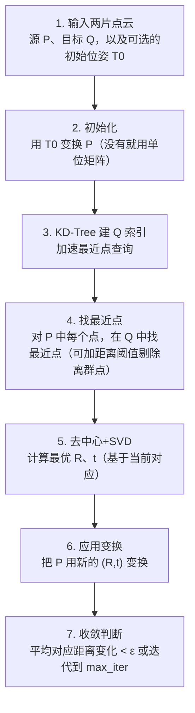

# ICP 迭代最近点 · 算法流程

<AlgorithmCard
  name="ICP 迭代最近点"
  enName="Iterative Closest Point"
  chapter="ch-14-3d-vision"
  branch="geometry"
  year="1992"
  author="Paul Besl / Neil McKay"
  paper="—"
  level="advanced"
  tagline="两片点云拼起来的经典算法：找最近点配对，算刚体变换，反复迭代到对齐"
  analogy="你拿着两张撕碎的地图，每次把一片上每个点在另一片上找最近对应，算平移旋转让它们靠近，再重新找对应点……几十次后两片就严丝合缝拼在一起了"
  scene="激光雷达点云配准、三维重建、机器人 LiDAR SLAM、多视角点云融合、医学影像配准"
  :pros='["思想简单", "任意维度适用", "无需特征提取", "Open3D/PCL高效实现", "局部收敛保证"]'
  :cons='["需要初始位姿", "对离群点敏感", "原始O(N²)慢", "重叠率要够", "点到点精度不如点到面"]'
/>

## 完整算法流程

ICP 迭代最近点算法可以分解为以下关键步骤：

## 步骤详解

### 步骤 1：输入两片点云

源 P、目标 Q，以及可选的初始位姿 T0

### 步骤 2：初始化

用 T0 变换 P（没有就用单位矩阵）

### 步骤 3：KD-Tree 建 Q 索引

加速最近点查询

### 步骤 4：找最近点

对 P 中每个点，在 Q 中找最近点（可加距离阈值剔除离群点）

### 步骤 5：去中心+SVD

计算最优 R、t（基于当前对应）

### 步骤 6：应用变换

把 P 用新的 (R,t) 变换

### 步骤 7：收敛判断

平均对应距离变化 < ε 或迭代到 max_iter

## 在整体视觉 pipeline 中的位置

### 关键复杂度

| 维度 | 复杂度 |
|---|---|
| 时间 | 详见各实现 |
| 内存 | 与图像尺寸线性相关 |

