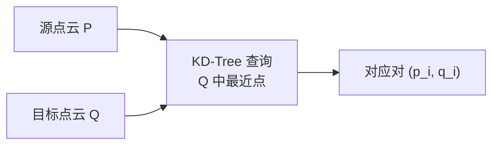

## 🧪 原理互动演示

<AlgoVisualizer type="icp" />

# ICP 迭代最近点 · 核心概念

<AlgorithmCard
  name="ICP 迭代最近点"
  enName="Iterative Closest Point"
  chapter="ch-14-3d-vision"
  branch="geometry"
  year="1992"
  author="Paul Besl / Neil McKay"
  paper="—"
  level="advanced"
  tagline="两片点云拼起来的经典算法：找最近点配对，算刚体变换，反复迭代到对齐"
  analogy="你拿着两张撕碎的地图，每次把一片上每个点在另一片上找最近对应，算平移旋转让它们靠近，再重新找对应点……几十次后两片就严丝合缝拼在一起了"
  scene="激光雷达点云配准、三维重建、机器人 LiDAR SLAM、多视角点云融合、医学影像配准"
  :pros='["思想简单", "任意维度适用", "无需特征提取", "Open3D/PCL高效实现", "局部收敛保证"]'
  :cons='["需要初始位姿", "对离群点敏感", "原始O(N²)慢", "重叠率要够", "点到点精度不如点到面"]'
/>

🧪 公式看不懂？去 <a href="/math-lab/">原理实验室</a> 拖动滑块直观体验卷积/梯度/高斯/霍夫/角点/RANSAC/光流等核心概念；看完原理再去本页底部 <a href="./source">源码/真机实验室</a> 亲手调参数。

## ICP 迭代最近点的核心思想

两片点云拼起来的经典算法：找最近点配对，算刚体变换，反复迭代到对齐。你拿着两张撕碎的地图，每次把一片上每个点在另一片上找最近对应，算平移旋转让它们靠近，再重新找对应点……几十次后两片就严丝合缝拼在一起了

**生活类比**：你拿着两张撕碎的地图，每次把一片上每个点在另一片上找最近对应，算平移旋转让它们靠近，再重新找对应点……几十次后两片就严丝合缝拼在一起了

**典型应用**：激光雷达点云配准、三维重建、机器人 LiDAR SLAM、多视角点云融合、医学影像配准

## 核心概念详解

### 概念1：点云配准问题

给定两片点云 P（源）和 Q（目标），两者表示同一个物体/场景，但有一个刚体变换（旋转 R + 平移 t）把它们错开。ICP 的目标就是求 (R,t) 让变换后的 P 和 Q 对齐。

### 概念2：最近点对应

对 P 中每个点 p_i，在 Q 中找欧氏距离最近的点 q_i，认为它们是对应点。原始 ICP 用全搜索（O(N·M)），实际用 KD-Tree 加速到 O(N log M)。

### 概念3：SVD 求刚体变换

给定对应点对，用 SVD 分解求最优 R、t：① 去中心化；② 计算 H = Σ (p_i - p̄)(q_i - q̄)ᵀ；③ SVD H = UΣVᵀ；④ R = VUᵀ；⑤ t = q̄ - R p̄。这保证 R 是正交的（旋转而非镜像）。

### 概念4：迭代收敛

找对应→求变换→应用变换→再找对应……反复直到平均最近点距离变化 < ε 或达到最大迭代次数。由于每次迭代对应误差单调下降，理论上保证收敛到局部最优。

### 概念5：点到点 vs 点到面

点到点：最小化对应点距离；点到面：点到目标点切平面的距离（精度更高、收敛更快，但 Q 要有法向量）。工业实现常用点到面 ICP。

