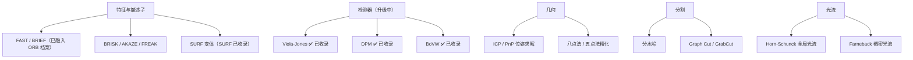

# 算法档案

> **一句话**：把每一个经典算法，拆成「论文 → 概念 → 流程 → 源码 → 踩坑 → 调参」六步，从源头讲到落地。

## 为什么要有"算法档案"

**大部分教程的问题**：**只讲怎么调 API，不讲为什么这样设计**。

**结果**：

- 参数报错时不知道从哪改
- 效果不好时不知道该怪算法还是怪参数
- 换个场景就完全不会用了

**本档案的目标**：**让你理解"这个算法为什么是这样"，从而知道"什么时候该用它、什么时候该换"**。

## 档案结构（六步）

| 步骤 | 回答什么问题 |
|---|---|
| **① 总览** | 它解决什么问题？一句话是什么？ |
| **② 论文精读** | 原始论文的核心思想？有哪些洞察？ |
| **③ 核心概念** | 需要哪些预备知识？关键公式怎么理解？ |
| **④ 算法流程** | 分几步？每步在干什么？ |
| **⑤ 源码走读** | OpenCV 里怎么实现的？关键代码在哪？ |
| **⑥ 实战踩坑** | 实际用会踩什么坑？怎么避开？ |
| **⑦ 调参技巧** | 每个参数什么意思？怎么调？ |

## 已收录的算法

### Canny 边缘检测

**一句话**：**"找边缘"的黄金标准**——通过"高斯去噪 + 梯度 + 非极大值抑制 + 双阈值"得到细且连通的边缘。

| 项 | 内容 |
|---|---|
| **年份** | 1986 |
| **作者** | John F. Canny |
| **论文** | *A Computational Approach to Edge Detection* |
| **DOI** | 10.1109/TPAMI.1986.4767851 |
| **地位** | **边缘检测的标杆**，至今所有边缘检测都要和它比 |

**核心洞察**：**"好边缘"有三个标准**（低误检、高定位精度、单响应）。

**入口**：[Canny 档案总览 →](/algorithms/canny/)

::: tip 为什么先看 Canny
**因为它是"传统 CV 的第一课"**。

它把传统 CV 的典型套路全用了一遍：

- 高斯滤波（去噪）
- 梯度计算（差分）
- 非极大值抑制（细化的化简）
- 双阈值 + 滞后（鲁棒判定）

**理解了 Canny，就理解了传统 CV 的"四步套路"**。
:::

### SIFT 特征匹配

**一句话**：**"找特征点"的黄金标准**——在**尺度空间**里找稳定的极值点，生成**对旋转/尺度不变**的描述子。

| 项 | 内容 |
|---|---|
| **年份** | 1999（初版）/ 2004（完整版） |
| **作者** | David G. Lowe |
| **论文** | *Distinctive Image Features from Scale-Invariant Keypoints* |
| **地位** | **特征匹配的里程碑**，几乎所有后续特征都受它影响 |

**核心洞察**：

1. **找特征点要在"尺度空间"找**（这样才有尺度不变性）
2. **方向要归一化**（这样才有旋转不变性）
3. **描述子要基于梯度直方图**（这样对光照变化鲁棒）

**入口**：[SIFT 档案总览 →](/algorithms/sift/)

::: tip SIFT 的"四不变性"
| 不变性 | 怎么做到 |
|---|---|
| **尺度不变** | 尺度空间（DoG）极值检测 |
| **旋转不变** | 以主方向为基准归一化 |
| **光照不变** | 梯度幅值归一化 + 阈值截断 |
| **视角（小范围）不变** | 因为基于局部梯度统计 |

**但有专利限制**（2020 年 3 月已过期，现在可以自由使用）。
:::

### HOG + SVM 行人检测

**一句话**：**"用梯度直方图描述形状，用 SVM 分类"**——传统目标检测的经典范式。

| 项 | 内容 |
|---|---|
| **年份** | 2005 |
| **作者** | Navneet Dalal、Bill Triggs |
| **论文** | *Histograms of Oriented Gradients for Human Detection* |
| **地位** | **传统目标检测的模板**，Viola-Jones 之后的重大突破 |

**核心洞察**：

1. **不用颜色，只用梯度方向**（形状比颜色更稳定）
2. **分块 + 块内归一化**（对光照鲁棒）
3. **用滑动窗口 + SVM**（不做"检测"而做"分类"）

**入口**：[HOG+SVM 档案总览 →](/algorithms/hog-svm/)

::: tip HOG 的"分块归一化"是精髓
**为什么必须归一化**：

- 光照变化会让梯度幅值整体缩放
- **块内归一化能消除这个缩放**（只保留"相对"的梯度分布）

**HOG 的效果**（当时的误检率）：

| 特征 | 误检率（FPPW） |
|---|---|
| 原始像素 | ~10⁻¹ |
| 只做方向统计 | ~10⁻² |
| **HOG（含块归一化）** | **~10⁻⁴** |

**块内归一化是最关键的改进**（论文中明确做了消融实验）。
:::

## 完整档案一览（11 个）

除上面三个"样板"外，以下 8 个算法也已完成**七页式完整档案**
（总览 → 论文精读 → 核心概念 → 算法流程 → 源码走读 → 实战踩坑 → 调参技巧）：

| 算法 | 年份 | 分支 | 定位 | 一句话 | 入口 |
|---|---|---|---|---|---|
| 霍夫变换 | 1962 | 图像分割 | 基础 | 把"点共线"投票成"线" | [→](/algorithms/hough/) |
| Sobel 边缘算子 | 1968 | 图像处理 | 基础原子算子 | 3×3 卷积算梯度 | [→](/algorithms/sobel/) |
| Otsu 大津阈值 | 1979 | 图像处理 | 基础原子算子 | 类间方差最大的自动阈值 | [→](/algorithms/otsu/) |
| RANSAC | 1981 | 特征匹配 | 进阶 | 随机采样剔外点 | [→](/algorithms/ransac/) |
| 对极几何与三角化 | 1981 | 几何视觉 | 进阶应用 | 两条视线交汇算三维 | [→](/algorithms/epipolar-geometry/) |
| Lucas-Kanade 光流 | 1981 | 几何视觉 | 进阶 | 局部窗口解运动 | [→](/algorithms/lucas-kanade/) |
| Harris 角点 | 1988 | 特征检测 | 基础 | 找"两个方向都在变"的点 | [→](/algorithms/harris/) |
| 张氏相机标定 | 2000 | 几何视觉 | 进阶 | 一张棋盘格标定相机 | [→](/algorithms/zhang-calibration/) |

::: tip 基础原子算子 vs 进阶应用
**基础原子算子**（Sobel、Otsu、Harris、霍夫）是"积木块"：
单独用只能解决最基础的问题，但一切复杂流程都由它们拼成。

**进阶应用**（RANSAC、LK 光流、对极几何与三角化、张氏标定）是"成品机"：
直接对应一个完整工程能力——剔外点、估运动、算深度、标定相机。
:::

## 计划收录

## 全算法索引（59 个档案，持续更新）

| 分支 | 算法 | 年份 | 一句话 | 入口 |
|---|---|---|---|---|
| 图像处理 | 双边滤波 | 1998 | 空间×值域高斯，保边去噪 | [→](/algorithms/bilateral/) |
| 图像处理 | CLAHE 限制对比度自适应直方图均衡 | 1994 | 分块直方图均衡 + 对比度裁剪 | [→](/algorithms/clahe/) |
| 图像处理 | 连通域分析（Two-Pass） | 1966 | 两遍扫描标记连通块 | [→](/algorithms/connected-components/) |
| 图像处理 | 距离变换 | 1966 | 到最近背景的欧氏距离场 | [→](/algorithms/distance-transform/) |
| 图像处理 | Gabor 纹理滤波 | 1985 | 方向/频率选择性纹理滤波 | [→](/algorithms/gabor/) |
| 图像处理 | 高斯滤波 | 1990 | 可分离高斯核线性平滑，去噪基石 | [→](/algorithms/gaussian-blur/) |
| 图像处理 | Haar 小波变换 | 1989 | 多分辨率分解，压缩与特征 | [→](/algorithms/haar-wavelet/) |
| 图像处理 | KNN 背景建模 | 2006 | 非参数最近样本背景估计 | [→](/algorithms/knn-background/) |
| 图像处理 | LBP 局部二值模式 | 1996 | 局部二值模式纹理描述 | [→](/algorithms/lbp/) |
| 图像处理 | 中值滤波 | 1979 | 排序取中值，去椒盐不糊边 | [→](/algorithms/median-filter/) |
| 图像处理 | 形态学操作 | 1964 | 膨胀/腐蚀/开闭，形状滤波基础 | [→](/algorithms/morphology/) |
| 图像处理 | Otsu 大津阈值法 | 1979 | 类间方差最大自动阈值 | [→](/algorithms/otsu/) |
| 图像处理 | Sobel 边缘算子 | 1968 | 3×3 卷积算梯度，边缘鼻祖 | [→](/algorithms/sobel/) |
| 图像处理 | ViBe 背景建模 | 2011 | 样本一致性随机传播背景建模 | [→](/algorithms/vibe/) |
| 特征检测 | AKAZE 加速 KAZE 特征 | 2013 | 非线性扩散尺度空间 + M-LDB | [→](/algorithms/akaze/) |
| 特征检测 | BRIEF 二进制描述子 | 2010 | 256 bit 二进制描述子 | [→](/algorithms/brief/) |
| 特征检测 | BRISK 二进制鲁棒不变可伸缩关键点 | 2011 | AGAST+同心采样，二进制快特征 | [→](/algorithms/brisk/) |
| 特征检测 | Canny 边缘检测 | 1986 | 三阶段管线，单像素细边 | [→](/algorithms/canny/) |
| 特征检测 | 轮廓拟合与多边形逼近 | 1973 | 道格拉斯-普克折线简化 | [→](/algorithms/contour-fitting/) |
| 特征检测 | FAST 角点检测 | 2006 | 决策树判定，比 Harris 快 10 倍 | [→](/algorithms/fast/) |
| 特征检测 | FREAK 仿生二进制描述子 | 2012 | 仿视网膜级联二进制描述子 | [→](/algorithms/freak/) |
| 特征检测 | Harris 角点检测 | 1988 | 自相关矩阵角点 | [→](/algorithms/harris/) |
| 特征检测 | 霍夫圆变换 | 1972 | 圆心投票检测圆 | [→](/algorithms/hough-circles/) |
| 特征检测 | MSER 最大稳定极值区域 | 2002 | 阈值稳定极值区域 | [→](/algorithms/mser/) |
| 特征检测 | ORB 实时特征点 | 2011 | oFAST+rBRIEF 免费实时 | [→](/algorithms/orb/) |
| 特征检测 | Shi-Tomasi 角点 | 1994 | min(λ1,λ2)，光流友好角点 | [→](/algorithms/shi-tomasi/) |
| 特征检测 | SURF 加速稳健特征 | 2006 | Hessian 近似+积分图加速 | [→](/algorithms/surf/) |
| 特征匹配 | FLANN 快速最近邻搜索 | 2009 | 自动配置的近似最近邻搜索 | [→](/algorithms/flann/) |
| 特征匹配 | Lucas-Kanade 光流 | 1981 | 稀疏光流跟踪 | [→](/algorithms/lucas-kanade/) |
| 特征匹配 | RANSAC 随机采样一致 | 1981 | 随机采样一致剔除外点 | [→](/algorithms/ransac/) |
| 特征匹配 | SIFT 尺度不变特征变换 | 1999 | DoG 尺度+128 维描述子 | [→](/algorithms/sift/) |
| 图像分割 | 高效图分割 Felzenszwalb | 2004 | 最小生成树贪心超像素 | [→](/algorithms/felzenszwalb-segmentation/) |
| 图像分割 | GrabCut 抠图 | 2004 | GMM+GraphCut 迭代抠图 | [→](/algorithms/grabcut/) |
| 图像分割 | 霍夫变换 | 1962 | 参数空间投票找直线/圆 | [→](/algorithms/hough/) |
| 图像分割 | K-Means 颜色聚类 | 1967 | 颜色空间聚类 | [→](/algorithms/kmeans/) |
| 图像分割 | MeanShift 均值漂移 | 2002 | 密度峰值非参数聚类 | [→](/algorithms/meanshift/) |
| 图像分割 | 区域生长分割 | 1994 | 种子点相似性扩张分割 | [→](/algorithms/region-growing/) |
| 图像分割 | SLIC 超像素 | 2010 | LabXY 5 维局部 K-Means | [→](/algorithms/slic/) |
| 图像分割 | 分水岭分割 | 1991 | 梯度地形浸没分割 | [→](/algorithms/watershed/) |
| 目标检测 | 词袋模型 BoVW | 2004 | 视觉词袋+SVM 检索 | [→](/algorithms/bovw/) |
| 目标检测 | CamShift 连续自适应 MeanShift | 1998 | 自适应 MeanShift 跟踪 | [→](/algorithms/camshift/) |
| 目标检测 | CSRT 通道与空间可靠性跟踪 | 2017 | 通道+空间可靠性跟踪 | [→](/algorithms/csrt/) |
| 目标检测 | 可变形部件模型 DPM | 2008 | 可变形部件传统检测巅峰 | [→](/algorithms/dpm/) |
| 目标检测 | HOG + SVM 行人检测 | 2005 | 行人检测标配 | [→](/algorithms/hog-svm/) |
| 目标检测 | KCF 核相关滤波跟踪 | 2015 | 循环矩阵核相关滤波跟踪 | [→](/algorithms/kcf/) |
| 目标检测 | MOSSE 相关滤波跟踪 | 2010 | 频域相关滤波，600+ FPS | [→](/algorithms/mosse/) |
| 目标检测 | Viola-Jones 人脸检测 | 2001 | Haar+AdaBoost 级联人脸 | [→](/algorithms/viola-jones/) |
| 几何视觉 | 光束法平差 BA | 1958 | 全局重投影误差最小化 | [→](/algorithms/bundle-adjustment/) |
| 几何视觉 | 对极几何与基础矩阵 | 1981 | 基础矩阵+三角化 | [→](/algorithms/epipolar-geometry/) |
| 几何视觉 | 本质矩阵与八点法 | 1981 | 两视图相对位姿求解 | [→](/algorithms/essential-matrix/) |
| 几何视觉 | Farnebäck 稠密光流 | 2003 | 多项式稠密光流 | [→](/algorithms/farneback/) |
| 几何视觉 | 单应矩阵估计 | 1981 | 4 点 RANSAC 估算平面变换 | [→](/algorithms/homography/) |
| 几何视觉 | Horn-Schunck 稠密光流 | 1981 | 全局平滑稠密光流 | [→](/algorithms/horn-schunck/) |
| 几何视觉 | ICP 迭代最近点 | 1992 | 迭代最近点点云配准 | [→](/algorithms/icp/) |
| 几何视觉 | MOG2 背景减除 | 2004 | 自适应高斯混合背景模型 | [→](/algorithms/mog2/) |
| 几何视觉 | PnP 位姿估计 | 2009 | O(n) 位姿求解 | [→](/algorithms/pnpsolver/) |
| 几何视觉 | SGM 半全局立体匹配 | 2005 | 半全局立体匹配 | [→](/algorithms/sgbm/) |
| 几何视觉 | 三角化重建 | 1997 | 两视线求交还原三维点 | [→](/algorithms/triangulation/) |
| 几何视觉 | 张氏相机标定法 | 2000 | 棋盘格标定相机 | [→](/algorithms/zhang-calibration/) |

**收录原则**：**"工业常用 + 有代表性 + 有清晰思想"**。

**不收录**：纯理论无实用、或已被完全淘汰且无传承价值的算法。

### 双边滤波保边去噪

**一句话**：**"磨皮去噪但不糊边"**——空间高斯+值域高斯乘积核，离得近且颜色像的像素才被拉平。

| 项 | 内容 |
|---|---|
| **年份** | 1998 |
| **作者** | Carlo Tomasi, Roberto Manduchi |
| **论文** | *Bilateral Filtering for Gray and Color Images* |
| **地位** | 保边滤波的奠基作，美颜/HDR/卡通化的标配 |

**入口**：[双边滤波档案 →](/algorithms/bilateral/)

### MOG2 背景减除

**一句话**：**"监控里的自动哨兵"**——每个像素维护自适应 K 个高斯，和背景对不上的就判为运动前景。

| 项 | 内容 |
|---|---|
| **年份** | 2004 |
| **作者** | Zoran Zivkovic |
| **论文** | *Improved Adaptive Gaussian Mixture Model for Background Subtraction* |
| **地位** | OpenCV 默认的运动检测算法，CPU 实时、树莓派可跑 |

**入口**：[MOG2 档案 →](/algorithms/mog2/)

### KCF 核相关滤波跟踪

**一句话**：**"CPU 上跑 150 FPS 的跟踪小钢炮"**——循环矩阵+FFT+核技巧，把跟踪训练检测全推到频域加速。

| 项 | 内容 |
|---|---|
| **年份** | 2015 |
| **作者** | João F. Henriques 等 |
| **论文** | *High-Speed Tracking with Kernelized Correlation Filters* |
| **地位** | 相关滤波跟踪的代表作，OpenCV TrackerKCF 的直接实现 |

**入口**：[KCF 档案 →](/algorithms/kcf/)

### LBP 局部二值模式

**一句话**：**"30 年前就跑在诺基亚上的纹理指纹"**——每个像素和 8 邻居比亮暗拼 8-bit 编码，分块直方图就是纹理描述子。

| 项 | 内容 |
|---|---|
| **年份** | 1996 |
| **作者** | Timo Ojala, Matti Pietikäinen, David Harwood |
| **论文** | *A Comparative Study of Texture Measures with Classification Based on Featured Distributions* |
| **地位** | 纹理分类/人脸识别（LBP-Face）的基石，比 HOG 还小还快 |

**入口**：[LBP 档案 →](/algorithms/lbp/)

### BRISK 二进制尺度旋转不变特征
**一句话**：**"免费版 SIFT"**——AGAST 找角点 + 同心圆采样 + 长短点对分工，比 ORB 鲁棒、比 SIFT 快。

| 项 | 内容 |
|---|---|
| **年份** | 2011 |
| **作者** | Stefan Leutenegger, Margarita Chli, Roland Siegwart |
| **论文** | BRISK: Binary Robust Invariant Scalable Keypoints (ICCV) |
| **地位** | OpenCV 免费专利二进制特征里，尺度/旋转不变性强于 ORB |

**入口**：[BRISK 档案 →](/algorithms/brisk/)

### AKAZE 加速 KAZE 非线性特征
**一句话**：**"保边尺度空间里的免费强特征"**——非线性扩散保边缘，M-LDB 二进制描述子，OpenCV 专利免费特征里精度最高。

| 项 | 内容 |
|---|---|
| **年份** | 2013 |
| **作者** | Pablo F. Alcantarilla, Jesús Nuevo, Adrien Bartoli |
| **论文** | Fast Explicit Diffusion for Accelerated Features in Nonlinear Scale Spaces (BMVC) |
| **地位** | 专利免费特征的精度担当，非线性尺度空间代表 |

**入口**：[AKAZE 档案 →](/algorithms/akaze/)

### CLAHE 限制对比度自适应直方图均衡
**一句话**：**"奶奶也会用的对比度增强"**——分小块拉对比度，超过阈值的超额均摊给所有人，既出细节又不炸噪声。

| 项 | 内容 |
|---|---|
| **年份** | 1994 |
| **作者** | Karel Zuiderveld |
| **论文** | Contrast Limited Adaptive Histogram Equalization (Graphics Gems IV) |
| **地位** | 工业界低对比度/医学影像/X光/人脸预处理 30 年首选 |

**入口**：[CLAHE 档案 →](/algorithms/clahe/)

### 距离变换
**一句话**：**"迷宫里离最近墙有多远"**——两遍扫描给二值图每个前景像素算到最近背景的距离，分水岭/骨架/匹配的底层积木。

| 项 | 内容 |
|---|---|
| **年份** | 1966 |
| **作者** | Azriel Rosenfeld, John Pfaltz |
| **论文** | Sequential Operations in Digital Picture Processing (JACM) |
| **地位** | 形态学/分割最底层 O(N) 工具，分水岭必用 |

**入口**：[距离变换档案 →](/algorithms/distance-transform/)

### 连通域分析 Two-Pass
**一句话**：**"二值图里数个数的最快工具"**——两遍扫描 + 并查集给每个连通块打标签，直接带面积/外接框/质心。

| 项 | 内容 |
|---|---|
| **年份** | 1966（2008/2016 BBDT/SAUF 优化） |
| **作者** | Azriel Rosenfeld / Wu et al. / Grana et al. |
| **论文** | Sequential Operations in Digital Picture Processing / BBDT / SAUF |
| **地位** | 工业界"数个数/筛大小/缺陷统计"最高频底层操作 |

**入口**：[连通域档案 →](/algorithms/connected-components/)

### 区域生长分割
**一句话**：**"种子灌水法"**——从用户指定种子出发用最小堆按相似度扩散，最直觉的交互式分割。

| 项 | 内容 |
|---|---|
| **年份** | 1994 |
| **作者** | Rolf Adams, Leanne Bischof |
| **论文** | Seeded Region Growing (TPAMI) |
| **地位** | GrabCut 之前最经典交互式分割；医学影像分割常用 |

**入口**：[区域生长档案 →](/algorithms/region-growing/)

### Gabor 纹理滤波
**一句话**：**"生物视觉同款纹理探针"**——高斯 × 正弦波的多方向多尺度滤波器组，时频局部化最优，指纹/虹膜/纹理黄金标准。

| 项 | 内容 |
|---|---|
| **年份** | 1946/1985 |
| **作者** | Dennis Gabor / John Daugman |
| **论文** | Theory of Communication / Uncertainty relation for 2D cortical filters |
| **地位** | 指纹识别、虹膜识别（Daugman 算法）、纹理分类的经典特征 |

**入口**：[Gabor 档案 →](/algorithms/gabor/)

### CSRT 通道与空间可靠性跟踪
**一句话**：**"OpenCV 传统跟踪器精度王"**——KCF 升级版，加空间掩膜过滤背景、通道可靠性降权失效特征，形变/遮挡都比 KCF 稳。

| 项 | 内容 |
|---|---|
| **年份** | 2017 |
| **作者** | Alan Lukežič et al. |
| **论文** | Discriminative Correlation Filter with Channel and Spatial Reliability (CVPR) |
| **地位** | OpenCV 传统单目标跟踪精度最高档（VOT 2017 实时冠军） |

**入口**：[CSRT 档案 →](/algorithms/csrt/)

## 怎么用这些档案

| 你的处境 | 建议入口 |
|---|---|
| **完全不懂这个算法** | ① 总览 → ③ 核心概念 |
| **要复现论文** | ② 论文精读 → ④ 算法流程 |
| **要用 OpenCV 调参** | ⑦ 调参技巧（+ ⑥ 踩坑） |
| **效果不好要排查** | **⑥ 实战踩坑**（先看这里！） |
| **要改源码 / 自己实现** | ⑤ 源码走读 |

::: tip 遇到问题先看"踩坑"
**很多问题不是算法错，而是"用错了"**。

**典型例子**：

- **Canny 阈值没调**（用默认值）→ 效果差
- **SIFT 匹配不做比值筛选** → 大量误匹配
- **HOG 的窗口尺寸和训练时不一致** → 检测不出

**这些都在"踩坑"里写清楚了。**
:::

## 相关链接

- [六大技术分支](/branches/)
- [本体 Schema](/ontology/schema)
- [术语表](/glossary)
- [实战案例](/cases/)
- [传承脉络：传统 CV → 深度学习](/legacy/)
