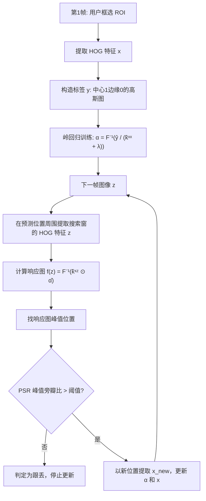

# 🏗 算法流程

## 关键术语解释

- **PSR（Peak-to-Sidelobe Ratio）**：响应峰值减去旁瓣均值再除以旁瓣标准差。PSR>10 高置信度，<5 基本跟丢。用来判断要不要更新模型，**防漂移关键指标**。
- **搜索窗**：通常是目标大小的 2.5 倍，上下左右都给点冗余，让 KCF 在这个窗口里找。
- **学习率 interp_factor**：`new_template = (1-η)*old + η*new`，η 越大模型跟目标变化快，但越容易漂移。

## 为什么不抗尺度？

原始 KCF 的检测窗口大小是固定的。目标走近/走远，HOG cell 尺寸不变，响应峰值就会下降甚至漂移。DSST 单独训一个一维的"尺度相关滤波器"——在新位置切 33 个不同尺度，挑响应最高的——但 OpenCV 的 KCF 没内置这个。
