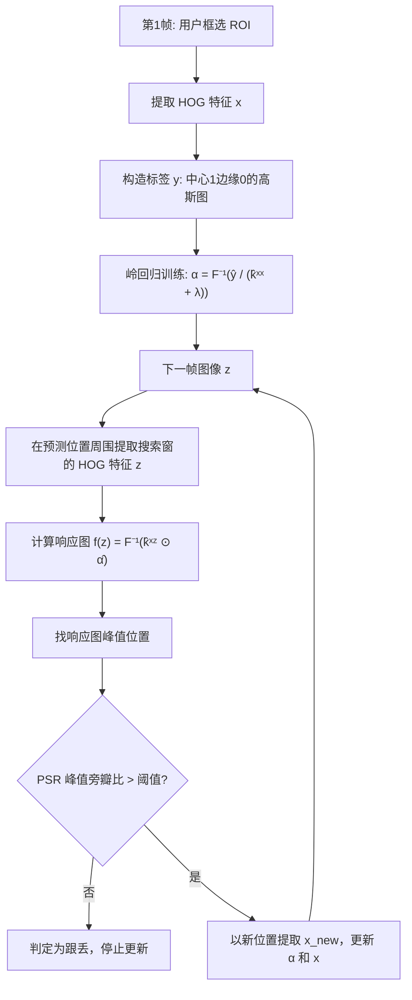

# 🏗 算法流程



## 关键术语解释

- **PSR（Peak-to-Sidelobe Ratio）**：响应峰值减去旁瓣均值再除以旁瓣标准差。PSR>10 高置信度，<5 基本跟丢。用来判断要不要更新模型，**防漂移关键指标**。
- **搜索窗**：通常是目标大小的 2.5 倍，上下左右都给点冗余，让 KCF 在这个窗口里找。
- **学习率 interp_factor**：`new_template = (1-η)*old + η*new`，η 越大模型跟目标变化快，但越容易漂移。

## 为什么不抗尺度？

原始 KCF 的检测窗口大小是固定的。目标走近/走远，HOG cell 尺寸不变，响应峰值就会下降甚至漂移。DSST 单独训一个一维的"尺度相关滤波器"——在新位置切 33 个不同尺度，挑响应最高的——但 OpenCV 的 KCF 没内置这个。

<!-- AUTO-EXTENSION -->

## 🏗 算法流程（续）：循环移位的魔法

KCF 最天才的地方是：**不需要真的采成千上万个负样本**——它利用"循环移位"性质，一张图平移 1 格、2 格……N 格，就自动生成 N×N 个"虚拟样本"，而这些样本在傅里叶域里**正好可以用对角矩阵表示**，训练瞬间变成元素级乘法，速度暴增几千倍。

```mermaid
flowchart LR
  A[初始框 x] --> B[提取 HOG 特征]
  B --> C[循环移位 → 成千虚拟样本]
  C --> D[在傅里叶域岭回归<br/>元素级运算 O(n²)→O(n)]
  D --> E[得到相关滤波模板 w]
  E --> F[下一帧在搜索区做响应图<br/>argmax 即新位置]
  F --> G[更新模板 w ← (1-η)w + ηw_new]
  G --> F
```

## 📐 三种核函数对比

| 核 | 速度 | 精度 | 推荐场景 |
| --- | --- | --- | --- |
| **线性核** | ⚡ 最快 | 一般 | 高帧率 >100fps 场景 |
| **高斯核（默认）** | 中等 | 最好 | 通用场景 |
| **多项式核** | 慢 | 与高斯接近 | 不推荐 |

这就是为什么 OpenCV 默认用高斯核——综合性价比最高。

## 🔁 为什么会"漂移"？

每帧都在更新模板，只要有几帧跟偏了（遮挡、光照突变、形变），**错误就会慢慢累积进模板**，框越来越偏，最后彻底飞掉。这个问题叫**模型漂移（model drift）**，是所有在线更新跟踪器的通病。
