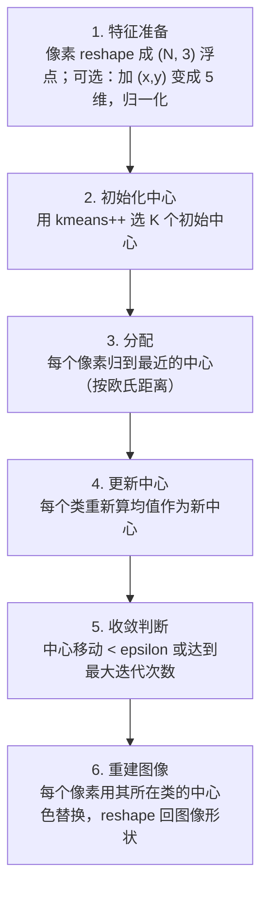

# K-Means 颜色聚类 · 算法流程

<AlgorithmCard
  name="K-Means 颜色聚类"
  enName="K-Means Clustering"
  chapter="ch-10-image-segmentation"
  branch="segmentation"
  year="1967"
  author="Stuart Lloyd / James MacQueen"
  paper="—"
  level="basic"
  tagline="把所有像素按颜色分成 K 堆，每堆一个代表色，图像立刻变卡通"
  analogy="把一盒彩笔按颜色分成 K 堆：先随机挑 K 支笔当组长，其他笔投奔最近的组长；每堆重新选平均色当新组长；反复到组长不再变"
  scene="颜色量化、海报风格化、肤色区域分割、语义分割前处理、调色板生成"
  :pros='["思想极简单", "速度快", "OpenCV/sklearn 一行调用", "适用范围广"]'
  :cons='["必须指定 K", "只看颜色不看位置", "对初始值敏感", "对噪声敏感"]'
/>

## 完整算法流程

K-Means 颜色聚类算法可以分解为以下关键步骤：

## 步骤详解

### 步骤 1：特征准备

像素 reshape 成 (N, 3) 浮点；可选：加 (x,y) 变成 5 维，归一化

### 步骤 2：初始化中心

用 kmeans++ 选 K 个初始中心

### 步骤 3：分配

每个像素归到最近的中心（按欧氏距离）

### 步骤 4：更新中心

每个类重新算均值作为新中心

### 步骤 5：收敛判断

中心移动 < epsilon 或达到最大迭代次数

### 步骤 6：重建图像

每个像素用其所在类的中心色替换，reshape 回图像形状

## 在整体视觉 pipeline 中的位置

### 关键复杂度

| 维度 | 复杂度 |
|---|---|
| 时间 | 详见各实现 |
| 内存 | 与图像尺寸线性相关 |

