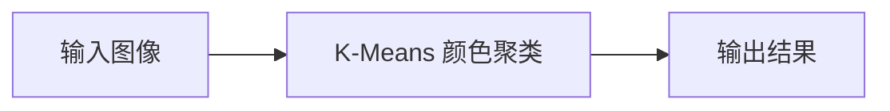

# K-Means 颜色聚类

<AlgorithmCard
  name="K-Means 颜色聚类"
  enName="K-Means Clustering"
  chapter="第5章 · 目标分割"  chapterLink="/chapters/ch05-segmentation"
  branch="segmentation"
  year="1967"
  author="Stuart Lloyd (1957 提出) / James MacQueen 1967 命名"
  paper="https://ieeexplore.ieee.org/document/10564897"
  level="basic"
  tagline="把所有像素按颜色分成 K 堆，每堆一个代表色，图像立刻变卡通"
  analogy="把一盒彩笔按颜色分成 K 堆：先随机挑 K 支笔作为「小组长」，其他笔投奔最近的组长；每堆重新选一个「平均色」当新组长；反复到组长不再变。分完每堆用一个代表色涂，图像就被量化/分割了"
  scene="颜色量化（图像压缩）、海报风格化、肤色区域分割、语义分割前处理、矢量图调色板生成"
  :pros='["思想极简单直观", "速度快（线性复杂度）", "OpenCV/sklearn 一行调用", "适用范围广", "结果可解释"]'
  :cons='["必须预先指定 K", "只看颜色不看位置（需加坐标扩展）", "对初始值敏感（用 kmeans++）", "对噪声离群点敏感", "聚类结果可能是局部最优"]'
/>

## 一句话理解

把所有像素按颜色分成 K 堆，每堆一个代表色，图像立刻变卡通。把一盒彩笔按颜色分成 K 堆：先随机挑 K 支笔作为「小组长」，其他笔投奔最近的组长；每堆重新选一个「平均色」当新组长；反复到组长不再变。分完每堆用一个代表色涂，图像就被量化/分割了。

## 生活类比

把一盒彩笔按颜色分成 K 堆：先随机挑 K 支笔作为「小组长」，其他笔投奔最近的组长；每堆重新选一个「平均色」当新组长；反复到组长不再变。分完每堆用一个代表色涂，图像就被量化/分割了

## 它解决什么问题

颜色量化（图像压缩）、海报风格化、肤色区域分割、语义分割前处理、矢量图调色板生成。

在传统 CV 的六分支体系中，K-Means 颜色聚类 属于 **segmentation** 分支，主要解决的是该分支中把所有像素按颜色分成 K 堆，每堆一个代表色，图像立刻变卡通的问题。

## 核心优点

- ✅ **思想极简单直观**
- ✅ **速度快（线性复杂度）**
- ✅ **OpenCV/sklearn 一行调用**
- ✅ **适用范围广**
- ✅ **结果可解释**

## 它的短板

- ⚠️ 必须预先指定 K
- ⚠️ 只看颜色不看位置（需加坐标扩展）
- ⚠️ 对初始值敏感（用 kmeans++）
- ⚠️ 对噪声离群点敏感
- ⚠️ 聚类结果可能是局部最优

## 本算法档案包含 7 个页面

| 页面 | 内容 |
|---|---|
| [论文故事](/algorithms/kmeans/paper) | 作者、发表时间、核心贡献、为什么它会被提出 |
| [核心概念](/algorithms/kmeans/concepts) | 用生活比方讲清它依赖的关键概念 |
| [算法流程](/algorithms/kmeans/architecture) | 一步步走通算法全流程，配 mermaid 图 |
| [源码实现](/algorithms/kmeans/source) | OpenCV 调用 + NumPy 手写最小实现 |
| [踩坑清单](/algorithms/kmeans/painpoints) | 新手最常犯的 N 个错误 |
| [调参口诀](/algorithms/kmeans/tricks) | 参数怎么选、实战技巧、性能优化 |

## 相关链接

- 返回 [六大分支总览](/branches/)
- [K-Means 颜色聚类所在分支](/branches/segmentation/)
- [算法档案总览](/algorithms/)

---

## 🚀 动手体验（浏览器里直接玩，不用装环境）

> 下面这些组件都在**你的浏览器本地运行**，不上传任何图片、也不用安装 OpenCV 或写代码。

### 🎮 再跑真机：在浏览器里真跑 K-Means 颜色聚类

换成你自己的照片也行；下面还会**实时生成**对应的 Python / C++ / JavaScript 代码，拖参数时代码同步更新。

<ClientOnly>
  <OpencvPlayground initial-algo="kmeans" compact />
</ClientOnly>

> 想换示例图、上传自己的照片、或切换别的算法？去 [🎮 真机实验室](/playgrounds/)；想看完整的 14 个数学原理互动？去 [🧪 原理实验室](/math-lab/)。
