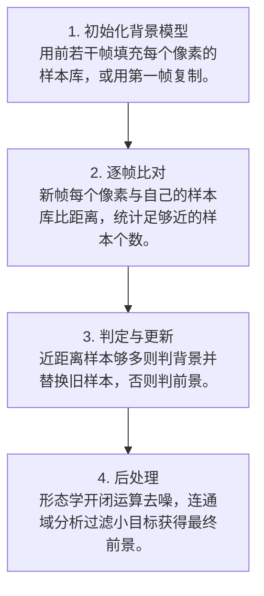

# 第 4 页 · 算法架构

## 完整流程图

## 每一步在做什么

### 步骤 1：初始化背景模型

用前若干帧填充每个像素的样本库，或用第一帧复制。

### 步骤 2：逐帧比对

新帧每个像素与自己的样本库比距离，统计足够近的样本个数。

### 步骤 3：判定与更新

近距离样本够多则判背景并替换旧样本，否则判前景。

### 步骤 4：后处理

形态学开闭运算去噪，连通域分析过滤小目标获得最终前景。

## 在整体视觉管线中的位置

## 复杂度分析

时间复杂度 O(W·H·nSamples) 每帧；空间复杂度 O(W·H·nSamples)，nSamples=20、1080p 时约需数百 MB。

## 参数总览（论文建议 vs OpenCV 默认 vs 实战推荐）

| 参数 | 含义 | 论文建议 | OpenCV 默认 | 实战推荐 |
|------|------|----------|-------------|----------|
| history | 历史帧数 | — | 500 | ****200~500**** |
| nSamples | 每像素样本数 | 20 | 7 | ****10~20**** |
| dist2Threshold | 样本距离平方阈值 | — | 400 | ****越大越宽容**** |
| detectShadows | 是否检测阴影 | True | True | **True** |

## 边界情况与失败模式

- **nSamples 设太大**：内存暴涨、变慢，收益却有限。
- **dist2Threshold 太小**：少量光照波动就被判成前景，满屏噪点。
- **未做形态学后处理**：前景掩码里全是胡椒面式噪点。
- **相机自动曝光突变**：全局亮度跳变会造成整屏误检，需重学背景。
