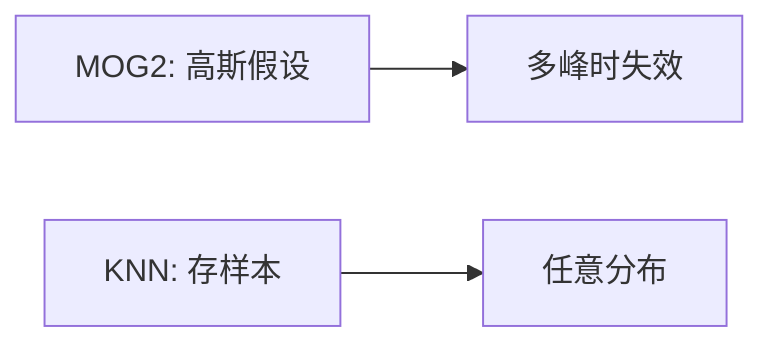

# 第 3 页 · 核心概念

🧪 公式看不懂？去 <a href="/math-lab/">原理实验室</a> 拖动滑块直观体验卷积/梯度/高斯/霍夫/角点/RANSAC/光流等核心概念；看完原理再去本页底部 <a href="./source">源码/真机实验室</a> 亲手调参数。

## 先用生活直觉理解

你家门口监控盯着一块地砖。这块砖最近见过 20 种“正常”颜色（晴天阴影、雨天湿、黄昏黄）。忽然来了一种谁都没见过的颜色——那多半是有东西停在那，报警！KNN 背景建模就是给每个像素存一小本“正常颜色账本”。

**典型应用**：监控运动检测、人流量统计、车辆计数、周界入侵报警（比 MOG2 更抗噪）

## 概念逐个拆解

### 概念 1：什么是背景建模

摄像头不动时，画面里不动的部分是背景，动的是前景。背景建模就是给每个像素学出「正常长什么样」。

### 概念 2：非参数 vs 参数

MOG2 先假设背景服从高斯混合、再估参数；KNN 直接存样本，不假设任何分布。多峰背景更适合后者。

### 概念 3：样本替换与自适应

新样本若判为背景，就随机替换掉一个旧样本。这样背景随时间缓慢漂移（光照变化）也能跟上。

### 概念 4：阴影检测

阴影会让像素变暗但不改变色度，OpenCV 用色度信息把阴影标成灰色（127）而非纯白前景。

## 和其他算法的关系

| 关系 | 算法 | 说明 |
|------|------|------|
| 前置依赖 | 灰度化或降采样 | 通常先做这些再做本算法 |
| 同类对比 | MOG2、ViBe、帧差法 | 解决同类问题，各有取舍 |
| 下游常用 | 形态学去噪、连通域分析、目标跟踪 | 本算法结果常交给它们处理 |

::: tip 记忆锚点
记住「KNN 存历史样本，MOG2 存高斯——KNN 更稳更慢」。
:::
