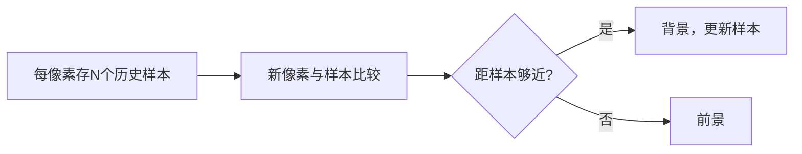

# 第 2 页 · 论文溯源

## 论文名片

| 项目 | 内容 |
|------|------|
| 标题 | **Efficient Adaptive Density Estimation per Image Pixel for the Task of Background Subtraction** |
| 作者 | Zoran Zivkovic / Ferdinand van der Heijden |
| 年份 | 2006 |
| 发表 | Pattern Recognition Letters, 2006 |
| 原文 | [https://ieeexplore.ieee.org/document/1640821](https://ieeexplore.ieee.org/document/1640821) |
| 一句话贡献 | 为每个像素维护一组最近样本，用非参数密度估计判断前景，比高斯混合更稳健。 |

## 1. 当时的问题

GMM（MOG2）假设背景像素服从高斯混合分布，但真实场景（树叶晃动、水面波纹）背景是多峰且非高斯的，高斯假设下要么误检要么漏检，且参数估计开销大。

## 2. 核心思想

干脆不做分布假设：给每个像素直接存最近观察到的 N 个颜色样本，用「新像素与多少样本足够接近」来估计它是否属于背景。样本足够近就直接替换最老的样本，实现自适应更新。

## 3. 关键贡献

- 提出**每像素非参数密度估计**的背景建模
- 用简单样本替换策略实现自适应与有限内存
- 证明在含噪声与多峰背景的监控场景优于 GMM

## 4. 核心公式（看懂思路即可）

若新像素值与 N 个历史样本中至少有 k 个的距离平方小于阈值 R，则判为背景，并用该值随机替换一个旧样本；否则判为前景。

## 5. 实验结果

在含严重噪声与动态背景的监控视频上，KNN 的误检率显著低于 MOG2，代价是速度慢约 2~3 倍、内存更高。

## 6. 局限与争议

速度与内存开销大于 MOG2；对全局光照突变需要重新收敛；参数对场景敏感。

## 7. 历史影响

与 MOG2 一起成为 OpenCV 背景减除的两大内置方法；其「样本替换」思想直接影响了 ViBe、PBAS 等后续算法。

## 8. 一句话总结

> 不给背景做分布假设，直接存样本——换来一个更抗噪的运动检测器。
