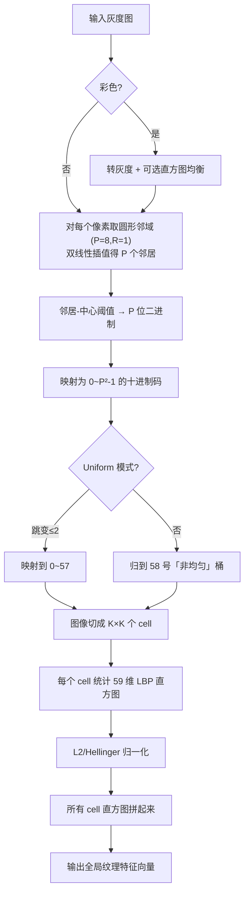
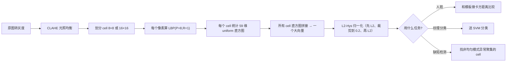

# 🏗 算法流程

## LBP 人脸识别的经典设置

- 图像对齐 + 裁剪到 128×128
- 分成 **8×8 = 64 个 cell**（每 cell 16×16 像素）
- 每个 cell 59 维 Uniform LBP 直方图
- 总特征维度 = 64 × 59 = **3776 维**
- 卡方距离 / 直方图交做匹配，或送 SVM 训练多类分类器

这就是 2004 年 Ahonen LBP-Face 在 FERET 库上刷 SOTA 的完整配置。诺基亚 N95 的人脸识别用的就是它——在 ARM9 上 200ms 跑一帧。

## 多尺度 LBP

为了捕捉不同尺度的纹理，通常同时算 (P=8,R=1)、(P=16,R=2)、(P=24,R=3) 三个尺度，把它们的直方图拼起来。这样细纹理、中纹理、粗纹理都覆盖到。

<!-- AUTO-EXTENSION -->

## 🏗 算法全流程（从图到判别）

## 🔑 为什么 "划分 cell" 这么重要？

直接对整张图做 LBP 直方图只有 59 维——它只告诉你"图里有哪些模式"，但**位置信息全丢了**（一张眼睛图和一张嘴图可能有相同直方图）。分成 cell 之后：
- 每个 cell 自己的直方图描述**局部纹理**；
- 拼接顺序保留**空间位置**（眼睛在上面 cell、嘴巴在下面 cell）；
- 这就像把脸拆成"左眉、右眉、左眼、右眼、鼻梁、左嘴角、右嘴角、下巴"，一块一块对比。
