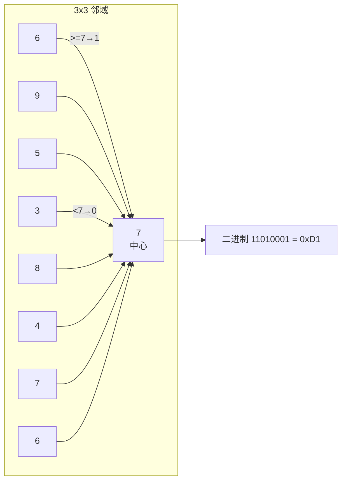

# 💡 核心概念

🧪 公式看不懂？去 <a href="/math-lab/">原理实验室</a> 拖动滑块直观体验卷积/梯度/高斯/霍夫/角点/RANSAC/光流等核心概念；看完原理再去本页底部 <a href="./source">源码/真机实验室</a> 亲手调参数。

## 基础 LBP 编码

对每个像素 g_c，和 8 个邻居 g_0..g_7 比大小：

$$
\text{LBP} = \sum_{p=0}^{7} s(g_p - g_c) \cdot 2^p,\quad s(x)=\begin{cases}1 & x\geq 0\\0 & x<0\end{cases}
$$

这个数天然对**光照单调变换**（如整张图 +20、×1.5）免疫——因为邻居之间的大小关系不变。这是 LBP 最核心的魅力。

## Uniform LBP（59 维魔法数）

256 种 8-bit 模式里，大部分模式都很少见。统计发现：**从 0 到 1 的「跳变」次数 ≤ 2** 的模式只有 58 种（比如 00000000、11111111、00001111、11000000……），它们覆盖了自然图像 90% 以上的 LBP 编码。剩下 198 种全部归到一个"非均匀"桶里，**总共 59 维**。

这就是著名的 `n_bins=59` 的来源。59 维直方图比 256 维小 4 倍，抗噪性还更好。

## 旋转不变 LBP

同一个纹理转个角度，LBP 会变成循环移位后的另一个数（如 11000000 → 01100000 → 00110000…）。**取这 8 个循环移位里的最小值**作为编码，就得到旋转不变版本——36 个 unique 值。但人脸识别里通常不用旋转不变，因为人脸本来就是正的。
