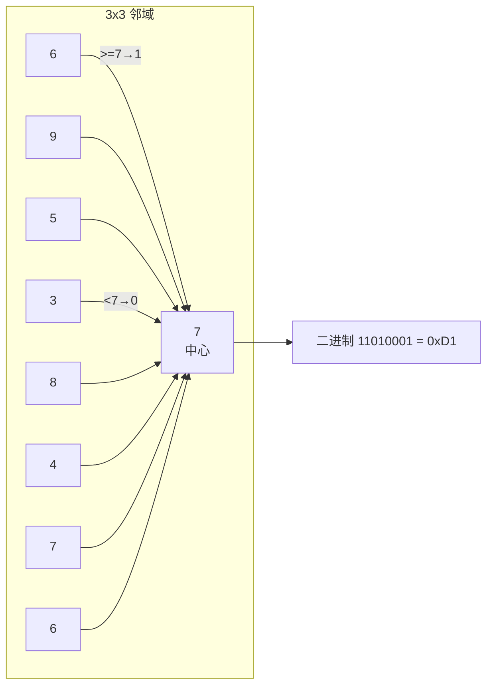

# 💡 核心概念

🧪 公式看不懂？去 <a href="/math-lab/">原理实验室</a> 拖动滑块直观体验卷积/梯度/高斯/霍夫/角点/RANSAC/光流等核心概念；看完原理再去本页底部 <a href="./source">源码/真机实验室</a> 亲手调参数。

## 基础 LBP 编码

对每个像素 g_c，和 8 个邻居 g_0..g_7 比大小：

$$
\text{LBP} = \sum_{p=0}^{7} s(g_p - g_c) \cdot 2^p,\quad s(x)=\begin{cases}1 & x\geq 0\\0 & x<0\end{cases}
$$

这个数天然对**光照单调变换**（如整张图 +20、×1.5）免疫——因为邻居之间的大小关系不变。这是 LBP 最核心的魅力。

## Uniform LBP（59 维魔法数）

256 种 8-bit 模式里，大部分模式都很少见。统计发现：**从 0 到 1 的「跳变」次数 ≤ 2** 的模式只有 58 种（比如 00000000、11111111、00001111、11000000……），它们覆盖了自然图像 90% 以上的 LBP 编码。剩下 198 种全部归到一个"非均匀"桶里，**总共 59 维**。

这就是著名的 `n_bins=59` 的来源。59 维直方图比 256 维小 4 倍，抗噪性还更好。

## 旋转不变 LBP

同一个纹理转个角度，LBP 会变成循环移位后的另一个数（如 11000000 → 01100000 → 00110000…）。**取这 8 个循环移位里的最小值**作为编码，就得到旋转不变版本——36 个 unique 值。但人脸识别里通常不用旋转不变，因为人脸本来就是正的。

<!-- AUTO-EXTENSION -->

## 🔍 三种 LBP 变体一张图看懂

<svg xmlns="http://www.w3.org/2000/svg" width="720" height="170" style="background:#fafbfc;border-radius:12px;border:1px solid #eaecef">
  <g transform="translate(20,10)">
    <text x="100" y="18" text-anchor="middle" font-size="13" font-weight="bold" fill="#333">原始 LBP (3×3)</text>
    <rect x="20" y="30" width="160" height="120" fill="#fff" stroke="#ccc"/>
    <!-- 3x3 grid -->
    <g font-size="10" text-anchor="middle">
      <rect x="40" y="50" width="30" height="30" fill="#eee"/><text x="55" y="69" fill="#333">6</text>
      <rect x="70" y="50" width="30" height="30" fill="#ddd"/><text x="85" y="69" fill="#333">9</text>
      <rect x="100" y="50" width="30" height="30" fill="#eee"/><text x="115" y="69" fill="#333">5</text>
      <rect x="40" y="80" width="30" height="30" fill="#bbb"/><text x="55" y="99" fill="#fff">3</text>
      <rect x="70" y="80" width="30" height="30" fill="#ddd"/><text x="85" y="99" fill="#c00" font-weight="bold">7</text>
      <rect x="100" y="80" width="30" height="30" fill="#eee"/><text x="115" y="99" fill="#333">8</text>
      <rect x="40" y="110" width="30" height="30" fill="#eee"/><text x="55" y="129" fill="#333">4</text>
      <rect x="70" y="110" width="30" height="30" fill="#ddd"/><text x="85" y="129" fill="#333">7</text>
      <rect x="100" y="110" width="30" height="30" fill="#eee"/><text x="115" y="129" fill="#333">6</text>
    </g>
    <text x="100" y="162" text-anchor="middle" font-size="10" fill="#888">256 种模式，半径固定</text>
  </g>
  <g transform="translate(260,10)">
    <text x="100" y="18" text-anchor="middle" font-size="13" font-weight="bold" fill="#333">圆形 LBP (P=8,R=2)</text>
    <rect x="20" y="30" width="160" height="120" fill="#fff" stroke="#ccc"/>
    <circle cx="100" cy="90" r="50" fill="none" stroke="#ddd" stroke-dasharray="3,2"/>
    <circle cx="100" cy="90" r="4" fill="#c00"/>
    <circle cx="150" cy="90" r="3" fill="#444"/><circle cx="135" cy="55" r="3" fill="#444"/>
    <circle cx="100" cy="40" r="3" fill="#444"/><circle cx="65" cy="55" r="3" fill="#444"/>
    <circle cx="50" cy="90" r="3" fill="#444"/><circle cx="65" cy="125" r="3" fill="#444"/>
    <circle cx="100" cy="140" r="3" fill="#444"/><circle cx="135" cy="125" r="3" fill="#444"/>
    <text x="100" y="162" text-anchor="middle" font-size="10" fill="#888">半径可调，双线性插值</text>
  </g>
  <g transform="translate(500,10)">
    <text x="100" y="18" text-anchor="middle" font-size="13" font-weight="bold" fill="#333">Uniform LBP</text>
    <rect x="20" y="30" width="160" height="120" fill="#fff" stroke="#ccc"/>
    <rect x="35" y="45" width="60" height="25" fill="#e8f4e8" stroke="#5cb85c"/><text x="65" y="62" text-anchor="middle" font-size="10">58 种 uniform</text>
    <rect x="105" y="45" width="60" height="25" fill="#f8e8e8" stroke="#d9534f"/><text x="135" y="62" text-anchor="middle" font-size="10">198 种混为 1</text>
    <text x="100" y="100" text-anchor="middle" font-size="11" fill="#333">共 59 维，抗噪 ↑4×</text>
    <text x="100" y="120" text-anchor="middle" font-size="10" fill="#888">覆盖自然图像 90%+ 模式</text>
    <text x="100" y="162" text-anchor="middle" font-size="10" fill="#888">人脸识别标准配置</text>
  </g>
</svg>

## 🧓 用大白话解释 LBP

LBP 就像每个像素都在做"我邻居谁比我亮"的小投票。把周围 8 个邻居挨个比一遍，比我亮记 1、比我暗记 0，拼起来是个 8 位二进制数——**这个数就是这个像素的"纹理密码"**。

神奇的是，**不管你整张图怎么调亮、调暗、乘个系数**，邻居之间的大小关系几乎不变，所以密码也不变——这就是 LBP "不怕光照变化"的根本原因。

## ⚠️ 什么时候不能用 LBP？

- **低分辨率 < 32×32 的脸**：cell 太少，拼接后的直方图没信息量；
- **大范围视角变化**：侧脸和正脸纹理分布完全不同；
- **严重模糊的图像**：邻居之间大小关系被抹平，密码失去意义；
- **要求语义级别识别**（"这是猫还是狗"）：LBP 只描述纹理，不懂形状语义，必须搭配 HOG 或深度学习。
