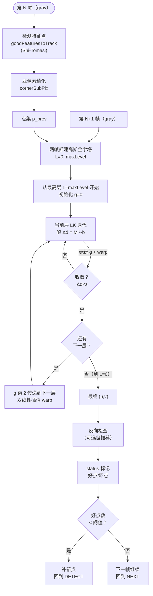

# Lucas-Kanade 光流：算法流程

完整的金字塔 LK 跟踪流程分成**两部分**：选点 + 跟踪。下面按步骤拆解。

## 整体流程图



## 阶段一：选点（只在第 1 帧或点不够时做）

### Step 1: Shi-Tomasi 角点检测

调用 `cv2.goodFeaturesToTrack`，内部做：

1. 对整幅图计算每个像素的结构张量 $M$（和 Harris 一样）
2. 取最小特征值 $\lambda_2$（而不是 Harris 的 $R = \lambda_1\lambda_2 - k(\lambda_1+\lambda_2)^2$）
3. 在 $\lambda_2$ 图上做阈值化 + 非极大值抑制
4. 按 `minDistance` 间隔取前 `maxCorners` 个最"好"的点

::: tip 为什么 Shi-Tomasi 而不是 Harris？
Shi-Tomasi 用 $\lambda_2$ 作为角点分数，判据更直接（"两个方向都有梯度"），理论和实践都证明它选的点更适合光流跟踪。
:::

### Step 2: 亚像素精化（可选但推荐）

`goodFeaturesToTrack` 给的是整像素坐标，LK 跟踪需要更精确的位置做插值。`cv2.cornerSubPix` 通过迭代拟合二次曲面，把点精化到 0.01 像素级别。

```python
# 典型参数
criteria = (cv2.TERM_CRITERIA_EPS + cv2.TERM_CRITERIA_COUNT, 30, 0.01)
cv2.cornerSubPix(gray, corners, winSize=(5,5), zeroZone=(-1,-1), criteria=criteria)
```

## 阶段二：金字塔 LK 跟踪（每一帧都做）

### Step 3: 构建高斯金字塔

对 prev 和 next 两帧都构建 `maxLevel+1` 层高斯金字塔：
- L0 = 原图
- L1 = L0 高斯模糊后 2 倍下采样
- L2 = L1 再下采样
- ...

OpenCV 内部自动完成，用户不需要手动建。

### Step 4: 自顶向下跟踪

从最高层 L_max 开始，初始位移估计 $g_L = 0$：

1. **Warp**：把 I_prev 在当前层用 $g_L$ 做双线性插值，得到 I_warped
2. **计算梯度**：对 I_warped 用 Sobel 核算 $I_x, I_y$
3. **构造 M 和 b**：在 winSize 窗口内累加
   $$
   M = \sum \begin{bmatrix} I_x^2 & I_x I_y \\ I_x I_y & I_y^2 \end{bmatrix}, \quad b = -\sum \begin{bmatrix} I_x \\ I_y \end{bmatrix} \cdot I_t
   $$
4. **解 2×2 线性方程**：$\Delta d = M^{-1} \cdot b$
5. **检查 M 可逆性**：通过最小特征值 $\lambda_2$ 判断点是不是"坏点"（平坦/边缘），坏点直接标 status=0
6. **更新估计**：$g_L = g_L + \Delta d$
7. **收敛判断**：如果 $|\Delta d| < \epsilon$ 或者达到最大迭代次数，进入下一层
8. **传递**：到下一层前把 $g$ 乘 2（因为分辨率加倍），重复 Step 4-7
9. 到达 L0 层后，最终位移 $d = g_0$

### Step 5: 错误检查和点管理

OpenCV 返回三个数组：
- `nextPts`：跟踪到的新位置
- `status`：每个点 0=失败，1=成功
- `err`：跟踪误差（SSD 残差）

工业级代码必做三件事：

1. **按 status 过滤**：丢掉 status=0 的点
2. **按 err 阈值过滤**：err 大于某个阈值的也丢（哪怕 status=1）
3. **反向一致性检查（Forward-Backward Error）**：
   - 用 p0→p1 算一次前向光流
   - 再用 p1→p0 算一次反向光流
   - 如果前向+反向后回不到原位置（距离 > 2 像素），说明点被遮挡/欺骗了，丢
4. **点数补全**：好点低于阈值（比如 50% 以下），重新 detect + 合并

## 60 行 Numpy 手写单层 LK（核心原理版）

想彻底理解，自己写一遍最小实现比什么都管用：

```python
import cv2, numpy as np

def lucas_kanade_single_level(prev, curr, points, win=15):
    """单层 LK（无金字塔、无迭代）——仅用于教学，生产用 calcOpticalFlowPyrLK"""
    # 1. 算梯度 Ix, Iy（用 prev 帧的梯度）
    Ix = cv2.Sobel(prev, cv2.CV_64F, 1, 0, ksize=3)
    Iy = cv2.Sobel(prev, cv2.CV_64F, 0, 1, ksize=3)
    It = curr.astype(np.float64) - prev.astype(np.float64)

    half = win // 2
    new_pts = []
    status = []

    for pt in points.reshape(-1, 2):
        x, y = int(round(pt[0])), int(round(pt[1]))
        # 边界检查
        if x < half or y < half or x >= prev.shape[1]-half or y >= prev.shape[0]-half:
            new_pts.append(pt); status.append(0); continue

        # 2. 取 win×win 窗口
        Ix_w = Ix[y-half:y+half+1, x-half:x+half+1].flatten()
        Iy_w = Iy[y-half:y+half+1, x-half:x+half+1].flatten()
        It_w = It[y-half:y+half+1, x-half:x+half+1].flatten()

        # 3. 构造 M 和 b
        Ixx = np.sum(Ix_w * Ix_w)
        Iyy = np.sum(Iy_w * Iy_w)
        Ixy = np.sum(Ix_w * Iy_w)
        Ixt = np.sum(Ix_w * It_w)
        Iyt = np.sum(Iy_w * It_w)

        M = np.array([[Ixx, Ixy], [Ixy, Iyy]])
        b = -np.array([Ixt, Iyt])

        # 4. 判据：最小特征值太小就放弃（不是角点）
        eig = np.linalg.eigvalsh(M)
        if eig[0] < 1e-6:           # Shi-Tomasi 判据
            new_pts.append(pt); status.append(0); continue

        # 5. 解 2×2 方程
        d = np.linalg.solve(M, b)   # 位移 (u,v)
        new_pts.append(pt + d)
        status.append(1)

    return np.array(new_pts).reshape(-1,1,2), np.array(status)
```

## LK 变体家族（知道有这些就够）

| 变体 | 解决什么问题 | 用在哪 |
|---|---|---|
| **标准 LK** | 小位移平移 | 理论基础 |
| **Pyramidal LK（Bouguet 2000）** | 大位移 | OpenCV `calcOpticalFlowPyrLK` |
| **Iterative LK** | 一阶近似不准 | Bouguet 每层内部已经在做 |
| **Affine LK** | 旋转/缩放/仿射 | 目标跟踪（KLT 也有 affine 版本） |
| **Inverse Compositional (Baker-Matthews 2004)** | 提速（预计算 Hessian）| 高速跟踪，工业用的少 |
| **Horn-Schunck** | 稠密光流 | 教学/研究 |
| **Farneback (2003)** | 稠密光流（多项式展开）| OpenCV `calcOpticalFlowFarneback` |

## OpenCV `calcOpticalFlowPyrLK` 参数表

| 参数 | 含义 | 典型值 |
|---|---|---|
| `prevImg, nextImg` | 前后两帧（**必须是单通道 uint8 或 float32 灰度**） | - |
| `prevPts` | 要跟踪的点，shape (N,1,2)，float32 | `goodFeaturesToTrack` 输出 |
| `nextPts` | 输出，shape 同 prevPts | None（函数填）|
| `winSize` | 每层搜索窗口 | (15,15) 或 (21,21) |
| `maxLevel` | 金字塔层数 | 3~5 |
| `criteria` | 终止条件 | `(EPS+COUNT, 30, 0.01)` |
| `flags` | 初始估计/残差计算 | 0（默认）|
| `minEigThreshold` | 最小特征值阈值（<此值放弃） | 1e-4 ~ 1e-3 |

返回值：
- `nextPts`：新位置 (N,1,2)
- `status`：uint8 数组，1=成功，0=失败
- `err`：float32 数组，窗口内平均 SSD 误差
