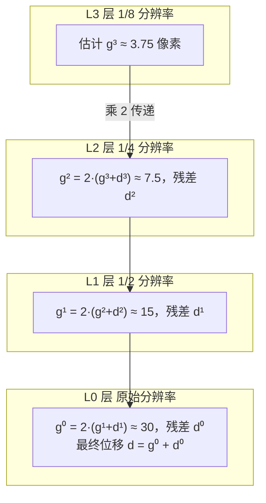

# Lucas-Kanade 光流：核心概念

光流算法看上去代码只有一行 `calcOpticalFlowPyrLK`，但背后站着四个必须搞懂的概念，少一个都会调参调到崩溃。

<div class="tip custom-block"><p>🧪 公式看不懂？去 <a href="/math-lab/">原理实验室</a> 拖动滑块直观体验卷积/梯度/高斯/霍夫/角点/RANSAC/光流等核心概念；看完原理再去本页底部 <a href="./source">源码/真机实验室</a> 亲手调参数。</p></div>


## 1. 亮度恒常性假设（Brightness Constancy）

### 白话
视频里一个点在移动，但它本身的颜色/亮度不变——变的只是它所在的像素位置。就像你盯着一个穿红衣服的人在走，他始终是红的。

### 形式化
$$I(x, y, t) = I(x + u \cdot dt, y + v \cdot dt, t + dt)$$

对右式一阶泰勒展开：

$$I_x u + I_y v + I_t = 0$$

这就是**光流约束方程（Optical Flow Constraint Equation, OFCE）**。其中：
- $I_x, I_y$：空间梯度（Sobel 算子算）
- $I_t$：时间梯度（两帧灰度差）
- $(u, v)$：像素位移速度（我们要求的）

### 生活比喻
你在火车站看到一列火车开过，假设你只盯着车窗上一个黑点——这个黑点在两帧里始终是黑色的，它只是从像素 (100,200) 跑到 (103,201)。LK 要做的就是算出 (3,1) 这个位移。

### 什么情况下这个假设破了？

| 违反情形 | 例子 | LK 会怎样 |
|---|---|---|
| 光照突变 | 开关灯、云遮太阳 | 点直接丢 |
| 镜面反射 | 金属、玻璃表面 | 高光到处"跑"，LK 跟着走偏 |
| 阴影移动 | 建筑物阴影扫过地面 | 阴影不是物体，但 LK 把它当目标跟 |
| 遮挡/出现 | 人走过柱子、新物体入画 | 点消失/出现，找不到对应 |
| 自动曝光 | 手机 AWB/AE 调整 | 整帧亮度漂移 |
| 模糊 | 运动模糊、失焦 | 梯度消失，算不出方向 |

::: warning 所以工业落地必做：
1. 抓图时**锁曝光/锁白平衡**（工业相机几乎都能锁）
2. 对输入做**直方图均衡/CLAHE**（减少光照影响）
3. 跟踪过程中**每帧校验跟踪质量**（err 超阈值立即丢点）
4. 定期**补新点**（`goodFeaturesToTrack` 重检测）
:::

## 2. 孔径问题（Aperture Problem）

### 白话
你通过一个钥匙孔看外面，一个穿横条纹 T 恤的人走过——你只能看到条纹在水平移动，却无法判断人是在水平走、斜着走还是往上跳，因为沿条纹方向的运动你**根本看不见**。

### 数学根源
光流约束方程 $I_x u + I_y v = -I_t$ 是**一个方程两个未知数**，数学上有无穷多解。我们只能确定沿梯度方向（法线方向）的分量，切线方向（沿边方向）完全不确定。

```
    ↑ 不可见（切线方向）
    │
────┼────  边缘
    │  ╱  可见（法线方向）
    │ ╱   （只能看到垂直于边缘的运动）
    ↓
```

### 三类像素点
根据结构张量 $M = \sum [I_x^2, I_x I_y; I_x I_y, I_y^2]$ 的两个特征值 $\lambda_1 \ge \lambda_2$：

| 特征值情况 | 点类型 | 孔径问题 | LK 能不能跟 |
|---|---|---|---|
| $\lambda_1 \approx \lambda_2 \approx 0$ | **平坦区**（蓝天、白墙） | 所有方向都不可见 | ❌ 完全不行 |
| $\lambda_1$ 大、$\lambda_2 \approx 0$ | **边缘**（直线、条纹）| 切线方向不可见 | ⚠️ 会沿边漂 |
| $\lambda_1$ 大、$\lambda_2$ 也大 | **角点**（拐角、十字）| 两方向都可见 | ✅ 可跟踪！|

::: tip 这就是为什么：
光流**只在角点上跑**——选点时用 `cv2.goodFeaturesToTrack`（Shi-Tomasi）或 `cv2.cornerHarris`，只把角点丢给 LK。边缘点/平坦点根本不要给它，否则一定漂。
:::

### 生活类比
- 平坦区：你在一望无际的沙漠中央，周围全是沙，你不知道自己往哪走
- 边缘：你沿着一条笔直的铁轨走，你能判断自己离铁轨的远近，但看不出沿铁轨走了多远
- 角点：你站在十字路口，有两条垂直的路——这下东西南北都能定位了

## 3. 局部窗口运动一致假设

### 白话
小窗口里的所有像素都做**相同的运动**——比如车身上一个 15×15 小窗，车身在整体右移，窗内每个像素都右移相同距离。

### 为什么需要这个假设
单像素无法解（孔径问题），但如果假设 N×N 窗口里所有点的 (u,v) 相同，我们就有了 N² 个方程、2 个未知数——变成超定方程组，可以用最小二乘解。

### 这个假设什么时候破？
- **运动不连续**：窗口跨在物体边界上（一半是车、一半是背景），两边运动不同 → 解错
- **旋转/缩放/形变**：窗口内不是纯平移，是旋转或放大 → LK 会失败（要用更高级的 affine LK）
- **大窗口跨深度**：透视效果下远近物体位移不同（近快远慢）→ 大窗口反而差

::: tip 窗口大小 winSize 的 tradeoff
- 小窗口（5~11）：精确定位，但对噪点敏感，大位移易失败
- 大窗口（21~31）：抗噪、能覆盖更大纹理，但跨运动边界会"糊"
- 工业典型：**15×15 或 21×21**
:::

## 4. 金字塔 Lucas-Kanade（处理大位移）

### 白话
原始 LK 只能处理 1~2 像素的小位移（泰勒展开要求位移小）。金字塔 LK 像用望远镜看远处：先看"大方向"（低分辨率图里位移就小了），再凑近看细节。

### 数学直觉
假设两帧之间实际位移是 30 像素。直接在原始分辨率上跑 LK：泰勒展开只在 1~2 像素内成立，30 像素的位移一阶近似完全失效。

但如果把图像**缩到 1/8**（金字塔第 3 层），位移变成 30/8 ≈ 3.75 像素，LK 可以大致估一个位移。然后把这个估计"乘 2"传到下一层做精修，逐层往下直到原始分辨率。每层只需要解很小的残差，自然就准。

### 金字塔过程



### 参数要点
- **maxLevel**：金字塔层数，典型 3~5。太小大位移跟不住，太大高层分辨率太低定位会错
- **每层窗口大小**：高层可以小一点（分辨率低），低层用标准 winSize
- **warp**：每层用双线性插值把当前估计"移动"过去，再在残差上做 LK

## 四个概念的总关系图


## 速查表：你到底需要懂多少？

| 概念 | 调参时必须懂 | 写代码必须懂 | 做研究必须懂 |
|---|---|---|---|
| 亮度恒常 | ✅ 知道为什么要锁曝光 | ✅ 知道 Ix/Iy/It 怎么算 | ✅ 知道它的推广（梯度恒常、Hessian 恒常）|
| 孔径问题 | ✅ 知道为什么只追角点 | ✅ 知道 M 特征值的意义 | ✅ 知道广义 aperture 和纹理 aperture |
| 局部一致 | ✅ 知道 winSize 的 tradeoff | ✅ 知道窗口跨边界的问题 | ✅ 知道 affine LK / homography LK |
| 金字塔 | ✅ 知道 maxLevel 怎么设 | ✅ 知道逐层 warp 的逻辑 | ✅ 知道 coarse-to-fine 的 warping 误差累积 |


---

## 🧪 原理可视化

看不懂上面的公式？下面这个互动组件把「Lucas-Kanade 光流」画出来了——拖动滑块，看每一步怎么算。

<ClientOnly>
  <MathVisualizer initial-tab="lk" compact />
</ClientOnly>

> 想看它在真实照片上的实际效果？回到 [本算法首页](./index) 或去 [🎮 真机实验室](/playgrounds/)。
