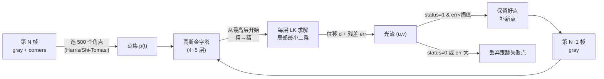

# Lucas-Kanade 光流（KLT 稀疏光流）（1981）

<AlgorithmCard
  name="Lucas-Kanade 光流"
  enName="Lucas-Kanade Optical Flow"
  year="1981"
  chapter="第11章 · 运动分析"  chapterLink="/chapters/ch11-motion"
  branch="几何视觉"
  level="中层"
  analogy="追着一个人在人群里跑——只盯他的帽子这个好认的特征"
  scene="视频稳像、动作捕捉、SLAM 特征跟踪、目标跟踪、无人机悬停"
  paper="https://ri.cmu.edu/pub_files/pub3/lucas_bruce_d_1981_1/lucas_bruce_d_1981_1.pdf"
/>

## TL;DR（太长不看）

- **一句话**：在第 1 帧选一批好跟踪的角点，自动在第 2 帧找到它们去了哪
- **解决什么**：连续帧之间的"点对应"问题——不跟踪整个物体，只跟踪几百个特征点
- **代价**：每个点 2×2 最小二乘，Pyramid LK 单帧可实时跟踪 1000~5000 点（CPU）
- **前置阅读**：[Harris 角点](../harris/)、[Sobel 算子](/operators/sobel)
- **一句话选它**：视频里要"追点跑"、做 SLAM、做稳像、做动作捕捉，不用 LK 几乎不可能

## 3 分钟电梯演讲



## 四层闭环视图（论文 → 理论 → 实现 → 实战）

| 层 | 内容 | 链接 |
|---|---|---|
| L1 论文 | Lucas & Kanade 1981 IJCAI | [论文精读](./paper) |
| L2 理论 | 亮度恒常假设、孔径问题、结构张量 M、金字塔 LK | [核心概念](./concepts) |
| L3 实现 | 高斯金字塔自顶向下 + 每层最小二乘 + Shi-Tomasi 选点 | [算法流程](./architecture)、[源码走读](./source) |
| L4 实战 | 视频稳像、KLT 跟踪器、SLAM 前端、动作捕捉 | [实战踩坑](./painpoints)、[调参技巧](./tricks) |

## 核心贡献表（1981）

| 贡献 | 解决什么问题 | 代码落点 |
|---|---|---|
| 亮度恒常 + 局部一致 | 一个方程两个未知数的孔径问题 | `cv2.calcOpticalFlowPyrLK` |
| 最小二乘解 [u,v] = M⁻¹b | 把邻域 N² 个方程当"投票" | 手写 2×2 矩阵求逆 |
| Shi-Tomasi 选点 | 选 λ₂ 大的好点（双方向都有梯度） | `cv2.goodFeaturesToTrack` |
| Pyramidal LK（Bouguet 2000）| 大位移（几十像素）直接跟不住 | `maxLevel=3~5` |
| 反向一致性检查 | 前向/反向跟踪位移不一致=外点 | `forwardBackward` 自己写 |

## 和它的"兄弟"们怎么选

| 算法 | 稀疏/稠密 | 速度 | 大位移 | 形变物体 | 专利 |
|---|---|---|---|---|---|
| **Lucas-Kanade** | 稀疏（500~1000点） | ⚡⚡⚡⚡⚡ 极快 | 靠金字塔可处理中位移 | ❌ 刚体假设 | ✅ 免费 |
| Horn-Schunck | 稠密（整幅） | ⚡⚡ 慢 | ❌ 小位移 | ✅ 全局平滑 | ✅ 免费 |
| Farneback | 稠密 | ⚡⚡⚡ 中 | 靠金字塔 | ❌ | ✅ 免费 |
| RAFT (DL) | 稠密 | ⚡⚡ 需 GPU | ✅ | ✅ | ✅ 免费 |
| 光流网 (FlowNet) | 稠密 | ⚡⚡ 需 GPU | ✅ | ✅ | ✅ 免费 |

::: tip 一句话选型
只追稀疏点、要 CPU 实时、做 SLAM/稳像 → **LK**；要整幅像素运动（视频补帧、分割）→ Farneback 或上深度学习。
:::

## 快速调用（5 行上手）

```python
import cv2, numpy as np

# 第 1 帧选 100 个 Shi-Tomasi 角点
old_gray = cv2.cvtColor(old_frame, cv2.COLOR_BGR2GRAY)
p0 = cv2.goodFeaturesToTrack(old_gray, maxCorners=100, qualityLevel=0.3,
                             minDistance=7, blockSize=7)

# 第 2 帧跟踪
p1, st, err = cv2.calcOpticalFlowPyrLK(old_gray, new_gray, p0, None,
    winSize=(15,15), maxLevel=3,
    criteria=(cv2.TERM_CRITERIA_EPS|cv2.TERM_CRITERIA_COUNT, 10, 0.03))
```

就是这 5 行——你已经在用工业界最经典的光流算法了。详细参数和坑请看[源码走读](./source)。

## 为什么它 44 年了还在用

1. **数学干净**：2×2 矩阵求解，没有任何训练/迭代黑箱
2. **CPU 实时**：追 1000 个点只要几毫秒，嵌入式都能跑
3. **鲁棒**：角点天生抗光照（梯度方向），比整块匹配稳
4. **生态成熟**：OpenCV/Matlab/VXL/OpenMV 都内置，SLAM（ORB-SLAM、VINS）前端标配
5. **教学价值高**：讲清了光流约束方程、孔径问题、最小二乘——是学稠密光流/深度学习光流的前置
