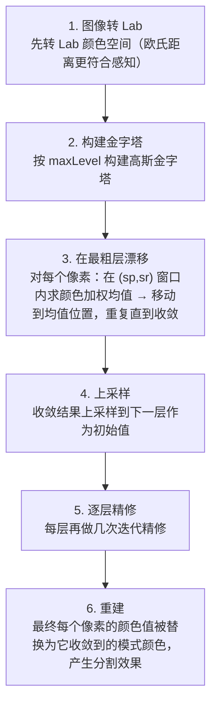

# MeanShift 均值漂移 · 算法流程

<AlgorithmCard
  name="MeanShift 均值漂移"
  enName="Mean-Shift Mode Seeking"
  chapter="ch-10-image-segmentation"
  branch="segmentation"
  year="1975/2002"
  author="K. Fukunaga / D. Comaniciu / P. Meer"
  paper="—"
  level="mid"
  tagline="每个点朝邻居最密的方向挪一步，最后聚成几坨——不用提前说有几坨"
  analogy="广场上站了一群人，每个人都往「周围人最密集的方向」走一步。走几步后大家会聚成几个紧密的小圈子，每个圈子就是一类"
  scene="图像平滑分割（pyrMeanShiftFiltering）、目标跟踪（CamShift）、聚类、运动目标分割"
  :pros='["无需指定聚类数", "同时考虑颜色+空间", "任意形状聚类", "对光照鲁棒"]'
  :cons='["速度很慢", "带宽 sp/sr 参数难调", "窗口大小固定", "高维不行"]'
/>

## 完整算法流程

MeanShift 均值漂移算法可以分解为以下关键步骤：

## 步骤详解

### 步骤 1：图像转 Lab

先转 Lab 颜色空间（欧氏距离更符合感知）

### 步骤 2：构建金字塔

按 maxLevel 构建高斯金字塔

### 步骤 3：在最粗层漂移

对每个像素：在 (sp,sr) 窗口内求颜色加权均值 → 移动到均值位置，重复直到收敛

### 步骤 4：上采样

收敛结果上采样到下一层作为初始值

### 步骤 5：逐层精修

每层再做几次迭代精修

### 步骤 6：重建

最终每个像素的颜色值被替换为它收敛到的模式颜色，产生分割效果

## 在整体视觉 pipeline 中的位置

### 关键复杂度

| 维度 | 复杂度 |
|---|---|
| 时间 | 详见各实现 |
| 内存 | 与图像尺寸线性相关 |

