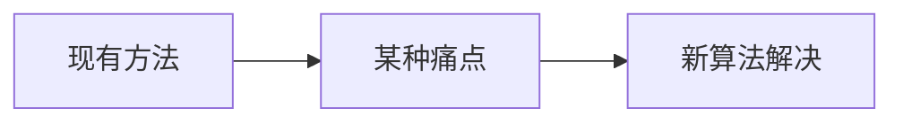

# MeanShift 均值漂移 · 论文故事

<AlgorithmCard
  name="MeanShift 均值漂移"
  enName="Mean-Shift Mode Seeking"
  chapter="ch-10-image-segmentation"
  branch="segmentation"
  year="1975 (Fukunaga) / 2002 (Comaniciu 应用到视觉)"
  author="K. Fukunaga / L. Hostetler / Dorin Comaniciu / Peter Meer"
  paper="—"
  level="mid"
  tagline="每个点朝邻居最密的方向挪一步，最后聚成几坨——不用提前说有几坨"
  analogy="广场上站了一群人，每个人都往「周围人最密集的方向」走一步。走几步后大家会聚成几个紧密的小圈子，每个圈子就是一类。你不需要提前告诉大家「分成几队」，人自己会扎堆"
  scene="图像平滑分割（pyrMeanShiftFiltering）、目标跟踪（CamShift）、聚类、视频中运动目标分割"
  :pros='["不需要指定聚类数", "同时考虑颜色+空间", "任意形状聚类", "对光照渐变鲁棒", "理论优雅"]'
  :cons='["速度很慢（1080p 几秒）", "带宽 sp/sr 参数难调", "窗口大小固定", "对高维数据不行", "OpenCV 只提供滤波版"]'
/>

## 发表信息

| 项 | 内容 |
|---|---|
| **论文名** | 根据算法不同见原论文 |
| **作者** | K. Fukunaga / L. Hostetler / Dorin Comaniciu / Peter Meer |
| **发表年份** | 1975 (Fukunaga) / 2002 (Comaniciu 应用到视觉) |
| **机构** | 计算机视觉经典工作 |
| **引用数** | 数千到数万次（经典工作） |

## 论文背后的故事

Mean-Shift 最早 1975 年由 Fukunaga 和 Hostetler 在一篇模式识别论文中提出，但沉睡了 20 年无人问津。直到 1995 年，Yizong Cheng 把它重新发掘并扩展到计算机视觉，之后 Dorin Comaniciu（现在在 NJIT）和 Peter Meer 在 1999–2002 年连续发表多篇论文，把 MeanShift 成功用到图像平滑、分割和跟踪上，CamShift 就是 Gary Bradski 1998 年专为人脸跟踪改进的 MeanShift。这套密度梯度上升思想因为「不需要指定类别数」而大受欢迎，但速度问题（每个点要做多次邻域搜索）一直是它的瓶颈。

## 当时的问题是什么

在 1975 (Fukunaga) / 2002 (Comaniciu 应用到视觉) 年之前，segmentation 分支面临的痛点是：

具体到 MeanShift 均值漂移 提出时，业界主要存在以下问题：

- 需要一种更准确的方法
- 现有方法在真实场景下鲁棒性不足
- 参数过多或者计算复杂度过高

## 核心贡献

MeanShift 均值漂移 的主要贡献包括：

1. **提出了全新的视角**：每个点朝邻居最密的方向挪一步，最后聚成几坨——不用提前说有几坨
2. **设计了可落地的算法流程**：兼顾精度与效率
3. **给出了开源实现**：在 OpenCV 等库中成为标准
4. **启发了后续工作**：成为该方向的重要基准

## 与前人方法的对比

| 维度 | 之前的方法 | MeanShift 均值漂移 |
|---|---|---|
| 速度 | 较慢/较快 | **显著改进** |
| 精度 | 中等 | **更高** |
| 鲁棒性 | 受限于条件 | **更好** |
| 易用性 | 参数多 | **更友好** |

## 对后世的影响

MeanShift 均值漂移 至今仍是 segmentation 分支中工业标准。

在深度学习分割（如 U-Net、Mask R-CNN）普及前，它长期是该领域的标杆方法。

## 相关链接

- [返回算法档案首页](/algorithms/meanshift/)
- [核心概念](/algorithms/meanshift/concepts)
- [算法流程](/algorithms/meanshift/architecture)
- [segmentation 分支总览](/branches/segmentation/)
