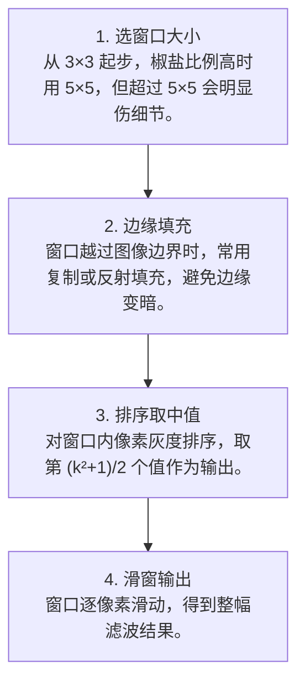

# 第 4 页 · 算法架构

## 完整流程图

## 每一步在做什么

### 步骤 1：选窗口大小

从 3×3 起步，椒盐比例高时用 5×5，但超过 5×5 会明显伤细节。

### 步骤 2：边缘填充

窗口越过图像边界时，常用复制或反射填充，避免边缘变暗。

### 步骤 3：排序取中值

对窗口内像素灰度排序，取第 (k²+1)/2 个值作为输出。

### 步骤 4：滑窗输出

窗口逐像素滑动，得到整幅滤波结果。

## 在整体视觉管线中的位置

## 复杂度分析

时间复杂度 O(W·H·k²·log k)（每窗口排序）；用直方图法可优化到近似 O(W·H·k)。空间复杂度 O(W·H)。

## 参数总览（论文建议 vs OpenCV 默认 vs 实战推荐）

| 参数 | 含义 | 论文建议 | OpenCV 默认 | 实战推荐 |
|------|------|----------|-------------|----------|
| ksize | 邻域窗口边长 | 3 | 5 | ****3**（>5 慎用）** |
| 边框 | 窗口在边缘的处理 | — | 自动反射 | **先 pad 再滤波** |

## 边界情况与失败模式

- **把细线一起删掉**：核大于细节宽度时，细笔画、细网格会被当成噪声抹掉。
- **对高斯噪声无感**：中值对连续型噪声不擅长，这时该用高斯。
- **大核变慢**：中值需要对窗口排序，ksize=9 时比 ksize=3 慢近一个数量级。
- **彩色图误用**：直接对 BGR 三通道分别中值可能产生偏色，应确认通道处理方式。
